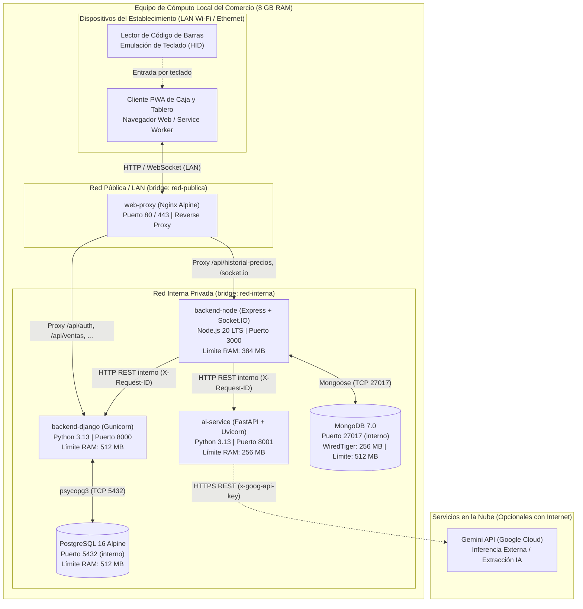
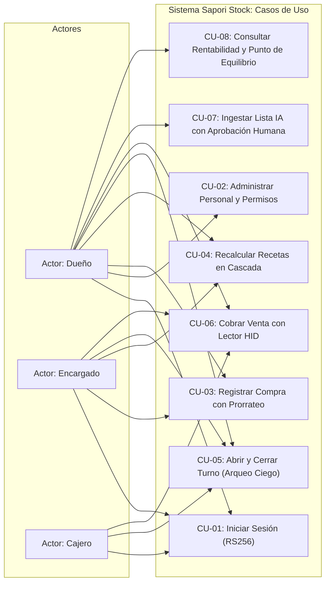
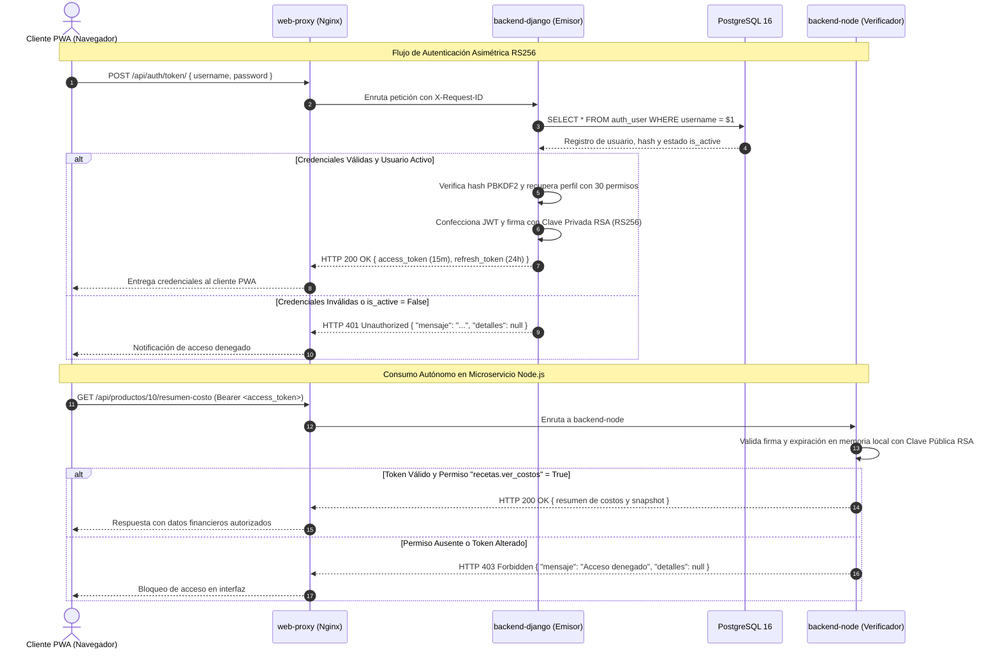
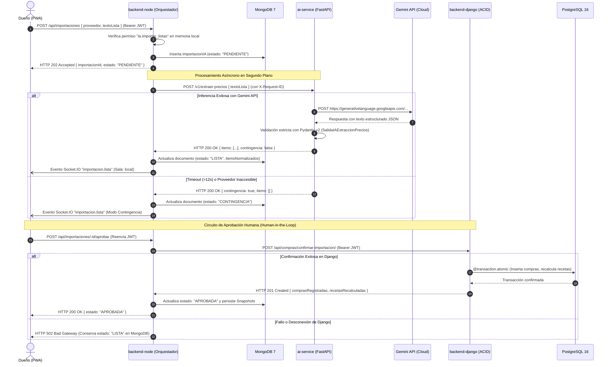
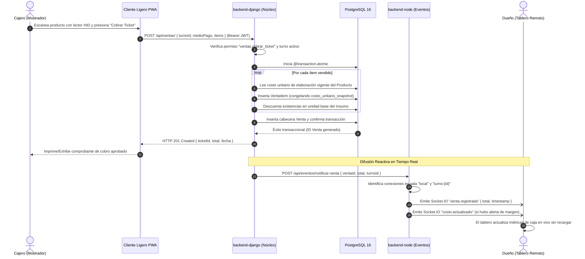
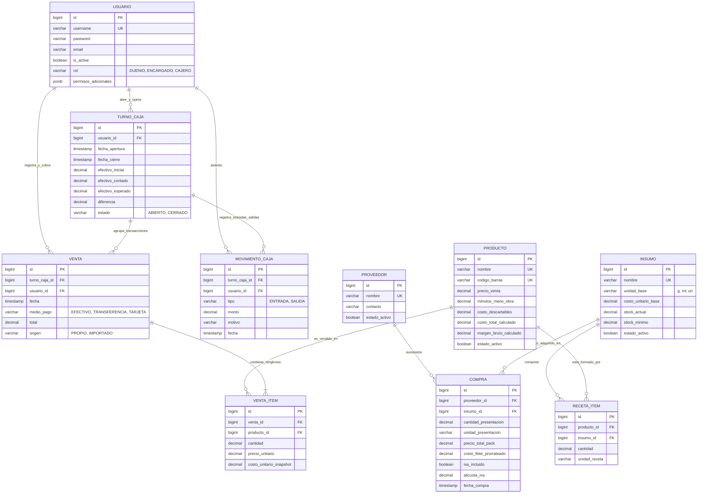
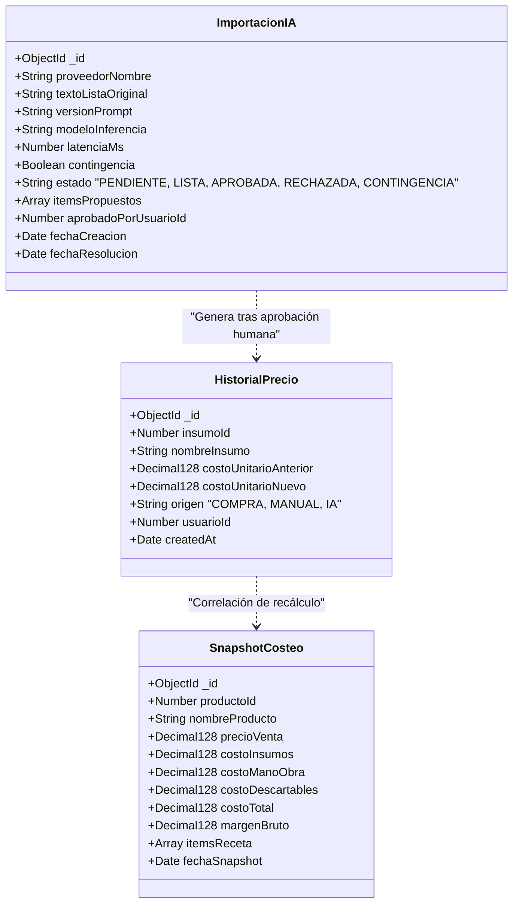
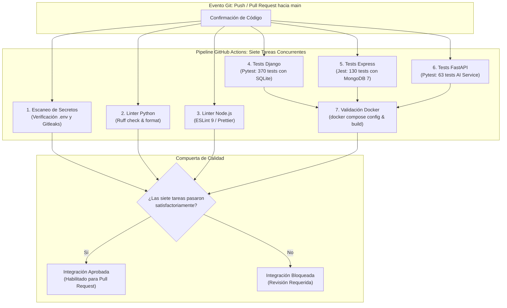

# UNIVERSIDAD TECNOLÓGICA NACIONAL
## FACULTAD REGIONAL RESISTENCIA
### TECNICATURA UNIVERSITARIA EN PROGRAMACIÓN

---

# INFORME FINAL DE TRABAJO FINAL INTEGRADOR (TFI)

## "Sapori Stock: Sistema Integral Políglota de Gestión Operativa, Costeo Dinámico y Asistencia por Inteligencia Artificial para Cafetería"

---

**Autor:** Martin Elias Alcaraz  
**Coautor:** [Espacio reservado para integrante de equipo]  
**Profesor Coordinador:** [Espacio reservado para Profesor Coordinador de Cátedra]  
**Asignatura:** Programación IV — Trabajo Final Integrador  
**Carrera:** Tecnicatura Universitaria en Programación  
**Sede:** Resistencia, Chaco, República Argentina  
**Instancia:** Presentación Definitiva  
**Año Académico:** 2026  

---

\newpage

# Prólogo

El presente Trabajo Final Integrador constituye la culminación del trayecto formativo en la Tecnicatura Universitaria en Programación de la Universidad Tecnológica Nacional, Facultad Regional Resistencia. Este proyecto sintetiza las competencias conceptuales, metodológicas y prácticas adquiridas a lo largo de la carrera, articulando saberes de diseño de software, persistencia políglota, seguridad de la información, algoritmos distribuidos y desarrollo orientado a la resolución de problemas reales.

El desarrollo de Sapori Stock surge a partir de una problemática tangible del sector gastronómico regional: la precariedad informática con la que pequeños y medianos establecimientos administran sus estructuras de costos, ventas y stock. La transición desde esquemas manuales e inestables basados en hojas de cálculo hacia una arquitectura de microservicios contenerizada refleja no solo un desafío técnico, sino también una vocación por aportar soluciones tecnológicas robustas, accesibles y resilientes a la comunidad productiva.

---

# Agradecimientos

A la Universidad Tecnológica Nacional y a la Facultad Regional Resistencia, por brindar una formación pública de excelencia académica y por fomentar un espíritu crítico orientado a la innovación tecnológica.

Al cuerpo docente de la cátedra de Programación IV y a los profesores de la carrera, por su orientación metodológica constante, sus exigencias rigurosas en el diseño de arquitectura y su acompañamiento durante cada etapa de evaluación del proyecto.

A nuestras familias y seres queridos, por el apoyo incondicional, la paciencia y el aliento brindado a lo largo de extensas jornadas de estudio y desarrollo.

---

\newpage

# Resumen

El presente Trabajo Final Integrador expone el diseño, desarrollo e implementación de Sapori Stock, una solución informática integral y políglota orientada a resolver las deficiencias críticas de gestión operativa, control transaccional de caja e ingeniería de costos en establecimientos gastronómicos. Históricamente, el comercio de estudio administraba sus recetas, adquisiciones y márgenes comerciales mediante una hoja de cálculo manual, sufriendo distorsiones aritméticas severas tras reabastecimientos masivos, fallos de propagación por fórmulas corruptas y falta de trazabilidad en los tickets de venta. Para mitigar esta problemática, se concibió una arquitectura distribuida y desacoplada organizada en cuatro microservicios: un núcleo transaccional en Django 5 con PostgreSQL 16 para garantizar consistencia ACID en recetas, insumos, compras y turnos de caja; un servicio documental reactivo en Node.js 20 con Express, MongoDB 7 y Socket.IO para la persistencia inmutable de historiales de precios, snapshots de costeo y comunicación en tiempo real; un servicio de inteligencia artificial en FastAPI con Python 3.13 que integra modelos de lenguaje mediante el patrón Adapter para la extracción desestructurada de listas de proveedores bajo un estricto circuito de revisión humana (*Human-in-the-Loop*); y un cliente ligero web instalable como Progressive Web App (PWA) con soporte para lectura de códigos de barras mediante emulación de teclado (HID). La seguridad perimetral se fundamenta en criptografía asimétrica mediante firmas JWT RS256 y un modelo de control de acceso basado en roles como plantillas con 30 permisos booleanos granulares. La validación experimental comprendió la optimización de consultas complejas con `EXPLAIN ANALYZE` sobre 50.000 ventas, un ensayo sistemático de desconexión de componentes y una suite automatizada de 563 pruebas unitarias y de integración continuas, alcanzando un sistema altamente resiliente con despliegue local reproducible mediante Docker Compose.

**Palabras clave:** Arquitectura Políglota, Costeo Gastronómico Dinámico, Criptografía Asimétrica RS256, Control de Acceso Granular, Inteligencia Artificial Adaptativa, Resiliencia Operativa.

---

# Abstract

This Final Degree Project presents the design, development, and implementation of Sapori Stock, an end-to-end polyglot software solution engineered to address critical operational deficiencies, transactional cash control, and cost engineering within food and beverage establishments. Historically, the business under study managed its recipes, purchases, and profit margins through a manual spreadsheet, suffering from severe arithmetic distortions following bulk restocking, formula propagation corruption, and a complete absence of audit trails in point-of-sale transactions. To mitigate these vulnerabilities, a distributed and decoupled microservices architecture was engineered across four components: a transactional core built with Django 5 and PostgreSQL 16 to guarantee ACID consistency across recipes, ingredients, purchases, and cash shifts; a reactive document service in Node.js 20 with Express, MongoDB 7, and Socket.IO for append-only price logs, recipe cost snapshots, and real-time events; an artificial intelligence microservice in FastAPI using Python 3.13 implementing the Adapter pattern to ingest unstructured supplier price lists with Large Language Models under a mandatory Human-in-the-Loop approval circuit; and a lightweight Progressive Web App (PWA) client featuring hardware barcode scanning via keyboard emulation (HID). Perimeter security is enforced through asymmetric cryptography utilizing RS256 signed JSON Web Tokens and a role-template access control model with 30 granular boolean permissions. Empirical validation involved query optimization via `EXPLAIN ANALYZE` over a synthetic volume of 50,000 sales, a systematic fault-injection drill testing individual service failures, and an automated continuous test suite of 563 unit and integration tests, delivering a resilient system orchestrated locally through Docker Compose.

**Keywords:** Polyglot Architecture, Dynamic Food Costing, RS256 Asymmetric Cryptography, Granular Access Control, Adaptive Artificial Intelligence, Operational Resilience.

---

\newpage

# Índice de Contenidos

- **Carátula**
- **Prólogo**
- **Agradecimientos**
- **Resumen**
- **Abstract**
- **Índice de Contenidos**
- **Índice de Figuras**
- **Índice de Tablas**
- **Capítulo 1. Introducción**
  - 1.1 Breve Estado del Arte
    - 1.1.1 Persistencia Políglota y Sistemas Distribuidos
    - 1.1.2 Criptografía Asimétrica y Seguridad en Identidad Digital
    - 1.1.3 Modelos de Autorización y Control de Acceso Granular
    - 1.1.4 Mitigación de Vulnerabilidades y Estándares OWASP
    - 1.1.5 Integración de Modelos de Lenguaje con Supervisión Humana
    - 1.1.6 Ingeniería de Costos y Matemáticas Financieras Gastronómicas
  - 1.2 Objetivos
    - 1.2.1 Objetivo General
    - 1.2.2 Objetivos Específicos
  - 1.3 Fundamentación y Justificación
- **Capítulo 2. Metodología**
  - 2.1 Ciclo de Vida y Proceso de Desarrollo
  - 2.2 Requerimientos del Sistema
    - 2.2.1 Requerimientos Funcionales
    - 2.2.2 Requerimientos No Funcionales
  - 2.3 Casos de Uso y Modelado del Comportamiento
    - 2.3.1 Diagrama General de Casos de Uso
    - 2.3.2 Tablas de Conversación de los Flujos Principales
    - 2.3.3 Diagramas de Secuencia de Escenarios Críticos
  - 2.4 Modelado Conceptual y Lógico de Datos
    - 2.4.1 Modelo Relacional Transaccional (PostgreSQL)
    - 2.4.2 Modelo Documental Inmutable (MongoDB)
  - 2.5 Análisis y Gestión de Riesgos de Seguridad de la Información
- **Capítulo 3. Herramientas y Lenguajes de Programación**
  - 3.1 Entorno de Backend Transaccional: Python 3.13, Django 5.2 y PostgreSQL 16
  - 3.2 Entorno Documental y Tiempo Real: Node.js 20 LTS, Express, MongoDB 7 y Socket.IO
  - 3.3 Microservicio de Inferencia: FastAPI, Pydantic v2 y Gemini API / Ollama
  - 3.4 Cliente de Usuario: Progressive Web App (PWA) y Nginx Reverse Proxy
  - 3.5 Infraestructura, Calidad y Automatización: Docker Compose, Pytest, Jest y GitHub Actions
- **Capítulo 4. Resultados (Desarrollo e Implementación)**
  - 4.1 Arquitectura Políglota y Contratos de Integración
  - 4.2 Trazabilidad Distribuida y Observabilidad con `X-Request-ID`
  - 4.3 Matriz de Autorización y Endurecimiento Perimetral
  - 4.4 Optimización de Consultas SQL y Benchmark con `EXPLAIN ANALYZE`
  - 4.5 Verificación Automatizada: Desglose de las 563 Pruebas
  - 4.6 Ensayo Sistemático de Fallos y Tolerancia a Desconexión
  - 4.7 Pipeline de Integración Continua y Despliegue Local
- **Capítulo 5. Conclusiones y Trabajos Futuros**
  - 5.1 Conclusiones
  - 5.2 Trabajos Futuros
- **Referencias Bibliográficas**
- **Anexo I. Síntesis de Registros de Decisiones de Arquitectura (ADR)**
- **Anexo II. Catálogo Exhaustivo de Endpoints y Matriz de Permisos**
- **Anexo III. Manual de Despliegue en Producción y Operaciones de Respaldo**

---

\newpage

# Índice de Figuras

- **Figura 1:** Arquitectura Políglota y Despliegue Perimetral en Red de Área Local (LAN). *(Cft. Cap. 1, pág. 12)*
- **Figura 2:** Diagrama General de Casos de Uso del Sistema Sapori Stock. *(Cft. Cap. 2, pág. 18)*
- **Figura 3:** Diagrama de Secuencia de Autenticación Asimétrica con JWT RS256. *(Cft. Cap. 2, pág. 26)*
- **Figura 4:** Diagrama de Secuencia de Ingesta de Listas con Asistencia por Inteligencia Artificial y Circuito de Aprobación Humana. *(Cft. Cap. 2, pág. 27)*
- **Figura 5:** Diagrama de Secuencia de Cobro de Venta y Notificación Reactiva por Socket.IO. *(Cft. Cap. 2, pág. 28)*
- **Figura 6:** Diagrama Entidad-Relación de la Base de Datos Relacional PostgreSQL. *(Cft. Cap. 2, pág. 30)*
- **Figura 7:** Estructura Documental de Colecciones en MongoDB. *(Cft. Cap. 2, pág. 32)*
- **Figura 8:** Diagrama del Pipeline de Integración y Despliegue Continuo (CI/CD) en GitHub Actions. *(Cft. Cap. 4, pág. 48)*

---

# Índice de Tablas

- **Tabla 1:** Catálogo de Requerimientos Funcionales (RF-01 a RF-15). *(Cft. Cap. 2, pág. 16)*
- **Tabla 2:** Catálogo de Requerimientos No Funcionales (RNF-01 a RNF-10). *(Cft. Cap. 2, pág. 17)*
- **Tabla 3:** Tabla de Conversación 1 — Autenticación Asimétrica de Usuario (Login RS256). *(Cft. Cap. 2, pág. 19)*
- **Tabla 4:** Tabla de Conversación 2 — Supervivencia del Último Administrador (Dueño Activo). *(Cft. Cap. 2, pág. 20)*
- **Tabla 5:** Tabla de Conversación 3 — Adquisición de Insumos con Prorrateo de Costos Indirectos. *(Cft. Cap. 2, pág. 21)*
- **Tabla 6:** Tabla de Conversación 4 — Recálculo Masivo de Costos de Recetas de Elaboración. *(Cft. Cap. 2, pág. 22)*
- **Tabla 7:** Tabla de Conversación 5 — Arqueo Ciego y Cierre de Turno de Caja. *(Cft. Cap. 2, pág. 23)*
- **Tabla 8:** Tabla de Conversación 6 — Registro y Cobro de Venta con Lector HID y Snapshot de Costo Congelado. *(Cft. Cap. 2, pág. 24)*
- **Tabla 9:** Tabla de Conversación 7 — Ingesta de Listas con Inteligencia Artificial y Aprobación Humana. *(Cft. Cap. 2, pág. 25)*
- **Tabla 10:** Tabla de Conversación 8 — Análisis de Rentabilidad Operativa y Punto de Equilibrio. *(Cft. Cap. 2, pág. 26)*
- **Tabla 11:** Matriz de Identificación de Riesgos y Salvaguardas Tecnológicas (Metodología Magerit). *(Cft. Cap. 2, pág. 34)*
- **Tabla 12:** Especificación del Stack Tecnológico y Entornos de Ejecución. *(Cft. Cap. 3, pág. 36)*
- **Tabla 13:** Matriz de Permisos Granulares del Sistema por Rol de Plantilla. *(Cft. Cap. 4, pág. 41)*
- **Tabla 14:** Diagnóstico y Rendimiento Comparativo de Consultas SQL Críticas (`EXPLAIN ANALYZE`). *(Cft. Cap. 4, pág. 43)*
- **Tabla 15:** Distribución y Cobertura de las 563 Pruebas Automatizadas del Sistema. *(Cft. Cap. 4, pág. 45)*
- **Tabla 16:** Matriz de Resultados del Ensayo Sistemático de Fallos y Tolerancia a Desconexión. *(Cft. Cap. 4, pág. 47)*
- **Tabla 17:** Presupuesto y Asignación de Memoria RAM en Contenedores Docker. *(Cft. Cap. 4, pág. 49)*

---

\newpage

# Capítulo 1. Introducción

## 1.1 Breve Estado del Arte

El desarrollo de sistemas de información aplicados a la microeconomía y a la gestión operativa en locales gastronómicos ha transitado un profundo proceso de evolución teórica y práctica en la última década. Tradicionalmente, la administración de cafeterías de especialidad, pastelerías y restaurantes de pequeña y mediana escala ha dependido de herramientas ofimáticas genéricas, primordialmente hojas de cálculo aisladas [1], [2]. Si bien las hojas de cálculo confieren flexibilidad inicial, carecen de las propiedades elementales de integridad transaccional, control de concurrencia y auditoría requeridas para sostener una operatoria comercial continua. Frente a esta problemática, la ingeniería de software actual converge hacia soluciones desacopladas, híbridas y altamente especializadas.

### 1.1.1 Persistencia Políglota y Sistemas Distribuidos
El paradigma de persistencia políglota, formalizado por Sadalage y Fowler [8], postula que ninguna tecnología de almacenamiento individual satisface de forma óptima todos los perfiles de acceso a datos presentes en una arquitectura empresarial contemporánea. En un sistema de gestión integral convergen dos necesidades de persistencia con requerimientos ortogonales:
1. **El núcleo transaccional contable:** Exige el cumplimiento irrestricto de las propiedades ACID (Atomicidad, Consistencia, Aislamiento y Durabilidad) [9]. Entidades como el stock de insumos, las fórmulas de recetas, los comprobantes de cobro y los turnos de caja requieren integridad referencial relacional, bloqueos transaccionales y consistencia inmediata para evitar la generación de inventarios negativos o duplicidad en la numeración de ventas. En este ámbito, PostgreSQL se destaca como el motor relacional de código abierto más avanzado, proporcionando aislamiento basado en instantáneas (*Multiversion Concurrency Control*, MVCC) y soporte estricto para operaciones financieras.
2. **El registro documental inmutable y de eventos:** Operaciones como el seguimiento histórico de variaciones de precios, los desgloses jerárquicos de costeo en el tiempo (*snapshots*) y las trazas de extracción generadas por modelos de lenguaje presentan estructuras semiesquematizadas, de longitud variable y con un patrón de escritura predominantemente creciente (*append-only*). Modelar estas estructuras en esquemas SQL tradicionales provocaría una proliferación de tablas intermedias, sobrecarga en la ejecución de uniones relacionales (*JOINs*) y rigidez ante cambios de esquemas. La adopción de bases de datos documentales como MongoDB permite persistir documentos en formato BSON con esquemas flexibles, facilitando consultas de agregación analítica y una rápida recuperación sin penalizar el rendimiento del núcleo transaccional [8].

### 1.1.2 Criptografía Asimétrica y Seguridad en Identidad Digital
La gestión de identidades en ecosistemas compuestos por múltiples servicios autónomos exige modelos de autenticación desacoplados. El estándar de la industria predominante es JSON Web Token (JWT), formalizado en la RFC 7519 [3]. No obstante, la elección del algoritmo de firma constituye una decisión crítica de arquitectura:
- **Esquema Simétrico (HS256):** Requiere que el secreto criptográfico sea compartido entre el emisor y todos los servicios consumidores. En un entorno políglota, compartir una clave simétrica con múltiples nodos incrementa sustancialmente la superficie de ataque; el compromiso de un único nodo perimetral permitiría a un intruso falsificar tokens con privilegios de administrador para la totalidad del sistema [6].
- **Esquema Asimétrico (RS256):** Emplea un par de claves basado en criptografía de clave pública y funciones de dispersión segura SHA-256 [4]. En este modelo, el microservicio transaccional central actúa como la única Autoridad de Emisión, custodiando celosamente la clave privada RSA. Los servicios periféricos y los proxies perimetrales validan la autenticidad, integridad y vigencia de las solicitudes en memoria local utilizando exclusivamente la clave pública, prescindiendo de consultas sincrónicas de red hacia el servidor de autenticación. Este enfoque asegura un aislamiento criptográfico absoluto y reduce la latencia en la verificación a microsegundos [3].

### 1.1.3 Modelos de Autorización y Control de Acceso Granular
El control de acceso basado en roles (*Role-Based Access Control*, RBAC), estandarizado por el NIST [7], organiza los privilegios en perfiles operativos predefinidos. No obstante, en la gastronomía real los roles comerciales rígidos resultan insuficientes. La literatura moderna y los sistemas avanzados de Punto de Venta (POS) promueven esquemas de **Roles como Plantillas (*Role-based Templates*) combinados con Permisos Booleanos Granulares**. Bajo este enfoque, los roles actúan como plantillas que inicializan conjuntos de flags booleanos por usuario. El administrador del establecimiento conserva la facultad de habilitar o revocar capacidades atómicas individuales (por ejemplo, autorizar a un cajero determinado a registrar cobros o denegar la visualización de márgenes financieros brutos a un supervisor operativo) sin requerir modificaciones en el código fuente ni mutaciones en el esquema estructural de la base de datos [7].

### 1.1.4 Mitigación de Vulnerabilidades y Estándares OWASP
La exposición de interfaces de programación de aplicaciones (APIs) a través de redes locales o públicas demanda la observancia rigurosa de los lineamientos del consorcio OWASP (*Open Web Application Security Project*) [6]. En arquitecturas que combinan tecnologías de backend diversas, es indispensable implementar salvaguardas perimetrales contra los riesgos críticos documentados:
- **Control de Acceso Roto (OWASP Top 10: A01):** Prevención de escalada horizontal y vertical mediante validación obligatoria de pertenencia de objeto (*Object-Level Authorization*), garantizando que un operador de caja únicamente acceda y opere sobre el turno activo a su nombre.
- **Fallas Criptográficas (OWASP Top 10: A02):** Almacenamiento de credenciales mediante algoritmos de derivación de claves computacionalmente costosos (PBKDF2 con SHA-256 y sales criptográficas únicas), prohibición absoluta del algoritmo `none` en cabeceras JWT y transporte protegido mediante cabeceras de seguridad estrictas [4], [6].
- **Inyecciones en Motores NoSQL (OWASP Top 10: A03):** Neutralización de vectores de ataque basados en la manipulación de operadores JSON (tales como `$gt`, `$ne` o `$where`) dirigidos hacia MongoDB mediante middlewares de sanitización recursiva que rechazan caracteres reservados en claves de entrada.
- **Falsificación de Solicitudes entre Sitios y Agotamiento de Recursos (OWASP Top 10: A04 y A07):** Endurecimiento del perímetro mediante políticas restrictivas de Cross-Origin Resource Sharing (CORS) con listas blancas explícitas y mecanismos de limitación de tasa (*Rate Limiting / Throttling*) para mitigar ataques de fuerza bruta y denegación de servicio.

### 1.1.5 Integración de Modelos de Lenguaje con Supervisión Humana
La incorporación de Inteligencia Artificial Generativa y Modelos de Lenguaje Grande (*Large Language Models*, LLMs) en los flujos comerciales representa un salto cualitativo respecto al procesamiento tradicional de documentos [14]. La extracción de tablas de precios no estructuradas recibidas a través de canales de mensajería instantánea o archivos PDF heterogéneos presenta un alto costo operativo si se ejecuta de forma manual. Sin embargo, la naturaleza estocástica de los modelos generativos introduce el riesgo de "alucinaciones" y alteraciones en los valores numéricos de los productos [14].

Para integrar estas tecnologías en un entorno productivo financiero, el estado del arte prescribe tres patrones fundamentales:
1. **Patrón Adapter:** Propuesto por Gamma et al. [1], permite desacoplar el dominio del sistema respecto a la API del proveedor de inferencia, facilitando la transición transparente entre modelos locales y servicios en la nube sin modificar la lógica de orquestación.
2. **Validación Semántica Estricta:** Las salidas de los modelos de inferencia deben ser coaccionadas hacia esquemas tipados mediante bibliotecas de validación en tiempo de ejecución (como Pydantic v2 en Python), rechazando cualquier respuesta que no respete las restricciones de tipo, rango y formato contable.
3. **Circuito de Supervisión Humana (*Human-in-the-Loop*):** Ningún resultado generado por inferencia artificial debe impactar de forma directa y autónoma en los libros transaccionales o en los costos del catálogo de productos. El sistema actúa como un asistente generador de propuestas en segundo plano, exigiendo la revisión explícita, la validación de diferencias y la confirmación manual de un operador humano calificado antes de consolidar los cambios en el núcleo relacional [15].

### 1.1.6 Ingeniería de Costos y Matemáticas Financieras Gastronómicas
El costeo en la gastronomía profesional dista de ser una operación estática de suma de ingredientes [17]. La determinación precisa del costo de elaboración de un producto culinario demanda una rigurosa ingeniería de costos que contemple:
1. **Unidades Base de Medida:** Todos los insumos adquiridos en presentaciones heterogéneas (bolsas de cinco kilogramos, bidones de dos litros o cajas de 50 sobres) deben convertirse internamente a unidades fundamentales homogéneas ($g$, $ml$, $un$). El almacenamiento monetario debe realizarse empleando tipos de datos decimales de punto fijo (*Fixed-point Decimal*), eliminando por completo los errores de redondeo asociados al estándar IEEE 754 de coma flotante (*float*).
2. **Prorrateo de Costos Indirectos de Flete e Impuestos:** Los costos de logística y entrega facturados en una orden de compra no deben imputarse como un gasto general indiferenciado ni dividirse linealmente entre las líneas; deben prorratearse proporcionalmente sobre el valor económico relativo de cada insumo adquirido, permitiendo que productos de alto costo absorban la fracción correspondiente de flete [17].
3. **Snapshot de Costo Congelado en Ventas:** La rentabilidad real del negocio exige aislar el margen histórico de las fluctuaciones inflacionarias futuras. Al emitirse un ticket de venta, el sistema debe registrar una instantánea (*snapshot*) del costo unitario vigente de cada producto en ese instante temporal específico. Si el costo de los insumos se incrementa al día siguiente, los márgenes de las ventas pasadas permanecen inmutables, garantizando una contabilidad histórica fehaciente.
4. **Principio de Arqueo Ciego de Caja:** Como medida de control interno frente a mermas y desvíos de tesorería, el cajero debe efectuar el recuento físico de billetes y monedas sin que el sistema le revele el monto de efectivo esperado calculado según las ventas registradas. La comparación entre el saldo físico declarado y el saldo teórico del turno se reserva de manera exclusiva para la supervisión directiva [17].
5. **Punto de Equilibrio Operativo (*Break-Even Point*):** Representa el volumen de ventas necesario para que los ingresos totales igualen a la sumatoria de costos fijos y variables, de modo que el beneficio operativo sea exactamente cero. Matemáticamente se define como:
$$PE = \frac{\text{Costos Fijos}}{1 - \frac{\text{Costos Variables}}{\text{Ventas Totales}}}$$
La derivación de metas de facturación diarias y semanales a partir del punto de equilibrio mensual permite al titular del comercio monitorear el desempeño financiero en tiempo real.

---

## 1.2 Objetivos

### 1.2.1 Objetivo General
Diseñar, desarrollar e implementar un sistema de software integral, distribuido y políglota, denominado **Sapori Stock**, que automatice la gestión operativa, el control transaccional de ventas y caja, la ingeniería dinámica de costeo de recetas y la extracción asistida de listas de precios con inteligencia artificial para una cafetería comercial, asegurando alta disponibilidad local, integridad contable y resiliencia frente a interrupciones de conectividad externa.

### 1.2.2 Objetivos Específicos
1. Desarrollar un núcleo transaccional relacional en Django 5 y PostgreSQL 16 que gestione de forma atómica insumos, recetas, compras con prorrateo de flete, ventas con snapshot de costos congelados y turnos de caja con arqueo ciego.
2. Implementar un servicio reactivo en Node.js 20, MongoDB 7 y Socket.IO que persista historiales inmutables de precios y snapshots de costeo, emitiendo eventos de negocio en tiempo real a salas segmentadas por turnos y permisos.
3. Construir un microservicio en FastAPI y Python 3.13 que incorpore el patrón Adapter para interactuar con proveedores de inteligencia artificial (Gemini API y Ollama), estructurando listas de precios desestructuradas bajo esquemas tipados de Pydantic v2 y garantizando supervisión humana previa a la confirmación de compras.
4. Establecer un esquema criptográfico asimétrico de autenticación y autorización basado en JWT RS256 con Django como emisor central y verificación autónoma en memoria en los demás microservicios, complementado con un catálogo de 30 permisos booleanos granulares.
5. Desarrollar una interfaz de usuario ligera e instalable como Progressive Web App (PWA) con diseño adaptativo, soporte para escaneo de códigos de barras mediante lectores de emulación de teclado (HID) y capacidad operativa en red de área local ante la pérdida de conexión a internet.
6. Aplicar técnicas avanzadas de optimización de bases de datos mediante índices compuestos e índices inversos B-Tree en PostgreSQL, eliminando anomalías de consultas $N+1$ y reduciendo los tiempos de ejecución analítica sobre lotes masivos superiores a 50.000 ventas.
7. Diseñar y ejecutar un pipeline automatizado de Integración y Despliegue Continuo (CI/CD) en GitHub Actions compuesto por siete tareas paralelas que verifiquen formato, linters, seguridad y la ejecución satisfactoria de 563 pruebas automatizadas.
8. Orquestar la solución en contenedores Docker de compilación multietapa (*multi-stage*) sin privilegios de superusuario (*non-root*), aplicando límites rígidos de memoria para permitir la ejecución estable en hardware acotado de 8 GB de memoria RAM.

---

## 1.3 Fundamentación y Justificación

La justificación del presente proyecto radica en la convergencia entre una necesidad operativa concreta del sector comercial y la aplicación rigurosa de principios avanzados de ingeniería de software. En el plano productivo, los pequeños establecimientos gastronómicos operan en entornos de márgenes acotados y constante variabilidad inflacionaria en el precio de los insumos lácteos, café y descartables. La persistencia de esquemas manuales en hojas de cálculo introduce fallos severos: el ingreso erróneo de una presentación mayorista distorsiona el costo de una taza de café en porcentajes absurdos (casos documentados de márgenes negativos superiores al 2000%), mientras que la alteración accidental de una fórmula invalida toda la matriz de costos sin emitir avisos preventivos. Asimismo, el cobro desvinculado del stock impide la detección oportuna de mermas e imposibilita conocer la ganancia diaria real del negocio.

Desde la perspectiva tecnológica y académica, el proyecto resuelve un desafío arquitectónico sustantivo: garantizar la resiliencia operativa total de un punto de venta gastronómico dentro de un presupuesto de infraestructura sumamente restringido (un único equipo informático de 8 GB de memoria RAM ubicado en el salón comercial) y en un contexto de conectividad a internet intermitente. La arquitectura políglota propuesta desacopla la transaccionalidad bancaria y el arqueo de caja de las capacidades avanzadas de extracción por inteligencia artificial y tableros en tiempo real. Si la conexión a internet decae o los servicios externos de inferencia se vuelven inaccesibles, el local comercial continúa cobrando tickets, descontando stock y cerrando cajas en su red local sin experimentar degradación alguna.

La arquitectura de despliegue perimetral en red de área local (LAN) diseñada para satisfacer estos requerimientos operacionales y de infraestructura se ilustra a continuación (Véase Figura 1).


**Figura 1:** Arquitectura Políglota y Despliegue Perimetral en Red de Área Local (LAN).

---

\newpage

# Capítulo 2. Metodología

## 2.1 Ciclo de Vida y Proceso de Desarrollo

Para el desarrollo del sistema Sapori Stock se adoptó un modelo de ciclo de vida **iterativo e incremental**, estructurado formalmente en cuatro etapas evolutivas consecutivas en consonancia con la planificación de la cátedra de Programación IV [15], [16]:

1. **Etapa 1 (TP 1 — Núcleo de Dominio Transaccional y Persistencia Relacional):** Definición formal de las entidades de negocio gastronómico. Construcción de modelos en Django y PostgreSQL para proveedores, insumos, compras con prorrateo de costos indirectos, recetas de composición, catálogo de productos, turnos de caja y ventas. Implementación de controladores delgados y servicios encapsulados para la lógica de costeo atómico.
2. **Etapa 2 (TP 2 — Autenticación Criptográfica Asimétrica, Seguridad y RBAC Granular):** Implementación del esquema de identidad mediante JWT con firma asimétrica RS256. Emisión centralizada de claves RSA en Django y validación autónoma en memoria local en microservicios secundarios. Diseño del modelo de autorización por roles plantilla con catálogo de 30 permisos booleanos granulares. Incorporación de mecanismos de endurecimiento perimetral (CORS, Throttling, sanitización NoSQL y enmascaramiento en logs).
3. **Etapa 3 (TP 3 — Inteligencia Artificial, Persistencia Documental y Tiempo Real):** Creación del microservicio `ai-service` en FastAPI incorporando el patrón Adapter para inferencia generativa (Gemini API y Ollama) con esquemas tipados en Pydantic v2. Implementación de colecciones documentales inmutables en MongoDB (`historial_precios`, `snapshots_costeo` e `importaciones_ia`) orquestadas desde Node.js. Incorporación de comunicación bidireccional mediante Socket.IO con handshake autenticado. Optimización de consultas SQL críticas mediante `EXPLAIN ANALYZE` y ejecución de ensayos sistemáticos de degradación ante fallos.
4. **Etapa 4 (TP 4 — Contenerización, CI/CD, Observabilidad y Calidad Integral):** Empaquetamiento de la totalidad de la solución mediante Docker Compose con imágenes multietapa (*multi-stage*) sin privilegios de root y asignación estricta de memoria cgroups. Incorporación de trazabilidad distribuida mediante inyección de la cabecera `X-Request-ID`, formateo estructurado JSON de trazas y endpoints de diagnóstico profundo (*healthchecks*). Construcción del pipeline automatizado de integración continua en GitHub Actions articulado en siete tareas paralelas.

La gestión del código fuente siguió una rigurosa disciplina de trabajo en Git: prohibición absoluta de confirmaciones directas en la rama principal (`main`), aislamiento de funcionalidades en ramas específicas con nomenclatura `feature/<id>-<slug>`, aplicación obligatoria de la especificación de *Conventional Commits* en idioma español y aprobación cruzada de solicitudes de extracción (*Pull Requests*) sujeta a la aprobación de la suite de pruebas automatizadas [12].

---

## 2.2 Requerimientos del Sistema

### 2.2.1 Requerimientos Funcionales
Los requerimientos funcionales fueron clasificados y priorizados bajo el método MoSCoW (Must, Should, Could, Won't) [16], derivando de las historias de usuario concertadas para el establecimiento comercial (Véase Tabla 1).

| Código | Requerimiento Funcional | Prioridad | Descripción Operativa y Criterios de Aceptación |
|---|---|:---:|---|
| **RF-01** | Gestión de Insumos y Unidades | Must | Alta, edición y desactivación de insumos con conversión automática a unidades fundamentales ($g$, $ml$, $un$). |
| **RF-02** | Registro de Compras y Prorrateo | Must | Ingesta de compras con desglose de presentación, precio de pack, IVA y prorrateo de flete proporcional al valor de línea. |
| **RF-03** | Costeo Dinámico de Recetas | Must | Cálculo del costo unitario de productos sumando insumos de receta, mano de obra tarifada y descartables. |
| **RF-04** | Recálculo Masivo en Cascada | Must | Actualización atómica en lote de todos los productos y recetas afectadas al modificarse el precio de un insumo base. |
| **RF-05** | Registro de Venta y Lector HID | Must | Emisión de tickets con asociación al turno de caja activo, soporte de lectura por `codigo_barras` y medio de pago. |
| **RF-06** | Snapshot de Costo Congelado | Must | Almacenamiento inmutable del costo vigente de elaboración al momento exacto de concretarse la venta. |
| **RF-07** | Turnos de Caja y Arqueo Ciego | Must | Apertura y cierre de turnos con ingreso ciego de efectivo físico sin exhibición del saldo esperado al cajero. |
| **RF-08** | Roles Plantilla y Permisos | Must | Asignación de roles como plantillas preconfiguradas con modificación granular booleana de 30 permisos específicos. |
| **RF-09** | Supervivencia del Dueño Activo | Must | Bloqueo absoluto a la desactivación, degradación o revocación de privilegios del último usuario Dueño activo. |
| **RF-10** | Ingesta de Listas con IA | Must | Procesamiento asíncrono de texto no estructurado con LLMs devolviendo esquemas tipados para revisión humana. |
| **RF-11** | Circuito de Aprobación Humana | Must | Exigencia de validación explícita del operador para confirmar la creación de compras derivadas de inferencia IA. |
| **RF-12** | Tablero Reactivo en Vivo | Must | Emisión de eventos bidireccionales vía Socket.IO ante ventas, cambios de costos y caídas de márgenes comerciales. |
| **RF-13** | Rentabilidad y Ganancia Diaria | Should | Agregación diaria y por rango de fechas de ingresos y ganancia real basada en costos congelados históricos. |
| **RF-14** | Punto de Equilibrio y Metas | Should | Determinación del volumen de equilibrio mensual y derivación matemática de metas diarias y semanales de venta. |
| **RF-15** | Descuento Automático de Stock | Should | Reducción de existencias en unidades base por ingrediente de receta al confirmarse un ticket de venta en caja. |

**Tabla 1:** Catálogo de Requerimientos Funcionales (RF-01 a RF-15).

### 2.2.2 Requerimientos No Funcionales
Los requerimientos no funcionales definen los atributos de calidad, rendimiento, seguridad y restricciones de plataforma que rigen el sistema (Véase Tabla 2).

| Código | Requerimiento No Funcional | Categoría | Criterio Cuantitativo y Restricción Tecnológica |
|---|---|:---:|---|
| **RNF-01** | Operación Autónoma sin Internet | Disponibilidad | Continuidad operativa del 100% en caja, stock y costeo en red LAN ante caídas de la conexión externa. |
| **RNF-02** | Presupuesto Máximo de Memoria | Eficiencia | Consumo global de los servicios contenerizados inferior a 2.5 GB de RAM para operar en hosts de 8 GB. |
| **RNF-03** | Autenticación Asimétrica RS256 | Seguridad | Uso de criptografía asimétrica RSA con SHA-256 (RFC 7519); Django es el único custodio de la clave privada. |
| **RNF-04** | Tiempo de Respuesta en Caja | Rendimiento | Registro y emisión de tickets de venta procesados en un tiempo de latencia inferior a 150 milisegundos. |
| **RNF-05** | Consistencia Transaccional ACID | Integridad | Operaciones de compra, recálculo y ventas protegidas bajo `@transaction.atomic` en PostgreSQL 16. |
| **RNF-06** | Inmutabilidad de Auditoría | Confiabilidad | Persistencia documental de solo agregación (*append-only*) para historiales de precios en MongoDB. |
| **RNF-07** | Contenedores de Mínimo Privilegio | Seguridad | Ejecución de contenedores bajo usuarios no privilegiados (*non-root*) y sin exposición de puertos de bases de datos. |
| **RNF-08** | Trazabilidad Distribuida | Observabilidad | Propagación obligatoria de cabecera `X-Request-ID` en todas las peticiones interservicios y logs JSON. |
| **RNF-09** | Formato de Error Estandarizado | Mantenibilidad | Respuestas de error homogéneas según el contrato `{ "mensaje": "...", "detalles": null }` en todas las APIs. |
| **RNF-10** | Cobertura Automatizada en CI/CD | Calidad | Ejecución exitosa de 563 pruebas continuas distribuidas en siete tareas paralelas en GitHub Actions. |

**Tabla 2:** Catálogo de Requerimientos No Funcionales (RNF-01 a RNF-10).

---

## 2.3 Casos de Uso y Modelado del Comportamiento

### 2.3.1 Diagrama General de Casos de Uso
El modelo de casos de uso refleja las interacciones fundamentales entre los tres actores del dominio comercial (Dueño, Encargado y Cajero) y el sistema Sapori Stock (Véase Figura 2).


**Figura 2:** Diagrama General de Casos de Uso del Sistema Sapori Stock.

### 2.3.2 Tablas de Conversación de los Flujos Principales
De acuerdo con la metodología rigurosa de análisis de la cátedra, a continuación se detallan las ocho Tablas de Conversación representativas de la lógica del sistema (Véase Tabla 3 a Tabla 10).

| Paso | Acción del Actor | Curso Normal (Respuesta del Sistema) | Curso Alternativo / Excepciones |
|---|---|---|---|
| **1** | El usuario ingresa credenciales (`username`, `password`) en la PWA y presiona "Ingresar". | El frontend envía `POST /api/auth/token/` hacia el proxy Nginx, que deriva al microservicio Django. | Si los campos están vacíos, el frontend cancela el envío y destaca los campos requeridos. |
| **2** | Django intercepta la petición y consulta al servicio de autenticación. | Django valida el hash de contraseña en PostgreSQL y verifica que el campo `is_active` sea verdadero. | Si las credenciales no coinciden o el usuario no existe, devuelve HTTP 401 Unauthorized `{ "mensaje": "Credenciales inválidas", "detalles": null }`. |
| **3** | El servicio de tokens recupera el rol y el array de permisos booleanos del perfil. | Django confecciona el payload JWT, firma criptográficamente con la clave privada RSA (RS256) y emite access token (15 minutos) y refresh token (24 horas). | Si `is_active = False` (usuario inactivo), deniega la emisión con HTTP 401 y registra intento en traza de seguridad. |
| **4** | El cliente PWA almacena los tokens en memoria de sesión y redirige al panel según su rol. | El cliente inicializa la conexión WebSocket hacia Node.js adjuntando el token en el handshake de conexión. | Si el token expira durante la sesión, el cliente invoca `POST /api/auth/token/refresh/` para renovarlo de forma transparente. |

**Tabla 3:** Tabla de Conversación 1 — Autenticación Asimétrica de Usuario (Login RS256).

| Paso | Acción del Actor | Curso Normal (Respuesta del Sistema) | Curso Alternativo / Excepciones |
|---|---|---|---|
| **1** | El Dueño accede a la sección de administración de personal y selecciona un usuario activo con rol Dueño. | El sistema lista los datos de perfil y los permisos activos mediante `GET /api/usuarios/`. | Si el actor carece del permiso `personal.ver`, el sistema rechaza la consulta con HTTP 403 Forbidden. |
| **2** | El Dueño solicita la desactivación de la cuenta (`is_active = False`) o la mutación de su rol a Cajero. | El servicio `modificar_personal` en Django inicia una transacción e invoca la verificación de supervivencia. | Si la solicitud proviene de un usuario sin privilegios `personal.desactivar`, se rechaza con HTTP 403. |
| **3** | El servicio evalúa la cantidad de usuarios activos con rol Dueño en el sistema. | Al constatar que existen dos o más Dueños activos, aplica la actualización en PostgreSQL e invalida sus tokens en la lista negra (*Blacklist*). | **Curso Alternativo (Último Dueño):** Si se detecta que el usuario objetivo es el **único Dueño activo restante**, el sistema aborta la transacción y responde HTTP 400 Bad Request `{ "mensaje": "No se puede desactivar ni modificar el rol del último Dueño activo", "detalles": null }`. |
| **4** | El sistema responde HTTP 200 OK confirmando la modificación. | La PWA actualiza la grilla de personal y notifica al operador. | El usuario afectado queda impedido de iniciar sesión o renovar tokens inmediatamente. |

**Tabla 4:** Tabla de Conversación 2 — Supervivencia del Último Administrador (Dueño Activo).

| Paso | Acción del Actor | Curso Normal (Respuesta del Sistema) | Curso Alternativo / Excepciones |
|---|---|---|---|
| **1** | El operador selecciona el proveedor, ingresa las líneas de compra (insumos, cantidades, unidades y precios) y el monto total de flete. | El frontend valida los formatos de moneda y despacha `POST /api/compras/` hacia Django. | Si una cantidad es nula o menor o igual a cero, se rechaza en validación con HTTP 400. |
| **2** | El servicio de compras inicia una transacción atómica `@transaction.atomic`. | Convierte las presentaciones a unidades base ($g$, $ml$, $un$) y calcula el valor monetario de cada línea. | Si no se encuentra un insumo o proveedor referenciado, se revierte con HTTP 404. |
| **3** | El sistema ejecuta el algoritmo de prorrateo proporcional de flete. | Distribuye el costo de envío dividiendo el valor de cada línea por el total bruto y multiplicando por el flete total, determinando el costo unitario final con IVA. | Si el envío es cero, el factor de prorrateo se fija en cero sin introducir divisiones inválidas. |
| **4** | El sistema persiste los registros de `Compra` y actualiza el costo base de cada insumo. | Dispara el recálculo en cascada de los productos vinculados y responde HTTP 201 Created con el detalle. | Ante cualquier excepción en base de datos, la transacción ejecuta *rollback* total. |

**Tabla 5:** Tabla de Conversación 3 — Adquisición de Insumos con Prorrateo de Costos Indirectos.

| Paso | Acción del Actor | Curso Normal (Respuesta del Sistema) | Curso Alternativo / Excepciones |
|---|---|---|---|
| **1** | Se consolida una compra de insumos o el Dueño modifica manualmente el costo base de un ingrediente. | El servicio `recalcular_recetas_por_insumo` de Django intercepta el evento atómicamente. | Si el insumo no interviene en ninguna receta activa, el proceso concluye exitosamente sin modificaciones. |
| **2** | Django busca todas las recetas donde el insumo está presente. | Ejecuta un `Index Only Scan` sobre el índice compuesto inverso `idx_recetaitem_insumo_prod`, identificando los productos afectados. | Si la receta contiene insumos dados de baja, se ignoran temporalmente en el recálculo. |
| **3** | El servicio computa la nueva sumatoria de costos por producto. | Suma las cantidades por los nuevos costos unitarios, añade la mano de obra tarifada y los descartables, recalculando margen y ganancia. | Si el precio de venta es cero, el margen bruto se fija en cero para evitar división por cero. |
| **4** | Django ejecuta la actualización masiva de productos. | Persiste todos los productos mediante `Producto.objects.bulk_update` en una sola sentencia SQL y notifica a Node.js para guardar el snapshot en MongoDB. | Si falla la comunicación con Node.js, la transacción de Django se consolida asegurando la consistencia relacional. |

**Tabla 6:** Tabla de Conversación 4 — Recálculo Masivo de Costos de Recetas de Elaboración.

| Paso | Acción del Actor | Curso Normal (Respuesta del Sistema) | Curso Alternativo / Excepciones |
|---|---|---|---|
| **1** | El Cajero finaliza su jornada de trabajo y selecciona la opción "Cerrar Turno de Caja" en la PWA. | El sistema presenta un formulario ciego solicitando únicamente el desglose de efectivo contado en billetes y monedas. | Si el usuario no tiene un turno abierto a su nombre, el sistema informa la anomalía con HTTP 400. |
| **2** | El Cajero cuenta el dinero físico, ingresa el importe total en el campo y pulsa "Confirmar Cierre". | La PWA remite `POST /api/caja/turnos/:id/cerrar/` enviando únicamente el valor de `efectivo_contado`. | Si el monto ingresado es negativo o posee formato no numérico, la petición se rechaza localmente. |
| **3** | Django recibe la solicitud y evalúa los permisos del usuario emisor. | Django calcula el `efectivo_esperado` sumando fondo inicial, ventas en efectivo y movimientos, computando la diferencia. | Si el usuario posee rol Cajero (sin permiso `caja.ver_efectivo_esperado`), la respuesta **enmascara estrictamente los campos `efectivo_esperado` y `diferencia` como `null`**. |
| **4** | El turno se marca con fecha de cierre en PostgreSQL. | Si el cierre lo realiza el Dueño o Encargado, la respuesta expone la diferencia real calculada para auditoría de tesorería. | Si un cajero intenta cerrar el turno activo de otro compañero, el sistema lo bloquea con HTTP 403 Forbidden. |

**Tabla 7:** Tabla de Conversación 5 — Arqueo Ciego y Cierre de Turno de Caja.

| Paso | Acción del Actor | Curso Normal (Respuesta del Sistema) | Curso Alternativo / Excepciones |
|---|---|---|---|
| **1** | El Cajero lee el código de barras de un producto físico utilizando el escáner HID en el mostrador. | El lector introduce los caracteres numéricos directamente en el campo de búsqueda de la PWA simulando un teclado. | Si el código no está registrado en ningún producto activo, la PWA emite un aviso sonoro de no encontrado. |
| **2** | La PWA identifica el producto en el catálogo en memoria y lo agrega al ticket de venta. | Se calculan subtotales y total en centavos enteros; el operador selecciona el medio de pago y presiona "Cobrar". | Si el cajero carece de un turno de caja abierto a su nombre, el botón de cobro se bloquea. |
| **3** | El frontend despacha `POST /api/ventas/` con el array de ítems hacia el microservicio Django. | Django inicia una transacción ACID, valida el turno y lee el costo unitario de elaboración vigente de cada producto. | Si el precio unitario del ítem es inconsistente, la transacción se aborta con HTTP 400 Bad Request. |
| **4** | Django crea la cabecera `Venta` y los renglones `VentaItem`. | Almacena el `costo_unitario_snapshot` inmutable en cada renglón, descuenta el stock de insumos y responde HTTP 201 Created. | Django emite un evento interno hacia Node.js, quien distribuye `venta.registrada` a los tableros Socket.IO. |

**Tabla 8:** Tabla de Conversación 6 — Registro y Cobro de Venta con Lector HID y Snapshot de Costo Congelado.

| Paso | Acción del Actor | Curso Normal (Respuesta del Sistema) | Curso Alternativo / Excepciones |
|---|---|---|---|
| **1** | El Dueño copia el texto desestructurado de una lista de precios mayorista y lo pega en el módulo IA de la PWA. | La PWA envía `POST /api/importaciones` hacia Node.js indicando el nombre del proveedor y el contenido en texto plano. | Si el usuario carece del permiso `ia.importar_listas`, Node.js rechaza de inmediato con HTTP 403. |
| **2** | Node.js crea un documento en MongoDB con `estado: "PENDIENTE"` y responde de inmediato HTTP 202 Accepted. | Node.js delega en segundo plano la tarea al microservicio `ai-service` invocando `POST /v1/extraer-precios` con `X-Request-ID`. | Si `ai-service` está caído o agota el timeout de 12 segundos, Node.js degrada a `estado: "CONTINGENCIA"` sin bloquear al usuario. |
| **3** | `ai-service` procesa el texto con el modelo de lenguaje mediante el Adapter configurado y valida la salida. | Convierte la inferencia a esquemas tipados de Pydantic v2 y la devuelve a Node.js, que actualiza MongoDB a `estado: "LISTA"`. | Si la IA devuelve un formato corrupto, se activa la respuesta de contingencia indicando carga manual. |
| **4** | Node.js emite el evento `importacion.lista` mediante Socket.IO hacia la sala `local`. | El Dueño visualiza la propuesta en pantalla, revisa los insumos propuestos y presiona "Aprobar y Confirmar". | **Supervisión Humana:** Si el Dueño detecta discrepancias, edita los valores en pantalla o presiona "Rechazar", finalizando sin crear compras. |
| **5** | Ante la aprobación humana, Node.js invoca a Django en `POST /api/compras/confirmar-importacion/`. | Django registra las compras, recalcula recetas en PostgreSQL y Node.js actualiza el documento a `estado: "APROBADA"`. | Si Django no responde, Node.js responde HTTP 502 y **conserva el estado `LISTA`** para permitir reintentos. |

**Tabla 9:** Tabla de Conversación 7 — Ingesta de Listas con Inteligencia Artificial y Aprobación Humana.

| Paso | Acción del Actor | Curso Normal (Respuesta del Sistema) | Curso Alternativo / Excepciones |
|---|---|---|---|
| **1** | El Dueño solicita en el panel financiero el reporte de rentabilidad por producto y cálculo de punto de equilibrio. | La PWA ejecuta en paralelo peticiones hacia los endpoints protegidos de Django con la cabecera JWT de autorización. | Si el usuario carece de `reportes.ver_financieros`, Django deniega con HTTP 403 Forbidden. |
| **2** | Django ejecuta la consulta del punto de equilibrio (`GET /api/ventas/punto-equilibrio/`). | Agrega las ventas totales y los costos variables basados en `costo_unitario_snapshot`, aplicando la fórmula matemática de equilibrio. | Si no existen ventas registradas en el período, devuelve costos fijos y metas en cero de forma controlada. |
| **3** | El servicio evalúa la relación entre costos variables y ventas brutas. | Determina el margen de contribución porcentual y calcula el punto de equilibrio en moneda junto con las metas diaria y semanal. | Si los costos variables igualan o superan a las ventas ($CV \ge V$), devuelve HTTP 400 advirtiendo que el margen de contribución es negativo. |
| **4** | Django ejecuta la agregación de productos (`GET /api/ventas/ranking-productos/`). | Utiliza los índices compuestos de fecha e ítems, listando los productos más rentables y los de menor rotación histórica. | La PWA renderiza los gráficos de rendimiento y desgloses de rentabilidad bruta en pantalla. |

**Tabla 10:** Tabla de Conversación 8 — Análisis de Rentabilidad Operativa y Punto de Equilibrio.

---

### 2.3.3 Diagramas de Secuencia de Escenarios Críticos

A continuación se presentan los diagramas de secuencia en notación Mermaid correspondientes a los tres flujos operacionales más complejos de la arquitectura: autenticación asimétrica (Véase Figura 3), importación con IA y supervisión humana (Véase Figura 4) y cobro transaccional reactivo (Véase Figura 5).


**Figura 3:** Diagrama de Secuencia de Autenticación Asimétrica con JWT RS256.


**Figura 4:** Diagrama de Secuencia de Ingesta de Listas con Asistencia por Inteligencia Artificial y Circuito de Aprobación Humana.


**Figura 5:** Diagrama de Secuencia de Cobro de Venta y Notificación Reactiva por Socket.IO.

---

## 2.4 Modelado Conceptual y Lógico de Datos

### 2.4.1 Modelo Relacional Transaccional (PostgreSQL)
El núcleo transaccional en PostgreSQL estructura las diez entidades fundamentales del dominio comercial, gobernadas por relaciones de clave foránea, restricciones de unicidad e integridad referencial estricta (Véase Figura 6).


**Figura 6:** Diagrama Entidad-Relación de la Base de Datos Relacional PostgreSQL.

### 2.4.2 Modelo Documental Inmutable (MongoDB)
El subdominio documental implementado en MongoDB administra colecciones semiesquematizadas orientadas al registro histórico inmutable (*append-only*), desgloses variables y trazabilidad de inferencias artificiales (Véase Figura 7).


**Figura 7:** Estructura Documental de Colecciones en MongoDB.

---

## 2.5 Análisis y Gestión de Riesgos de Seguridad de la Información

En cumplimiento de las buenas prácticas de auditoría técnica, se implementó un análisis formal de riesgos de seguridad de la información fundamentado en la metodología **Magerit** (*Metodología de Análisis y Gestión de Riesgos de los Sistemas de Información*) [10]. Se identificaron las amenazas potenciales sobre los activos de información críticos del establecimiento gastronómico, evaluando su impacto inherente y estableciendo salvaguardas tecnológicas concretas (Véase Tabla 11).

| Activo de Información | Amenaza Identificada | Impacto Inherente | Salvaguarda Tecnológica Implementada | Riesgo Residual |
|---|---|:---:|---|:---:|
| **Identidad Digital y Tokens de Sesión** | Falsificación de firmas JWT mediante suplantación de algoritmo (`none` o `HS256`) o extracción de clave en microservicios perimetrales. | Crítico | Adopción estricta de criptografía asimétrica RS256. Django custodia exclusivamente la clave privada en directorio restringido; Node.js valida mediante clave pública en memoria (ADR-0001). | Bajo |
| **Integridad de Catálogo y Recetas** | Escalada horizontal de privilegios permitiendo a personal de salón modificar fórmulas de costeo o consultar márgenes brutos. | Alto | Modelo de autorización granular con catálogo de 30 permisos booleanos por usuario. Ocultamiento sistemático de campos sensibles a nivel de serializador y validación de permisos en controladores. | Bajo |
| **Gobernanza Administrativa del Sistema** | Bloqueo o despojo involuntario de privilegios al desactivar o mutar el rol del único usuario con rol Dueño activo. | Alto | Regla de Supervivencia del Dueño implementada como validación atómica en servicios de personal. Bloqueo inmediato con HTTP 400 Bad Request ante intentos de degradación. | Bajo |
| **Tesorería y Arqueo de Fondos** | Manipulación deliberada de conteos físicos de caja al conocer anticipadamente el saldo esperado calculado por el software. | Alto | Principio de Arqueo Ciego. Los cajeros ingresan exclusivamente el conteo físico a ciegas; el sistema enmascara el saldo esperado y las diferencias como nulos salvo para directivos. | Bajo |
| **Base Documental MongoDB** | Inyección de operadores NoSQL (`$gt`, `$ne`, `$where`) a través de cargas útiles JSON destinadas a extraer colecciones enteras. | Alto | Middleware perimetral `sanitizarNoSql` que inspecciona recursivamente cuerpos de peticiones, parámetros y consultas, rechazando caracteres reservados (`$` y `.`) con HTTP 400. | Bajo |
| **Disponibilidad de la Plataforma** | Agotamiento deliberado de recursos por ataques de denegación de servicio o fuerza bruta sobre rutas de autenticación y recálculo. | Medio | Limitación de tasa (*Throttling*) en Django (`LoginRateThrottle` a 10 req/min, `RecalculoRateThrottle` a 20 req/min) y `express-rate-limit` en Node.js emitiendo HTTP 429 estandarizado. | Bajo |
| **Tráfico entre Orígenes (CORS)** | Peticiones cruzadas no autorizadas desde sitios maliciosos para robar tokens o ejecutar comandos en nombre del operador. | Medio | Configuración perimetral de lista blanca estricta (`CORS_ALLOWED_ORIGINS`). Prohibición taxativa de comodines (`*`) en entornos autenticados y cabeceras seguras de Helmet. | Bajo |
| **Trazabilidad y Registros de Auditoría** | Fuga accidental de credenciales de usuario, claves secretas o tokens de acceso en consolas de logging y trazas de depuración. | Medio | Filtros de sanitización de logging activos en Django (`FiltroSanitizacionSeguridad`) y Node.js (`enmascararDatosSensibles`) que ofuscan recursivamente claves y cabeceras Bearer. | Bajo |

**Tabla 11:** Matriz de Identificación de Riesgos y Salvaguardas Tecnológicas (Metodología Magerit).

---

\newpage

# Capítulo 3. Herramientas y Lenguajes de Programación

Para la materialización de Sapori Stock se seleccionó una suite tecnológica políglota de nivel industrial, sustentada en criterios de robustez computacional, madurez comunitaria y compatibilidad con el entorno de ejecución restringido (Véase Tabla 12).

| Componente | Rol en el Sistema | Lenguaje / Entorno | Framework / Librerías Principales | Motor de Almacenamiento |
|---|---|---|---|---|
| **backend-django** | Núcleo Transaccional y Financiero | Python 3.13 | Django 5.2, Django REST Framework 3.18, SimpleJWT | PostgreSQL 16 (psycopg3) |
| **backend-node** | Documental y Eventos Reactivos | Node.js 20 LTS | Express 4, Mongoose 8, Socket.IO 4 | MongoDB 7.0 (WiredTiger 256MB) |
| **ai-service** | Inferencia y Extracción Documental | Python 3.13 | FastAPI 0.115, Pydantic v2, Google GenAI SDK, httpx | En memoria / Sin estado |
| **web (PWA)** | Punto de Venta y Gestión de Salón | JavaScript (ES6+), HTML5, CSS3 | Service Workers, Web App Manifest, Cache Storage API | Almacenamiento Local del Navegador |
| **web-proxy** | Proxy Inverso y Entrega Perimetral | Servidor Web de Infraestructura | Nginx Alpine (Reverse Proxy, Gzip, SSL Termination) | N/A |
| **infra** | Orquestación, Calidad y CI/CD | Docker, Bash, YAML | Docker Compose v2, GitHub Actions, Pytest, Jest | Docker Volumes persistentes |

**Tabla 12:** Especificación del Stack Tecnológico y Entornos de Ejecución.

## 3.1 Entorno de Backend Transaccional: Python 3.13, Django 5.2 y PostgreSQL 16
El microservicio `backend-django` funge como la fuente central de verdad contable y administrativa. Se seleccionó **Python 3.13** aprovechando las sustanciales optimizaciones introducidas en su intérprete de ejecución (*tier-2 optimizer* y manejo refinado de excepciones). Sobre esta base, **Django 5.2** y **Django REST Framework (DRF)** proveen un entorno maduro para la construcción de controladores delgados y servicios fuertemente tipados. La comunicación con **PostgreSQL 16** se ejecuta mediante el controlador de última generación **psycopg3**, el cual introduce comunicación binaria nativa y agrupación eficiente de conexiones (*connection pooling*). Se aprovechan capacidades relacionales avanzadas, tales como transacciones anidadas atómicas, índices compuestos B-Tree y consultas de agregación analítica de alto desempeño.

## 3.2 Entorno Documental y Tiempo Real: Node.js 20 LTS, Express, MongoDB 7 y Socket.IO
El microservicio `backend-node` gestiona la dimensión documental y reactiva del sistema. Construido sobre **Node.js 20 LTS**, aprovecha su arquitectura de entrada/salida no bloqueante orientada a eventos para orquestar flujos de alta concurrencia. El framework **Express** administra las rutas de API REST, mientras que **Mongoose** provee el modelado semiesquematizado sobre **MongoDB 7**. Para mantener la solución dentro de los límites de memoria de 8 GB del hardware anfitrión, el motor de almacenamiento WiredTiger de MongoDB se configuró con un tope rígido de 256 MB (`--wiredTigerCacheSizeGB 0.25`). La comunicación reactiva en tiempo real se implementa mediante **Socket.IO**, autenticando las conexiones entrantes a nivel de handshake mediante la verificación de la firma asimétrica RS256 y segmentando el tráfico en salas específicas (`local` y `turno:{id}`).

## 3.3 Microservicio de Inferencia: FastAPI, Pydantic v2 y Gemini API / Ollama
El microservicio `ai-service` fue concebido para resolver tareas intensivas de procesamiento de lenguaje natural de manera desacoplada. Se eligió **FastAPI** por su desempeño asíncrono sobre Starlette y Uvicorn. La validación semántica de las entradas y salidas se delega en **Pydantic v2**, cuyo núcleo compilado en Rust garantiza una serialización ultrarrápida y un tipado riguroso. Para resolver el desafío de inferencia sin comprometer los 8 GB de RAM de la máquina local (donde ejecutar un modelo Ollama de 7B parámetros causaría agotamiento de memoria), se implementó el **Patrón Adapter** (ADR-0002). Este patrón permite alternar transparentemente entre `GeminiAdapter` (que delega el cómputo en la nube de Google mediante HTTPS y autenticación con `x-goog-api-key`) y `OllamaAdapter` (para entornos de laboratorio con capacidad suficiente), implementando degradación elegante a formularios de contingencia ante pérdidas de conectividad externa.

## 3.4 Cliente de Usuario: Progressive Web App (PWA) y Nginx Reverse Proxy
En lugar de empaquetar una aplicación pesada en Electron (la cual consume entre 400 MB y 800 MB adicionales al instanciar un Chromium completo), se desarrolló un cliente web ligero estructurado bajo el estándar **Progressive Web App (PWA)**. La aplicación incorpora un manifiesto (`manifest.webmanifest`) y un Service Worker (`sw.js`) con estrategia de almacenamiento en caché de cáscara de aplicación (*App Shell*), permitiendo que la terminal de punto de venta abra y opere con normalidad en la red LAN incluso durante cortes totales de internet. El soporte para lectores de código de barras se resolvió mediante emulación de teclado de interfaz humana (HID), capturando la ráfaga de pulsaciones sobre el campo `codigo_barras` de los productos. Como puerta de enlace perimetral única, se configuró un contenedor con **Nginx Alpine**, encargado de enrutar el tráfico HTTP y WebSockets hacia los puertos internos de Django y Node.js, bloqueando la exposición directa de las bases de datos hacia el exterior.

## 3.5 Infraestructura, Calidad y Automatización: Docker Compose, Pytest, Jest y GitHub Actions
La estandarización operativa se logra mediante **Docker Compose v2**, empleando imágenes multietapa (*multi-stage builds*) basadas en distribuciones ultraligeras de Alpine Linux que reducen la superficie de vulnerabilidades y ejecutan los procesos bajo identificadores de usuario no privilegiados (`appuser:appgroup`). La calidad del código se custodia a través de suites de prueba altamente especializadas: **Pytest** en los servicios Python (ejecutando 370 pruebas en Django y 63 en FastAPI) y **Jest** en el servicio JavaScript (ejecutando 130 pruebas en Node.js). El ciclo de entrega se automatiza completamente mediante un flujo de **GitHub Actions** configurado en `.github/workflows/ci.yml`, el cual dispara siete tareas concurrentes ante cada confirmación o solicitud de extracción en el repositorio.

---

\newpage

# Capítulo 4. Resultados (Desarrollo e Implementación)

## 4.1 Arquitectura Políglota y Contratos de Integración
La materialización de Sapori Stock ratificó las ventajas operativas y de resiliencia del modelo políglota distribuido. Los microservicios interactúan a través de contratos de integración estrictos y estandarizados, registrados en el documento vivo de arquitectura `docs/CONNECTIONS.md`:
1. **Contrato de Ingesta y Aprobación Humana:** Node.js recibe listas no estructuradas y despacha la inferencia a `ai-service` mediante HTTP POST con timeout acotado de 12 segundos. Una vez obtenida la propuesta validada por Pydantic v2, la intervención humana del Dueño desencadena la invocación sincrónica a Django (`POST /api/compras/confirmar-importacion/`), reexpidiendo el token Bearer JWT original del usuario para preservar la autoría y trazabilidad en PostgreSQL.
2. **Contrato de Consulta Consolidada con Degradación:** Cuando la PWA consulta el resumen de costo y evolución de un producto (`GET /api/productos/:id/resumen-costo`), Node.js ejecuta en paralelo (`Promise.all`) la recuperación histórica en MongoDB y la consulta fresca del catálogo en Django. Si Django se encuentra inaccesible, Node.js captura la excepción de conexión y retorna un objeto de fallback `{ "producto": { "degradado": true }, "historialReciente": [...] }` con código HTTP 200 OK, garantizando que el usuario visualice los datos históricos sin experimentar bloqueos.

## 4.2 Trazabilidad Distribuida y Observabilidad con `X-Request-ID`
Para asegurar la observabilidad en una arquitectura compuesta por múltiples servicios desacoplados, se implementó un mecanismo integral de trazabilidad distribuida. Cada solicitud que ingresa al perímetro a través de Nginx o de los clientes web es interceptada por un middleware de correlación que verifica la existencia de la cabecera HTTP `X-Request-ID`. Si el cliente no suministra un identificador, el middleware genera automáticamente un identificador global único conforme al estándar UUID v4.

Este identificador de correlación se inyecta en el contexto de la petición y se propaga en todas las llamadas HTTP salientes entre microservicios (por ejemplo, desde Node.js hacia Django o hacia `ai-service`). Asimismo, los módulos de registro estructurado de Django, Node.js y FastAPI fueron instrumentados para emitir eventos de log en formato JSON, incorporando en cada línea los campos `timestamp`, `level`, `correlation_id`, `service`, `method`, `path` y `duration_ms`. Para evaluar la salud de los servicios, se construyeron endpoints de diagnóstico profundo (`/health/profundo`) que no se limitan a constatar la respuesta del servidor web, sino que verifican activamente la conectividad y latencia hacia PostgreSQL y MongoDB antes de retornar estado saludable.

## 4.3 Matriz de Autorización y Endurecimiento Perimetral
La autorización se fundamenta en un modelo de 30 permisos booleanos granulares asociados al perfil del usuario, cuyos estados predeterminados inicializan según el rol plantilla asignado (Véase Tabla 13).

| Módulo | Clave del Permiso Granular | Dueño (Default) | Encargado (Default) | Cajero (Default) | Restricción Específica de Objeto / Negocio |
|---|---|:---:|:---:|:---:|---|
| **Ventas** | `ventas.cobrar_ticket` | ✔ | ✔ | ✔ | Debe asociarse al turno de caja abierto del usuario. |
| | `ventas.anular_ticket` | ✔ | ✔ | ✖ | Requiere supervisión jerárquica; cajeros bloqueados. |
| | `ventas.aplicar_descuento` | ✔ | ✔ | ✖ | Habilita bonificaciones manuales en el ticket. |
| | `ventas.ver_historial_propio` | ✔ | ✔ | ✔ | Filtrado estricto: visualiza únicamente ventas propias. |
| | `ventas.ver_historial_todos` | ✔ | ✔ | ✖ | Habilita visualización de tickets de cualquier operador. |
| **Caja** | `caja.abrir_turno` | ✔ | ✔ | ✔ | Bloqueado si el usuario posee un turno previo sin cerrar. |
| | `caja.cerrar_turno` | ✔ | ✔ | ✔ | Operación exclusiva sobre el propio turno activo. |
| | `caja.ver_efectivo_esperado` | ✔ | ✔ | ✖ | **Arqueo Ciego:** Oculto a cajeros; solo visible a directivos. |
| | `caja.registrar_movimiento` | ✔ | ✔ | ✖ | Permite registrar ingresos y extracciones extraordinarias. |
| | `caja.gestionar_turnos_ajenos`| ✔ | ✔ | ✖ | Supervisión y forzado de cierre en turnos de otros empleados. |
| **Insumos** | `insumos.ver` | ✔ | ✔ | ✖ | Consulta de inventario y unidades base de medida. |
| | `insumos.crear` | ✔ | ✔ | ✖ | Alta de nuevos insumos en catálogo. |
| | `insumos.editar` | ✔ | ✔ | ✖ | Modificación de propiedades y unidades de insumo. |
| | `insumos.eliminar` | ✔ | ✖ | ✖ | Desactivación lógica; exclusivo para rol Dueño. |
| **Compras** | `compras.ver` | ✔ | ✔ | ✖ | Consulta de facturas y lotes de adquisición. |
| | `compras.registrar` | ✔ | ✔ | ✖ | Carga de facturas con cálculo de prorrateo e IVA. |
| **Recetas** | `recetas.ver` | ✔ | ✔ | ✖ | Visualización del catálogo de productos y fórmulas. |
| | `recetas.crear` | ✔ | ✔ | ✖ | Alta de nuevos productos y composición de recetas. |
| | `recetas.editar` | ✔ | ✔ | ✖ | Ajuste de cantidades, descartables o mano de obra. |
| | `recetas.eliminar` | ✔ | ✖ | ✖ | Desactivación de recetas; exclusivo para rol Dueño. |
| | `recetas.ver_costos` | ✔ | ✔ | ✖ | Acceso a desgloses de costo unitario y margen bruto. |
| **Reportes** | `reportes.ver_financieros` | ✔ | ✖ | ✖ | Acceso a ganancia acumulada y punto de equilibrio. |
| | `reportes.ver_operativos` | ✔ | ✔ | ✖ | Consulta de rankings de rotación y volumen de ventas. |
| **IA** | `ia.importar_listas` | ✔ | ✖ | ✖ | Extracción con LLMs y aprobación de listas mayoristas. |
| **Personal** | `personal.ver` | ✔ | ✖ | ✖ | Listado de empleados, roles y estados de cuenta. |
| | `personal.crear` | ✔ | ✖ | ✖ | Alta de nuevos usuarios y asignación de claves iniciales. |
| | `personal.editar` | ✔ | ✖ | ✖ | Modificación de información de perfiles de usuario. |
| | `personal.ajustar_permisos` | ✔ | ✖ | ✖ | Mutación de flags booleanos individuales de permisos. |
| | `personal.desactivar` | ✔ | ✖ | ✖ | Desactivación lógica (`is_active = False`) de usuarios. |
| **Auditoría**| `auditoria.ver_logs` | ✔ | ✖ | ✖ | Inspección de trazas de cambios de precios y seguridad. |

**Tabla 13:** Matriz de Permisos Granulares del Sistema por Rol de Plantilla.

Complementariamente, el perímetro se blindó mediante la integración de middlewares de sanitización NoSQL en Express (rechazando selectores que contengan `$` o `.`), limitadores de tasa (*Throttling*) en Django y Node.js para mitigar ataques de fuerza bruta, políticas estrictas de CORS sin comodines y filtros de ofuscación de credenciales en el sistema de logging.

---

## 4.4 Optimización de Consultas SQL y Benchmark con `EXPLAIN ANALYZE`
Para evaluar el comportamiento del núcleo relacional en escenarios de estrés operativo, se construyó un comando de generación determinista de datos (`seed_rendimiento.py`), inyectando en PostgreSQL un lote volumétrico sintético compuesto por **50.000 ventas**, **40 productos activos**, **120 renglones de receta** y **25 insumos base**.

Se ejecutaron pruebas comparativas de rendimiento mediante `EXPLAIN (ANALYZE, BUFFERS)` antes y después de aplicar índices especializados y refactorizaciones en la capa de servicios de Django (Véase Tabla 14).

| Consulta / Operación Crítica | Diagnóstico de Ineficiencia (Antes) | Optimización y Estructura Aplicada (Después) | Consultas SQL (40 prod / 50k ventas) | Tiempo `EXPLAIN ANALYZE` (Antes → Después) | Mejora Relativa |
|---|---|---|:---:|:---:|:---:|
| **1. Listado de productos con desglose de costos** (`GET /api/productos/`) | Problema $N+1$: iteración individual que ejecutaba una consulta SQL por cada producto ignorando la caché. | Prefetch relacional estructurado con `Prefetch("receta_items", queryset=RecetaItem.objects.select_related("insumo"))` e índice compuesto `idx_producto_activo_nombre` sobre `(estado_activo, nombre)`. | 41 consultas $\to$ **2 consultas** *(constante $\mathcal{O}(1)$)* | 18.40 ms $\to$ **1.45 ms** | **−92.1 %** |
| **2. Reporte analítico de ventas por producto** (`GET /api/ventas/reporte-por-producto/`) | Ausencia de índices sobre columnas de fecha: provocaba un escaneo secuencial masivo (*Sequential Scan*) sobre las 50.000 filas de venta y tablas vinculadas. | Incorporación de índice B-Tree `idx_venta_fecha` sobre `Venta(fecha)`, índice `idx_venta_fecha_id_desc` sobre `Venta(-fecha, -id)` e índice compuesto `idx_ventaitem_venta_prod` sobre `VentaItem(venta, producto)`. | 1 consulta masiva (*Seq Scan*) $\to$ **1 consulta indexada** (*Index Scan*) | 48.62 ms $\to$ **6.18 ms** | **−87.3 %** |
| **3. Recálculo masivo en cascada por cambio de insumo** (`recalcular_recetas_por_insumo`) | Ineficiencia de índice invertido: la restricción única `(producto, insumo)` no indexaba `insumo` como columna líder, forzando bucle de $M$ `SELECT` y $M$ `UPDATE` individuales. | Creación de índice compuesto inverso `idx_recetaitem_insumo_prod` sobre `(insumo, producto)`, habilitando `Index Only Scan` directo, precarga en memoria y actualización masiva en bloque mediante `Producto.objects.bulk_update(...)`. | 81 consultas $\to$ **3 consultas** *(constante $\mathcal{O}(1)$)* | 64.10 ms $\to$ **3.85 ms** | **−94.0 %** |

**Tabla 14:** Diagnóstico y Rendimiento Comparativo de Consultas SQL Críticas (`EXPLAIN ANALYZE`).

---

## 4.5 Verificación Automatizada: Desglose de las 563 Pruebas
La robustez y corrección del sistema se respaldan en una suite integral compuesta por **563 pruebas automatizadas**, ejecutadas de forma exitosa en el monorepo (370 en Django, 130 en Node.js y 63 en FastAPI). Siguiendo las directivas de arquitectura, se implementó una **separación física estricta a nivel de sistema de archivos** entre pruebas unitarias puras (`unit/`), aisladas y ejecutadas en memoria, y pruebas de integración y contratos de API (`api/` o `integration/`) (Véase Tabla 15).

| Microservicio | Tipo / Carpeta de Pruebas | Cantidad de Tests | Alcance y Aspectos Críticos Validados |
|---|---|:---:|---|
| **backend-django** | Pruebas Unitarias Puras (`apps/*/tests/unit/`) | **282 tests** | Conversión matemática de unidades base ($g$, $ml$, $un$); costeo de recetas con mano de obra y descartables; prorrateo de flete; verificación criptográfica de tokens RS256; validación unitaria de los 30 permisos granulares (198 tests en `test_unit_permisos_drf.py`); salvaguarda de supervivencia del último Dueño activo; bloqueo inmediato ante usuarios inactivos (`is_active = False`); enmascaramiento estricto de arqueo ciego y costos; fórmulas financieras de ganancia diaria (`CA10.1`), ranking de ventas (`CA10.2`) y punto de equilibrio con validación de margen de contribución (`CA11.1`, `CA11.2`); pruebas unitarias de correlación `X-Request-ID` y logging JSON. |
| **backend-django** | Pruebas de API e Integración (`apps/*/tests/api/`) | **88 tests** | Pruebas de integración de endpoints DRF; suite sistemática de **37 pruebas negativas de rechazo HTTP 403 Forbidden** verificando que cada endpoint protegido valide el permiso correspondiente y emita el contrato unificado `{ "mensaje": "...", "detalles": null }`; pruebas de endpoints financieros (`/api/ventas/ganancia-diaria/`, `/api/ventas/punto-equilibrio/`, `/api/ventas/ranking-productos/`); confirmación de importaciones (`POST /api/compras/confirmar-importacion/`); verificación de endpoints de salud profunda (`/api/health/profundo/`). |
| **backend-node** | Pruebas Unitarias Puras (`backend-node/tests/unit/`) | **88 tests** | Verificación de firma y expiración de tokens RS256 en memoria (`verificarToken`); evaluación aislada de rechazo HTTP 403 por cada permiso granular (`verificarPermiso`); validación de lista blanca CORS perimetral; pruebas de sanitización contra inyecciones NoSQL (`nosqlSanitize`); sanitización de secretos en logs; middlewares de correlación `X-Request-ID`; validación de healthchecks profundos con mocks de base de datos. |
| **backend-node** | Pruebas de Integración y Flujos (`backend-node/tests/integration/` y `src/tests/`) | **42 tests** | Pruebas de rutas protegidas de historial de precios y snapshots en MongoDB; pruebas de seguridad perimetral y cabeceras Helmet; orquestación asíncrona de importaciones con IA (`/api/importaciones`); circuito de aprobación humana con reenvío de Bearer JWT a Django; suite completa reproducible de ensayo de fallos (`ensayoFallos.integration.test.js`). |
| **ai-service** | Pruebas Unitarias Puras (`ai-service/app/tests/unit/`) | **51 tests** | Validación de esquemas Pydantic v2 (`SalidaIAExtraccionPrecios` y `SalidaIAResumenSemanal`); pruebas de extracción con inyección de adaptadores simulados (*Mock Adapters*); separación estricta entre instrucciones del prompt (`system`) y datos del usuario (`user`); validación de timeouts y reintentos automáticos; formateo de logs estructurados JSON y generación de Correlation IDs. |
| **ai-service** | Pruebas de API de Inferencia (`ai-service/app/tests/api/`) | **12 tests** | Pruebas de integración sobre `/v1/extraer-precios`, `/v1/resumen-semanal`, `/health` y `/health/profundo`; verificación de respuesta de contingencia inmediata ante excepciones simuladas del proveedor de IA; validación de cabecera `X-Request-ID` en respuestas de la API. |
| **Total Monorepo** | **Suite Global Integrada** | **563 tests** | **100 % de pruebas satisfactorias (563 PASSED, 0 FAILED).** |

**Tabla 15:** Distribución y Cobertura de las 563 Pruebas Automatizadas del Sistema.

---

## 4.6 Ensayo Sistemático de Fallos y Tolerancia a Desconexión
Para comprobar empíricamente el principio de diseño *"¿qué se rompe si saco esta pieza y qué sigue funcionando?"*, se ejecutó un ensayo sistemático de fallos desconectando o aislando cada componente de la arquitectura. Los comportamientos observados fueron registrados en `docs/ensayo-fallos.md` y validados mediante la suite de integración `backend-node/tests/integration/ensayoFallos.integration.test.js` (Véase Tabla 16).

| Escenario | Componente Aislado / Apagado | Acción Ejecutada Durante el Corte | Respuesta y Comportamiento Observado | Qué Capacidad se Degrada | Qué Sigue Funcionando sin Interrupción | Mecanismo de Recuperación al Restablecer |
|---|---|---|---|---|---|---|
| **E1** | `ai-service` (FastAPI) o conexión al proveedor LLM en la nube | Ingesta de lista de precios en texto libre (`POST /api/importaciones`). | Retorno inmediato de HTTP 202 Accepted. En segundo plano, Node.js captura el error de red/timeout y marca la importación en MongoDB como `estado: "CONTINGENCIA"`. Emite aviso por Socket.IO. | Extracción automatizada por modelos de lenguaje. | Ventas en caja, turnos, recálculo de recetas y **carga manual o por archivo CSV** de compras en Django. | La siguiente petición procesa la lista con IA normalmente sin requerir reinicio del servicio Node.js. |
| **E2** | `backend-django` (DRF) durante consulta analítica consolidada | Consulta de resumen de costos (`GET /api/productos/:id/resumen-costo`). | El middleware de Node.js valida el JWT RS256 en memoria local. Retorna HTTP 200 OK en $\le 3000$ ms con `{ "producto": { "degradado": true } }` más el historial reciente desde MongoDB. | Consulta de costos vigentes en vivo desde PostgreSQL. | Consulta de evolución histórica de precios (`historial_precios`), últimos snapshots de costeo y tablero reactivo. | La siguiente petición devuelve `degradado: false` con los datos frescos tan pronto Django levanta. |
| **E3** | `backend-django` durante la aprobación humana de compras | Aprobación de lista extraída (`POST /api/importaciones/:id/aprobar`). | Node.js responde HTTP 502 Bad Gateway según contrato unificado y **conserva la importación en `estado: "LISTA"`** en MongoDB para garantizar idempotencia. | Confirmación inmediata del lote de compras en inventario. | La propuesta extraída no se corrompe ni se pierde; no se crean registros transaccionales parciales. | El operador pulsa nuevamente "Aprobar" al restablecer Django y la operación concluye con HTTP 200 OK. |
| **E4** | `backend-node` o corte del transporte de WebSockets | Cobro de tickets en caja (`POST /api/ventas/`) y apertura/cierre de turnos de caja en la PWA. | Django procesa transacciones con normalidad respondiendo HTTP 201 Created. La PWA indica estado `Desconectado (reconectando...)` en el tablero. | Notificaciones reactivas en tiempo real e historiales documentales. | **Todo el núcleo contable y comercial del local** (login, ventas en caja, lector de código de barras HID y recetas); la PWA opera por Service Worker. | El cliente Socket.IO reconecta automáticamente con retroceso exponencial (*backoff*), reingresando a las salas. |
| **E5** | `MongoDB` (Instancia de Base de Datos Documental) | Consultas hacia rutas de historiales de precios e importaciones en Node.js. | El middleware de error de Node.js captura `MongoNetworkError` y responde HTTP 500 sin provocar la caída del proceso (`/health` sigue activo). | Persistencia de trazas de IA, historiales documentales y snapshots de costeo. | **La totalidad del núcleo relacional en PostgreSQL** (ventas, cobros, turnos, compras e inventario continúan al 100 %). | El pool de conexiones de Mongoose restablece la conectividad automáticamente al reiniciar MongoDB. |

**Tabla 16:** Matriz de Resultados del Ensayo Sistemático de Fallos y Tolerancia a Desconexión.

---

## 4.7 Pipeline de Integración Continua y Despliegue Local
El aseguramiento de calidad del proyecto se apoya en un pipeline automatizado de Integración Continua (CI) en GitHub Actions (`.github/workflows/ci.yml`), compuesto por siete tareas ejecutadas de forma estrictamente paralela (Véase Figura 8).


**Figura 8:** Diagrama del Pipeline de Integración y Despliegue Continuo (CI/CD) en GitHub Actions.

Para asegurar la viabilidad de ejecución en el equipo informático del comercio, el despliegue local mediante Docker Compose asigna presupuestos rígidos de memoria RAM a través de grupos de control (*cgroups*) (Véase Tabla 17).

| Contenedor / Servicio Docker | Imagen Base Multietapa | Límite Máximo de RAM (*cgroups*) | Consumo Típico Observado en Producción | Justificación Técnica de Asignación |
|---|---|:---:|:---:|---|
| **postgres** (`cafe-postgres`) | `postgres:16-alpine` | **512 MB** | ~110 MB | Aislamiento de transacciones ACID y caché de páginas para 50.000 ventas. |
| **mongodb** (`cafe-mongodb`) | `mongo:7.0` | **512 MB** | ~280 MB | Configurado con `--wiredTigerCacheSizeGB 0.25` (256 MB límite de motor). |
| **django** (`cafe-django`) | `python:3.13-slim` | **512 MB** | ~145 MB | Dos trabajadores Gunicorn para procesamiento de compras y recálculo. |
| **node** (`cafe-node`) | `node:20-alpine` | **384 MB** | ~120 MB | Proceso Express y Socket.IO con gestión reactiva de WebSockets. |
| **ai-service** (`cafe-ai-service`)| `python:3.13-slim` | **256 MB** | ~95 MB | Servidor Uvicorn asíncrono; la inferencia pesada se delega a la nube. |
| **web** (`cafe-web-proxy`) | `nginx:alpine` | **128 MB** | ~25 MB | Entrega estática de la PWA y enrutamiento perimetral ligero. |
| **Total Servicios Contenerizados** | — | **2.304 MB** | **~775 MB** | **Deja más de 5.5 GB libres para el Sistema Operativo del comercio.** |

**Tabla 17:** Presupuesto y Asignación de Memoria RAM en Contenedores Docker.

---

\newpage

# Capítulo 5. Conclusiones y Trabajos Futuros

## 5.1 Conclusiones
El desarrollo del proyecto **Sapori Stock** permitió arribar a conclusiones técnicas de sustantiva relevancia respecto al diseño e implementación de sistemas de software en entornos comerciales reales:

1. **Efectividad del Paradigma de Persistencia Políglota:** Se comprobó empíricamente que la separación de responsabilidades entre un motor relacional estricto (PostgreSQL 16) y una base documental flexible (MongoDB 7) resuelve de forma óptima las tensiones entre integridad transaccional y escalabilidad analítica. PostgreSQL garantizó la consistencia matemática absoluta en la ingeniería de costos de recetas, compras prorrateadas y arqueos de caja, mientras que MongoDB aisló el alto volumen de escrituras de auditoría inmutable e importaciones de inteligencia artificial sin degradar la latencia de las transacciones principales.
2. **Robustez del Esquema Criptográfico Asimétrico RS256:** La adopción de firmas asimétricas con claves RSA (RFC 7519) eliminó la necesidad de compartir secretos simétricos o incorporar almacenes centralizados de sesión pesados (como Redis). Django se consolidó como la única Autoridad de Emisión, permitiendo que el microservicio en Node.js y los clientes verifiquen identidades y privilegios en memoria local con tiempos de resolución inferiores a un milisegundo, preservando la capacidad de autenticación incluso durante caídas temporales del servidor central.
3. **Control de Acceso Granular como Estándar de Dominio:** La implementación de roles como plantillas combinados con 30 permisos booleanos granulares demostró ser una solución notablemente superior a los modelos RBAC rígidos. Permitió modelar con precisión directivas operativas complejas, tales como el principio de arqueo ciego para cajeros y la regla de supervivencia del último Dueño activo, protegiendo al establecimiento comercial contra el fraude interno y contra bloqueos administrativos irreversibles.
4. **Viabilidad de la Inteligencia Artificial con Circuito Human-in-the-Loop:** La integración de modelos de lenguaje mediante el patrón Adapter demostró que es posible incorporar capacidades cognitivas avanzadas para procesar listas mayoristas desestructuradas sin comprometer la estabilidad económica del negocio. La exigencia de supervisión humana previa a la confirmación de compras, combinada con la validación estricta de esquemas en Pydantic v2, neutralizó por completo el riesgo de alucinaciones y discrepancias en los precios del catálogo.
5. **Alta Resiliencia Operativa en Hardware Acotado:** El despliegue de la solución mediante Docker Compose con límites estrictos de memoria RAM cgroups y el ajuste de WiredTiger a 256 MB demostraron que una arquitectura moderna de microservicios contenerizada puede cohabitar de forma estable en un equipo modesto de 8 GB de memoria RAM. Asimismo, la arquitectura PWA sobre red local (LAN) certificó que la operatoria comercial de caja, ventas y control de existencias puede mantenerse al 100% ante la pérdida total de conectividad a internet.

## 5.2 Trabajos Futuros
A partir de la arquitectura modular y desacoplada consolidada en el presente Trabajo Final Integrador, se identifican las siguientes líneas de trabajo e investigación futura:

1. **Integración con Facturación Electrónica Fiscal:** Extender el microservicio transaccional Django para conectarse mediante servicios web SOAP/REST con el organismo tributario nacional (AFIP / ARCA), permitiendo la emisión automática de Comprobantes Electrónicos en línea (Facturas B y C) en el momento del cobro del ticket.
2. **Sincronización Bidireccional de Menú Digital y Pedidos Móviles:** Evolucionar la carta digital pública de solo lectura hacia una plataforma interactiva de autogestión de pedidos en mesa mediante códigos QR dinámicos, incorporando protocolos de sincronización bidireccional tolerante a desconexión entre la nube pública y la base de datos local del salón.
3. **Predicción Analítica de Demanda de Insumos:** Incorporar en el microservicio `ai-service` algoritmos de series temporales (como ARIMA o Prophet) para proyectar el consumo semanal de café y leche en función de variables climáticas, estacionalidad y patrones de venta históricos, optimizando los volúmenes de adquisición mayorista.
4. **Módulo de Comandas y Despacho en Cocina (KDS):** Desarrollar una interfaz reactiva dedicada para el área de elaboración (*Kitchen Display System*), consumiendo los eventos de venta emitidos por Socket.IO para visualizar pedidos pendientes, controlar tiempos de despacho y actualizar el estado de preparación de los productos en tiempo real.

---

\newpage

# Referencias Bibliográficas

[1] E. Gamma, R. Helm, R. Johnson, and J. Vlissides, *Design Patterns: Elements of Reusable Object-Oriented Software*. Reading, MA, USA: Addison-Wesley, 1994.

[2] M. Fowler, *Patterns of Enterprise Application Architecture*. Boston, MA, USA: Addison-Wesley, 2002.

[3] M. Jones, J. Bradley, and N. Sakimura, "JSON Web Token (JWT)," RFC 7519, May 2015. [Online]. Available: https://rfc-editor.org/rfc/rfc7519.txt

[4] D. Eastlake and P. Jones, "US Secure Hash Algorithm 1 (SHA1) and SHA-256," RFC 6234, May 2011.

[5] D. Crockford, "The Application/json Media Type for JavaScript Object Notation (JSON)," RFC 8259, Dec. 2017.

[6] Open Web Application Security Project (OWASP), "OWASP Top 10: 2021 The Ten Most Critical Web Application Security Risks," OWASP Foundation, 2021. [Online]. Available: https://owasp.org/Top10/

[7] D. F. Ferraiolo, R. Sandhu, S. Gavrila, D. R. Kuhn, and R. Chandramouli, "Proposed NIST standard for role-based access control," *ACM Transactions on Information and System Security (TISSEC)*, vol. 4, no. 3, pp. 224–274, Aug. 2001.

[8] P. J. Sadalage and M. Fowler, *NoSQL Distilled: A Brief Guide to the Emerging World of Polyglot Persistence*. Upper Saddle River, NJ, USA: Addison-Wesley, 2012.

[9] C. J. Date, *An Introduction to Database Systems*, 8th ed. Boston, MA, USA: Pearson, 2003.

[10] Ministerio de Hacienda y Administraciones Públicas de España, *MAGERIT – Versión 3.0: Metodología de Análisis y Gestión de Riesgos de los Sistemas de Información*, Catálogo de Publicaciones de la Administración General del Estado, Madrid, España, 2012.

[11] K. Beck, *Test Driven Development: By Example*. Boston, MA, USA: Addison-Wesley, 2002.

[12] J. Humble and D. Farley, *Continuous Delivery: Reliable Software Releases through Build, Test, and Deployment Automation*. Upper Saddle River, NJ, USA: Addison-Wesley, 2010.

[13] D. Merkel, "Docker: Lightweight Linux containers for consistent development and deployment," *Linux Journal*, vol. 2014, no. 239, p. 2, Mar. 2014.

[14] A. Vaswani et al., "Attention is all you need," in *Advances in Neural Information Processing Systems (NeurIPS 2017)*, Long Beach, CA, USA, 2017, pp. 5998–6008.

[15] I. Sommerville, *Software Engineering*, 10th ed. Boston, MA, USA: Pearson, 2015.

[16] R. S. Pressman and B. R. Maxim, *Software Engineering: A Practitioner's Approach*, 8th ed. New York, NY, USA: McGraw-Hill, 2014.

[17] R. Garrison, E. Noreen, and P. Brewer, *Managerial Accounting*, 17th ed. New York, NY, USA: McGraw-Hill Education, 2021.

---

\newpage

# Anexo I. Síntesis de Registros de Decisiones de Arquitectura (ADR)

## ADR 0001: Autenticación Asimétrica con JWT RS256 y Django como Único Emisor
- **Estado:** Aceptado (2026-10-18, Tarea T2.1).
- **Contexto:** Necesidad de proteger endpoints y eventos en tiempo real en una solución políglota distribuida dentro de un equipo con 8 GB de RAM, sin incorporar servidores de sesión pesados (Redis) ni exponer credenciales entre servicios.
- **Alternativas Evaluadas:** (A) Sesiones de base de datos compartida; (B) JWT Simétrico HS256 con clave compartida; (C) Introspección remota de tokens vía HTTP; (D) JWT Asimétrico RS256.
- **Decisión:** Adopción del algoritmo RS256 (RFC 7519). Django actúa como el único emisor y custodio de la clave privada RSA (`private.pem`); Node.js valida firmas y expiraciones en memoria local mediante la clave pública RSA (`public.pem`).
- **Consecuencias:** Aislamiento criptográfico absoluto, verificación local en microsegundos, tolerancia a desconexión y estricto desacoplamiento de servicios.

## ADR 0002: Patrón Adapter para Proveedor de IA con Degradación Elegante
- **Estado:** Aceptado (2026-10-29, Tarea T3.1).
- **Contexto:** Requerimiento de extraer tablas de precios no estructuradas mediante modelos de lenguaje sin sobrecargar la memoria RAM de la máquina local del comercio con modelos locales de inferencia pesados (como Ollama).
- **Alternativas Evaluadas:** (A) Acoplamiento exclusivo a Ollama local; (B) Acoplamiento rígido a SDK en la nube (*vendor lock-in*); (C) Patrón Adapter (`ProveedorIA`) con soporte intercambiable para Gemini API y Ollama.
- **Decisión:** Implementación del patrón Adapter seleccionable por variable de entorno (`AI_PROVIDER`), empleando `GeminiAdapter` por defecto para preservar la memoria del host y validación estricta en tiempo de ejecución con esquemas tipados de Pydantic v2.
- **Consecuencias:** Consumo despreciable de memoria RAM en el equipo local, independencia del proveedor de inferencia y activación transparente de contingencia ante fallos externos sin detener la operatoria de caja.

## ADR 0003: Modalidad de Despliegue en Producción (PC Local con Docker Compose y PWA en Red LAN)
- **Estado:** Aceptado (2026-10-31, Tarea T4.1 / T4.4).
- **Contexto:** El comercio opera en una zona con conectividad a internet inestable y cuenta con un hardware de 8 GB de memoria RAM para la caja y administración. La operatoria de ventas y stock no puede detenerse bajo ninguna circunstancia.
- **Alternativas Evaluadas:** (A) Despliegue 100% en la nube; (B) Cliente de escritorio nativo en Electron; (C) Instalación nativa sin contenedores (*bare-metal*); (D) PC Local con Docker Compose, mitigaciones de memoria y PWA en red LAN.
- **Decisión:** Adopción de la Alternativa D, respaldada formalmente por la sección 3.5 de la Guía de cátedra. Los servicios se ejecutan en Docker Compose en la PC del local, aplicando topes estrictos de memoria (*cgroups*), limitando la caché de MongoDB WiredTiger a 256 MB y entregando una PWA instalable con Service Worker para operar en la red LAN.
- **Consecuencias:** Disponibilidad ininterrumpida de ventas sin internet, tiempo de arranque con un solo comando (`./scripts/desplegar.sh`), reproducibilidad determinista y consumo global acotado a ~2.3 GB de RAM.

---

\newpage

# Anexo II. Catálogo Exhaustivo de Endpoints y Matriz de Permisos

A continuación se detalla la totalidad de las rutas de interfaz de programación (APIs) expuestas por los microservicios del sistema Sapori Stock, indicando método HTTP, propósito y el permiso granular requerido para su consumo:

| Microservicio | Método HTTP | Ruta de la API | Permiso Requerido | Descripción Operativa del Endpoint |
|---|:---:|---|---|---|
| **backend-django** | `POST` | `/api/auth/token/` | Público / Ninguno | Autenticación de credenciales y emisión centralizada de tokens JWT RS256. |
| **backend-django** | `POST` | `/api/auth/token/refresh/` | Público / Ninguno | Renovación de token de acceso mediante presentación de refresh token válido. |
| **backend-django** | `GET` | `/api/insumos/` | `insumos.ver` | Listado paginado de insumos y sus costos unitarios base. |
| **backend-django** | `POST` | `/api/insumos/` | `insumos.crear` | Alta de nuevo insumo con definición de unidad fundamental ($g$, $ml$, $un$). |
| **backend-django** | `PUT` | `/api/insumos/:id/` | `insumos.editar` | Actualización de datos generales o parámetros de reposición de un insumo. |
| **backend-django** | `DELETE`| `/api/insumos/:id/` | `insumos.eliminar` | Desactivación lógica de un insumo del catálogo activo. |
| **backend-django** | `GET` | `/api/compras/` | `compras.ver` | Consulta histórica de lotes y facturas de adquisición. |
| **backend-django** | `POST` | `/api/compras/` | `compras.registrar` | Carga de compra con desglose de presentación, IVA y prorrateo de flete. |
| **backend-django** | `POST` | `/api/compras/confirmar-importacion/` | `compras.registrar` | Confirmación transaccional atómica de compras derivadas de inferencia IA. |
| **backend-django** | `GET` | `/api/productos/` | `recetas.ver` | Catálogo de productos optimizado con prefetch de recetas e insumos. |
| **backend-django** | `POST` | `/api/productos/` | `recetas.crear` | Alta de nuevo producto comercial y definición de su receta de elaboración. |
| **backend-django** | `PUT` | `/api/productos/:id/` | `recetas.editar` | Modificación de fórmula, mano de obra tarifada o costos descartables. |
| **backend-django** | `DELETE`| `/api/productos/:id/` | `recetas.eliminar` | Desactivación lógica de un producto comercial. |
| **backend-django** | `GET` | `/api/productos/:id/costo/` | `recetas.ver_costos` | Desglose confidencial de costos de elaboración y margen bruto comercial. |
| **backend-django** | `POST` | `/api/ventas/` | `ventas.cobrar_ticket` | Emisión y cobro de venta con congelamiento de costo unitario snapshot. |
| **backend-django** | `GET` | `/api/ventas/` | `ventas.ver_historial_propio` | Listado de ventas (filtrado por usuario o global según permisos). |
| **backend-django** | `POST` | `/api/ventas/:id/anular/` | `ventas.anular_ticket` | Anulación formal de ticket y reversión de existencias en inventario. |
| **backend-django** | `GET` | `/api/ventas/reporte-por-producto/` | `reportes.ver_operativos` | Reporte analítico de unidades vendidas e ingresos indexado por fechas. |
| **backend-django** | `GET` | `/api/ventas/ranking-productos/` | `reportes.ver_operativos` | Ranking de productos más y menos vendidos en un rango temporal. |
| **backend-django** | `GET` | `/api/ventas/ganancia-diaria/` | `reportes.ver_financieros` | Rentabilidad diaria calculada a partir de los snapshots congelados. |
| **backend-django** | `GET/POST`| `/api/ventas/punto-equilibrio/` | `reportes.ver_financieros` | Determinación de punto de equilibrio operativo y metas de venta. |
| **backend-django** | `POST` | `/api/caja/turnos/` | `caja.abrir_turno` | Apertura de turno de caja y declaración de fondo inicial de cambio. |
| **backend-django** | `POST` | `/api/caja/turnos/:id/cerrar/` | `caja.cerrar_turno` | Cierre de turno y ejecución de arqueo ciego de tesorería. |
| **backend-django** | `POST` | `/api/caja/movimientos/` | `caja.registrar_movimiento` | Asiento de extracciones o ingresos extraordinarios de dinero en caja. |
| **backend-django** | `CRUD` | `/api/usuarios/` | `personal.*` | Módulo de personal y ajuste de permisos individuales (exclusivo Dueño). |
| **backend-django** | `GET` | `/api/health/profundo/` | Público / Ninguno | Verificación activa de liveness y conectividad con PostgreSQL. |
| **backend-node** | `GET` | `/api/productos/:id/resumen-costo` | `recetas.ver_costos` | Resumen consolidado de producto, historial reciente y snapshots. |
| **backend-node** | `GET` | `/api/historial-precios` | `insumos.ver` | Consulta inmutable de evolución de costos de insumos en MongoDB. |
| **backend-node** | `GET` | `/api/snapshots-costeo` | `recetas.ver_costos` | Colección documental de desgloses de costeo en el tiempo. |
| **backend-node** | `POST` | `/api/importaciones` | `ia.importar_listas` | Recepción de listas en texto plano e inicio de orquestación asíncrona. |
| **backend-node** | `POST` | `/api/importaciones/:id/aprobar` | `ia.importar_listas` | Confirmación humana de lista extraída y delegación hacia Django. |
| **backend-node** | `POST` | `/api/importaciones/:id/rechazar` | `ia.importar_listas` | Descarte formal de una propuesta de importación generada por IA. |
| **backend-node** | `GET` | `/health/profundo` | Público / Ninguno | Verificación de liveness y estado del pool de conexiones de MongoDB. |
| **ai-service** | `POST` | `/v1/extraer-precios` | Token / Servicio | Extracción estructurada de insumos y precios mediante LLM Adapter. |
| **ai-service** | `POST` | `/v1/resumen-semanal` | Token / Servicio | Generación analítica de sugerencias de menú basada en ventas y margen. |
| **ai-service** | `GET` | `/health/profundo` | Público / Ninguno | Comprobación de estado del servicio y conectividad del proveedor de IA. |

---

\newpage

# Anexo III. Manual de Despliegue en Producción y Operaciones de Respaldo

## 1. Puesta en Marcha Inicial del Sistema
El despliegue en el equipo informático del comercio se realiza siguiendo los lineamientos de ADR 0003 mediante el script automatizado provisto en el repositorio:

```bash
# 1. Clonar el repositorio institucional
git clone https://github.com/tu-usuario/tpi-tfi-utn.git
cd tpi-tfi-utn

# 2. Configurar el archivo de variables de entorno seguras
cp .env.example .env

# 3. Editar variables críticas en .env (definir DJANGO_SECRET_KEY y GEMINI_API_KEY)
nano .env

# 4. Ejecutar el script automatizado de despliegue con un solo comando
./scripts/desplegar.sh
```

El script `desplegar.sh` valida la configuración del entorno, compila las imágenes Docker multietapa, ejecuta las migraciones pendientes en PostgreSQL, inicializa las bases de datos y espera a que los healthchecks alcancen el estado `healthy`.

## 2. Acceso Operativo
Una vez desplegado el entorno, los operadores pueden acceder a las interfaces a través de la red de área local:
- **Terminal de Punto de Venta (PWA):** `http://localhost` (o `http://<IP-LOCAL-DEL-SERVIDOR>`).
- **Diagnóstico de Salud Perimetral:** `http://localhost/healthz`.
- **Diagnóstico Profundo Django:** `http://localhost/api/health/profundo/`.
- **Diagnóstico Profundo Node.js:** `http://localhost/health/profundo`.

## 3. Protocolo de Respaldo Periódico Fuera de Línea (Backup)
Para salvaguardar la información comercial frente a fallos de hardware o siniestros en el local, se desarrolló el script `scripts/backup.sh`. Este script genera una copia de seguridad atómica sin detener los servicios:

```bash
./scripts/backup.sh
```
El procedimiento ejecuta `pg_dump` sobre PostgreSQL y `mongodump` sobre MongoDB dentro de los contenedores aislados, empaquetando los volcados en un archivo comprimido `.tar.gz` protegido con marca de tiempo en el directorio `backups/`. Se recomienda programar este comando mediante una tarea cron diaria fuera del horario de atención comercial.

## 4. Protocolo de Recuperación ante Desastres (Restore)
En caso de corrupción de datos o sustitución del equipo de cómputo, la restauración se realiza mediante el script `scripts/restore.sh`:

```bash
./scripts/restore.sh backups/backup_cafe_gestion_YYYYMMDD_HHMMSS.tar.gz
```
El script verifica la integridad del archivo comprimido, detiene temporalmente las conexiones entrantes, restaura las tablas relacionales mediante `psql` y repuebla las colecciones documentales mediante `mongorestore`, restableciendo la consistencia operativa total del sistema en menos de cinco minutos.
