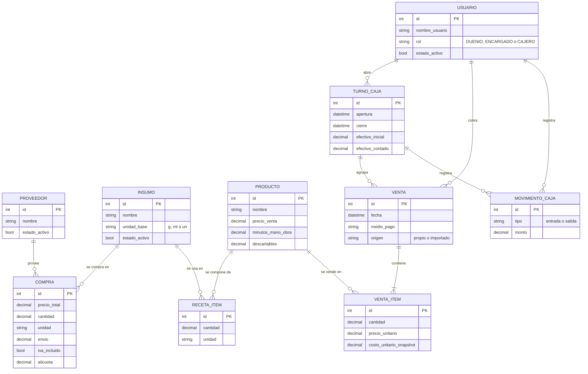

# Propuesta — Sistema de gestión para cafetería

> TP 0 · Tarea T0.2. Fuente de verdad del alcance junto con `docs/PLAN_IMPLEMENTACION.md`.
> Este documento no contiene nombres, teléfonos ni precios reales del local.

---

## 1. Problema y usuarios

### Problema

Una cafetería gestiona hoy **costos, precios, stock y caja en un Excel manual**. Ese archivo funciona como fuente de verdad, pero tiene fallas que afectan decisiones del negocio:

- **Resultados rotos sin aviso:** las fórmulas dependen de celdas y hojas enlazadas a mano; un cambio accidental produce errores (`#REF!`, `#DIV/0!`) que se propagan.
- **Márgenes absurdos tras un re-stock:** al cargar en la celda de costo el total pagado por un lote, la hoja lo compara con el precio de una sola unidad.
- **Datos duplicados:** los precios se repiten en varias hojas y se actualizan a mano, sin historial de quién cambió qué.
- **Costos incompletos:** el envío no se prorratea, y hay productos sin categoría o sin costo cargado.
- **Actualización de precios de proveedores manual:** cada lista nueva se vuelve a cargar a mano.

El sistema propuesto reemplaza el Excel por una aplicación que **costea recetas por código** (no editable a mano), separa la **compra** (total pagado, cantidad y unidad) del **costo unitario** (calculado), conserva el **historial de cambios** y controla ventas y caja.

> **Valor central del MVP:** el costeo (insumos → recetas → costos y márgenes → historial). No depende de qué sistema use el local para cobrar.

### Usuarios

| Rol | Qué necesita del sistema |
|---|---|
| **Dueño** | Conocer costos y márgenes, actualizar precios de proveedores, ver la ganancia y crear al personal definiendo sus permisos. |
| **Encargado** | Mantener insumos, compras y recetas; abrir y cerrar caja; aplicar descuentos o anular tickets. |
| **Cajero** | Cobrar tickets con medio de pago y operar su propio turno de caja. |

Los tres roles funcionan como **plantillas de permisos**: el dueño elige un rol al crear a una persona y puede tildar o destildar permisos individuales.

---

## 2. Historias de usuario (MoSCoW)

Prioridades según `docs/PLAN_IMPLEMENTACION.md` §6. Cada criterio sigue el formato **Dado / Cuando / Entonces** y cita la regla de la que deriva (`§3` = reglas de negocio del plan; `§2` = flujo de integración). No se fijan cifras: los casos de prueba usarán datos inventados.

### Must

**HU1 — Como dueño cargo insumos con presentación (pack, cantidad, unidad, precio, IVA, envío) y obtengo el costo unitario.** *(Must)*
- **CA1.1** Dado un insumo comprado con precio de pack y cantidad, cuando se guarda la compra, entonces el costo unitario es el precio dividido por la cantidad convertida a la unidad base (g, ml o un). *(§3, costo unitario de insumo)*
- **CA1.2** Dada una compra con envío, cuando se calcula el costo, entonces el envío se reparte entre las líneas en proporción a su valor. *(§3, prorrateo de envío)*
- **CA1.3** Dada una compra con cantidad vacía o en cero, cuando se intenta guardar, entonces el sistema la rechaza con un error de validación y no calcula nada. *(§1 del plan: evitar `#DIV/0!`)*

**HU2 — Como dueño armo recetas y veo el costo y margen de cada producto.** *(Must)*
- **CA2.1** Dado un producto con ítems de receta, mano de obra y descartables, cuando se consulta, entonces su costo es la suma de cantidad × costo unitario de cada insumo, más mano de obra, más descartables. *(§3, costo de producto)*
- **CA2.2** Dado un producto con precio de venta, cuando se consulta, entonces se informa la ganancia bruta (precio − costo) y el margen bruto (ganancia ÷ precio). *(§3, margen bruto)*
- **CA2.3** Dado un cálculo de costo o margen, cuando el usuario intenta modificarlo directamente, entonces el sistema no lo permite: solo se editan los datos de entrada. *(§1 del plan: resultados separados de entradas)*

**HU3 — Al cambiar el precio de un insumo se recalculan todas las recetas y queda historial.** *(Must)*
- **CA3.1** Dado un insumo usado en varias recetas, cuando se registra una compra con nuevo precio, entonces el costo de todos los productos que lo usan se recalcula. *(§3, costo de producto "se recalcula al cambiar cualquier insumo")*
- **CA3.2** Dado un cambio de costo, cuando se completa el recálculo, entonces se guarda un registro en `historial_precios` y un snapshot del desglose en `snapshots_costeo`. *(§2, paso 5 del flujo)*
- **CA3.3** Dada una compra de re-stock de un lote completo, cuando se carga, entonces el costo unitario sale de dividir el total pagado por la cantidad y el margen no se distorsiona. *(§3, costo unitario; §1, falla del re-stock)*

**HU4 — Como cajero registro una venta con medio de pago.** *(Must)*
- **CA4.1** Dado un turno de caja abierto, cuando el cajero cobra un ticket indicando el medio de pago, entonces la venta queda registrada con ese medio y asociada al turno. *(§3, caja)*
- **CA4.2** Dado un ítem vendido, cuando se registra la venta, entonces se guarda el costo vigente en ese momento y un cambio posterior de precios no lo altera. *(§3, ganancia diaria con costo congelado)*
- **CA4.3** Dado un cajero sin permiso para anular tickets, cuando intenta anular uno, entonces el sistema lo rechaza. *(§3, matriz de roles)*

**HU5 — Como encargado abro y cierro caja y veo la diferencia.** *(Must)*
- **CA5.1** Dado un turno abierto con ventas en efectivo y movimientos, cuando el encargado lo cierra, entonces el sistema calcula el efectivo esperado como apertura + ventas en efectivo + entradas − salidas. *(§3, caja)*
- **CA5.2** Dado el efectivo contado al cierre, cuando se compara con el esperado, entonces se muestra la diferencia (contado − esperado). *(§3, caja)*
- **CA5.3** Dadas ventas por transferencia, cuando se calcula el efectivo esperado, entonces no se incluyen: se registran aparte. *(§3, caja)*

**HU6 — Como dueño creo personal nuevo, le asigno un rol y ajusto sus permisos (dueño/encargado/cajero como plantillas).** *(Must)*
- **CA6.1** Dado un usuario nuevo, cuando el dueño elige un rol, entonces se precargan los permisos de esa plantilla y el dueño puede tildar o destildar permisos individuales. *(§3, roles)*
- **CA6.2** Dado el único dueño activo, cuando se intenta desactivarlo o degradarlo, entonces el sistema lo rechaza. *(§3, roles)*
- **CA6.3** Dado un usuario desactivado, cuando se consulta el historial de ventas y turnos, entonces sus registros siguen disponibles (borrado lógico). *(§3, roles)*

**HU7 — Como dueño pego una lista de proveedor y la IA propone los precios a actualizar.** *(Must, mínimo viable exigido por la arquitectura)*
- **CA7.1** Dado un texto de lista de proveedor, cuando el dueño lo envía, entonces el sistema responde de inmediato que lo recibió y procesa la importación sin bloquear. *(§2, paso 1)*
- **CA7.2** Dada una propuesta de la IA, cuando se obtiene, entonces se valida con un esquema tipado y se guardan entrada, salida, latencia y versión de prompt. *(§2, paso 2)*
- **CA7.3** Dada una propuesta de precios, cuando el dueño no la aprueba, entonces no se crea ninguna compra ni se modifica ningún costo. *(§2, paso 4: humano en el circuito)*

**HU8 — Tablero en vivo de ventas, ganancia y alertas.** *(Must, mínimo viable)*
- **CA8.1** Dado un usuario autenticado, cuando se registra una venta, entonces el tablero se actualiza sin recargar la página. *(§2, Socket.IO)*
- **CA8.2** Dado un usuario sin autenticar, cuando intenta conectarse al tablero, entonces la conexión es rechazada. *(§2, Socket.IO autenticado con JWT)*
- **CA8.3** Dado un cambio de costo que deja un margen por debajo del objetivo, cuando se recalcula, entonces se emite una alerta. *(§2, paso 5)*

### Should

**HU9 — Precio sugerido con margen objetivo y competencia.** *(Should)*
- **CA9.1** Dado un costo y un margen objetivo, cuando se pide el precio sugerido, entonces se calcula como costo ÷ (1 − margen objetivo), redondeado al múltiplo configurado. *(§3, precio sugerido)*
- **CA9.2** Dados precios de competencia cargados, cuando se calcula el sugerido, entonces queda acotado por el promedio y el mínimo de competencia. *(§3, precio sugerido)*

**HU10 — Ranking de productos más y menos vendidos y ganancia diaria.** *(Should)*
- **CA10.1** Dadas las ventas de un día, cuando se consulta la ganancia diaria, entonces es la suma de (precio − costo congelado) de los ítems vendidos. *(§3, ganancia diaria)*
- **CA10.2** Dado un rango de fechas, cuando se pide el ranking, entonces los productos se ordenan por cantidad vendida. *(HU10 del plan)*

**HU11 — Punto de equilibrio y metas diaria y semanal.** *(Should)*
- **CA11.1** Dados costos fijos, costos variables y ventas, cuando se calcula el punto de equilibrio, entonces equivale a costos fijos ÷ (1 − costos variables ÷ ventas). *(§3, punto de equilibrio)*
- **CA11.2** Dado un punto de equilibrio mensual, cuando se calculan las metas, entonces la meta diaria es el PE dividido por los días operativos y la semanal es la diaria por los días de la semana. *(§3, metas)*

**HU12 — Stock de insumos descontado por receta y alertas de mínimo.** *(Should)*
- **CA12.1** Dada una venta de un producto con receta, cuando se registra, entonces se descuenta del stock la cantidad de cada insumo, en unidad base. *(HU12 del plan; unidades base según `AGENTS.md`)*
- **CA12.2** Dado un insumo con stock por debajo de su mínimo, cuando se descuenta, entonces se emite una alerta de stock bajo. *(§2, Socket.IO: alertas de stock mínimo)*

**HU14 — Como dueño indico mi condición fiscal (responsable inscripto u otra) y el sistema calcula el costo con o sin IVA según corresponda.** *(Should)*
> **Reemplaza al parámetro global `costear_con_iva`** del plan (§0, 2b). La condición fiscal pasa a ser la configuración que decide cómo se trata el IVA en el costo; se conserva el modelado por compra (`iva_incluido`, `alicuota`).
- **CA14.1** Dado un dueño que declaró una condición fiscal, cuando se calcula el costo unitario de una compra con IVA, entonces el IVA se incluye o se excluye según esa condición. *(§3, costo unitario "± IVA según configuración")*
- **CA14.2** Dado un dueño que aún no declaró su condición fiscal, cuando se calcula un costo, entonces se aplica el criterio por defecto del plan (el costo es lo que realmente se paga, con IVA) y se avisa que falta la declaración. *(§0, 2b)*
- **CA14.3** Dado un cambio de la condición fiscal, cuando se guarda, entonces los costos de productos afectados se recalculan y queda historial. *(§3, costo de producto)*

### Could

**HU13 — Resumen semanal con IA y menú digital por QR.** *(Could)*
- **CA13.1** Dada una semana de ventas, cuando el dueño pide el resumen, entonces recibe el rendimiento del menú con sugerencias de rotación, validado con un esquema tipado. *(§2, FastAPI)*
- **CA13.2** Dado un proveedor de IA caído, cuando se pide el resumen, entonces el sistema responde con un mensaje de contingencia sin afectar ventas ni costeo. *(§2, degradación documentada)*

---

## 3. Fuera de alcance

- **Facturación electrónica** (la arquitectura no lo bloquea, pero no se construye).
- **Multi-sucursal:** el sistema atiende a un único local.
- **Pagos online.**

> **Importación de ventas desde el POS actual (Abarrotes): depende de la decisión del dueño.** El dueño todavía no definió si seguirá cobrando en el POS. Según el plan (§3b):
>
> | Escenario | Qué hace el dueño | Qué se construye |
> |---|---|---|
> | A. Reemplaza el POS | Cobra en este sistema | Ventas y caja propias (HU4–HU5 completas) |
> | B. Conserva el POS | Sigue cobrando en Abarrotes | Importación de ventas desde un export CSV/Excel (`Venta.origen = importado`) |
> | C. Sin datos de ventas | — | Carga manual de totales por producto y día (mínimo) |
>
> Solo el escenario B implica construir la importación; hasta que el dueño decida, **no está comprometida**. En cualquiera de los tres, el costeo funciona igual.

Este apartado es vinculante después de la defensa del TP 0.

---

## 4. Modelo de dominio

> **Atributos ilustrativos, se definen en el TP 1.** Los atributos del diagrama muestran la intención del modelo; los campos, tipos y restricciones definitivos se fijan al implementar los modelos.

**Cardinalidades destacadas**

- **Producto ↔ Insumo es muchos-a-muchos**, resuelto con `RecetaItem` (un producto usa varios insumos; un insumo se usa en varios productos). La cantidad y la unidad viven en `RecetaItem`.
- Un `Proveedor` tiene muchas `Compra`; cada `Compra` es de un `Insumo` y de un `Proveedor`.
- Una `Venta` tiene uno o más `VentaItem`; cada ítem congela el costo vigente al vender.
- Un `TurnoCaja` agrupa ventas y movimientos de caja; los abre un `Usuario`, que también cobra ventas y registra movimientos.
- Las unidades base son g, ml y un; el dinero se maneja con `Decimal`, nunca con `float`.

### Dónde se persiste cada cosa

| Motor | Qué guarda |
|---|---|
| **PostgreSQL** (Django) | Las 10 entidades del diagrama: `Proveedor`, `Insumo`, `Compra`, `Producto`, `RecetaItem`, `Venta`, `VentaItem`, `TurnoCaja`, `MovimientoCaja` y `Usuario`. Es la fuente de verdad contable y necesita transacciones y relaciones. |
| **MongoDB** (Node) | `historial_precios` (cada cambio de costo, solo se agrega) y `snapshots_costeo` (desglose de una receta en el tiempo, estructura variable). No tienen forma fija ni requieren joins. |

### Entidades previstas para historias Should

Se incorporarán al modelo cuando se implementen las historias correspondientes; **no se dibujan** en el diagrama:

- **Precios de competencia** (HU9: precio sugerido acotado por promedio y mínimo).
- **Costos fijos y metas** (HU11: punto de equilibrio y metas diaria y semanal).
- **Movimientos de stock** (HU12: descuento de insumos por receta y alertas de mínimo).

La condición fiscal del dueño (HU14) será un dato de configuración; su forma exacta se define al implementarla.

---

## 5. Riesgos y mitigación

| # | Riesgo | Mitigación |
|---|---|---|
| 1 | **Alcance excesivo:** el dueño pide funciones nuevas y el proyecto no llega a las entregas. | La sección 3 ("Fuera de alcance") es explícita y vinculante tras la defensa del TP 0. Las historias Should y Could se abordan solo si las Must están completas, y se congela la funcionalidad dos semanas antes del TFI. |
| 2 | **Dependencia de la decisión del dueño sobre el POS:** si no define si conserva Abarrotes ni si exporta ventas, no se sabe de dónde salen las ventas. | El valor central (costeo) no depende del POS. `Venta` lleva el campo `origen` (`propio` / `importado`) y se prevén los escenarios A/B/C de la sección 3. La pregunta al dueño queda en la sección 6. |
| 3 | **Código generado por IA que el equipo no comprende:** se considera "no entregado" si no se puede explicar en la defensa. | Una tarea por sesión del asistente, commits pequeños, PR revisado por el otro integrante, bitácora por tarea (`docs/bitacora.md`) y rotación de quién explica cada módulo. El uso de IA se declara en el README. |

---

## 6. Supuestos a validar

| Estado | Supuesto o pregunta | Detalle |
|---|---|---|
| ✅ **RESUELTO** | Frontend | Resuelto con los docentes: el frontend es de libre elección. Propuesta inicial del equipo: cliente mínimo (HTML + JS) y Django Admin. |
| ✅ **RESUELTO** | Proveedor de IA | Los docentes aceptan un proveedor de IA externo (Gemini) además de Ollama. Se registrará en un ADR; la clave va solo en `.env` y no se envían datos identificables del local. |
| ⏳ Pendiente | Aprobación del tema | Debe ser aprobado por ambos docentes antes de cerrar el TP 0. |
| ⏳ Pendiente | Decisión del dueño sobre el POS | ¿Seguirá usando el POS Abarrotes para cobrar? Define el escenario A, B o C de la sección 3. |
| ⏳ Pendiente | Exportación de ventas del POS | Si conserva el POS: ¿puede sacar las ventas a Excel o CSV? |
| ⏳ Pendiente | Condición fiscal del dueño | No se mencionó en la entrevista. Es necesaria para HU14 (costo con o sin IVA). |
