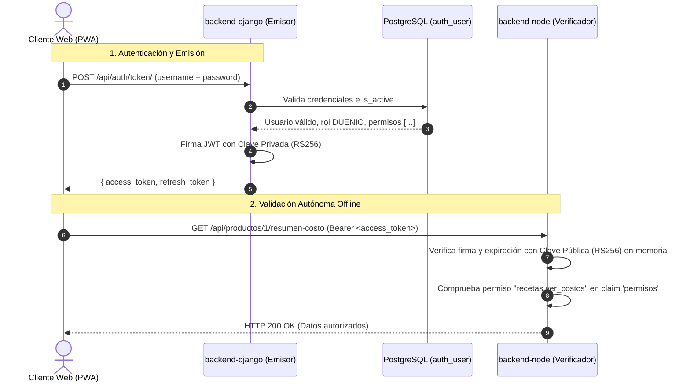

# ADR 0001: Autenticación Asimétrica con JWT RS256 y Django como Único Emisor

* **Estado:** Aceptado
* **Fecha:** 2026-10-18
* **Contexto:** TP 2 — Autenticación y seguridad (Tarea T2.1)
* **Decisores:** Equipo de desarrollo `cafe-gestion`
* **Consulta previa:** `docs/PLAN_IMPLEMENTACION.md` (§3, §5, §6), `docs/arquitectura.md` (§6), `.agents/rules/convenciones-node.md` (§7), `.agents/rules/convenciones-python.md` (§5)

---

## 1. Contexto y Problema

El sistema `cafe-gestion` es una solución políglota compuesta por:
- **`backend-django` (Django 5 + DRF + PostgreSQL 16):** Núcleo transaccional de negocio donde reside la base de usuarios, roles, contraseñas hasheadas (PBKDF2/Argon2) y permisos granulares.
- **`backend-node` (Express + Mongoose + MongoDB 7 + Socket.IO):** Servicio documental y de eventos en tiempo real, encargado de registrar historiales de precios, snapshots de costeo y distribuir eventos reactivos a clientes conectados.
- **`ai-service` (FastAPI + Pydantic v2 + Proveedor IA):** Microservicio de extracción y análisis documental (TP 3).

### Requisitos y desafíos de seguridad
1. **Autenticación desacoplada y eficiente:** `backend-node` necesita proteger sus endpoints HTTP y autenticar los handshakes de Socket.IO para unir clientes a salas específicas (ej. `sala:turno:{id}` o `sala:local`).
2. **Restricción de hardware (8 GB de RAM en PC local):** No es viable añadir un broker de sesiones distribuido pesado (como Redis) ni sobrecargar el sistema con llamadas HTTP inter-proceso sincrónicas cada vez que un cliente realiza una consulta en Node.
3. **Principio de menor privilegio:** Ningún servicio secundario (`backend-node`, `ai-service`) debe tener acceso a las contraseñas de los usuarios ni la capacidad de forjar o alterar tokens de autenticación con privilegios elevados.
4. **Resiliencia ante degradación:** Si Django se encuentra realizando operaciones intensivas (como el recálculo masivo de recetas), Node debe ser capaz de seguir validando peticiones y autorizando usuarios de forma autónoma sin depender de una conexión activa con Django en cada solicitud.

---

## 2. Alternativas Evaluadas

### Alternativa A: Sesiones tradicionales centralizadas (Cookies de sesión + Redis / Base de datos compartida)
* **Descripción:** Un almacén de sesiones común consultado por Django y Node ante cada petición.
* **Desventajas:**
  * Requiere un servicio adicional en ejecución (Redis) o acceso directo de Node a la tabla de sesiones de PostgreSQL.
  * Mayor consumo de memoria RAM en la PC del local (violando el objetivo de optimización para 8 GB).
  * Introduce acoplamiento fuerte a nivel de base de datos entre Django y Node.

### Alternativa B: JWT con Clave Simétrica (HS256)
* **Descripción:** Se utiliza una clave secreta compartida (`JWT_SECRET`) para firmar y verificar tokens HMAC.
* **Desventajas:**
  * **Violación de aislamiento:** Tanto Django (emisor) como Node (consumidor) deben conocer la misma clave secreta.
  * Si el entorno de Node o de un microservicio secundario se ve comprometido, un atacante podría utilizar el secreto para generar tokens falsos con rol `DUENIO` y privilegios totales.

### Alternativa C: Introspección remota de tokens (`POST /api/auth/verify/` en Django)
* **Descripción:** Node recibe un token opaco o JWT simple y consulta por HTTP a Django para verificar si es válido.
* **Desventajas:**
  * Introduce latencia de red innecesaria en cada petición a Node.
  * Genera un punto único de falla: si Django se reinicia o tiene congestión, toda la API de Node y los WebSockets se bloquean.

### Alternativa D: JWT con Esquema Asimétrico RS256 (Propuesta Elegida)
* **Descripción:** Uso de criptografía de clave pública y privada (algoritmo RS256: RSA Signature with SHA-256).
* **Mecanismo:** Django custodia exclusivamente la clave privada y firma los tokens; Node dispone únicamente de la clave pública y valida las firmas en memoria local sin comunicarse con Django.

---

## 3. Decisión Técnica

Se adopta el **esquema asimétrico RS256** con **Django como único emisor central de tokens** y **Node como verificador autónomo**.



### 3.1 Responsabilidades de cada servicio

1. **`backend-django` (Único Emisor):**
   - Custodia la clave privada RSA (`JWT_PRIVATE_KEY`).
   - Gestiona el login (`POST /api/auth/token/`), validando contraseñas mediante hash seguro y comprobando que `user.is_active` sea `True`.
   - Confecciona el payload del JWT con el rol plantilla y el listado consolidado de permisos granulares del usuario.
   - Firma criptográficamente el token con el algoritmo RS256.
   - Gestiona el refresco (`POST /api/auth/token/refresh/`) y la revocación con lista negra (`Blacklist`) ante cierre de sesión o desactivación de cuentas.

2. **`backend-node` (Verificador Autónomo):**
   - Dispone únicamente de la clave pública RSA (`JWT_PUBLIC_KEY`).
   - Implementa el middleware `verificarToken` utilizando la librería `jsonwebtoken` para validar la firma, el emisor (`iss`) y la vigencia (`exp`) en memoria local (tiempo de ejecución: microsegundos).
   - Implementa middlewares de autorización granular (`verificarPermiso('modulo.accion')`) que inspeccionan directamente el array de permisos contenido en el token.
   - **Node jamás emite tokens, no expone rutas de login y no almacena contraseñas.**

---

## 4. Definición Formal del Payload del JWT

El access token emitido por Django contiene una estructura estandarizada que combina claims estándar (RFC 7519) con claims específicos del dominio de negocio:

### 4.1 Especificación de Claims

| Claim | Tipo | Estándar / Privado | Descripción | Ejemplo |
|---|---|---|---|---|
| `iss` | `string` | RFC 7519 | Emisor del token (identificador de Django) | `"cafe-gestion-django"` |
| `sub` | `string` | RFC 7519 | Sujeto del token (ID de usuario serializado) | `"42"` |
| `iat` | `number` | RFC 7519 | Timestamp Unix de emisión del token | `1760756400` |
| `exp` | `number` | RFC 7519 | Timestamp Unix de expiración (15 minutos) | `1760757300` |
| `jti` | `string` | RFC 7519 | Identificador único del token (UUID para trazabilidad) | `"9b1deb4d-3b7d-4bad-9bdd-2b0d7b3dcb6d"` |
| `token_type` | `string` | SimpleJWT | Tipo de token | `"access"` |
| `user_id` | `number` | Dominio | Clave primaria del usuario en PostgreSQL | `42` |
| `username` | `string` | Dominio | Nombre de usuario en el sistema | `"cajero_maniana"` |
| `email` | `string` | Dominio | Correo o identificador de contacto | `"cajero1@cafe.local"` |
| `rol` | `string` | Dominio | Rol plantilla (`'DUENIO'`, `'ENCARGADO'`, `'CAJERO'`) | `"CAJERO"` |
| `permisos` | `string[]`| Dominio | Array de permisos granulares booleanos activos | `["ventas.cobrar_ticket", "caja.abrir_turno", ...]` |

### 4.2 Ejemplo de Payload JSON Decodificado

```json
{
  "iss": "cafe-gestion-django",
  "sub": "42",
  "user_id": 42,
  "username": "cajero_maniana",
  "email": "cajero1@cafe.local",
  "rol": "CAJERO",
  "permisos": [
    "ventas.cobrar_ticket",
    "ventas.ver_historial_propio",
    "caja.abrir_turno",
    "caja.cerrar_turno"
  ],
  "token_type": "access",
  "exp": 1760757300,
  "iat": 1760756400,
  "jti": "9b1deb4d-3b7d-4bad-9bdd-2b0d7b3dcb6d"
}
```

---

## 5. Ciclo de Vida, Claves y Políticas de Revocación

### 5.1 Tiempos de Expiración
- **Access Token:** Corta duración: **15 minutos**.
  * *Razón:* Al no requerir consulta a la base de datos para cada verificación, un tiempo corto limita la ventana de exposición en caso de revocación de permisos o desactivación de un usuario.
- **Refresh Token:** Duración prolongada: **24 horas** (con rotación de refresh tokens al usarse).
  * *Razón:* Proporciona comodidad al personal durante su jornada laboral en el punto de venta sin exigir reingreso de contraseña frecuente.

### 5.2 Gestión Criptográfica y Variables de Entorno
- **Par de Claves:** RSA con longitud de **2048 o 4096 bits** en formato PEM.
- **Custodia:**
  * En `backend-django`: ruta a la clave privada especificada en `JWT_PRIVATE_KEY_PATH` (o contenido en `JWT_PRIVATE_KEY`). Se mantiene estrictamente confidencial.
  * En `backend-node`: ruta a la clave pública especificada en `JWT_PUBLIC_KEY_PATH` (o contenido en `JWT_PUBLIC_KEY`).
  * En cumplimiento estricto de las reglas del proyecto (`AGENTS.md` regla 6), **nunca se versionan claves reales en Git**. Solo se documentan los nombres de variables en `.env.example` y se proveen scripts/comandos de generación para entornos de desarrollo.

---

## 6. Consecuencias y Compensaciones (Trade-offs)

### Consecuencias Positivas
* **Alto rendimiento en Node:** Verificación en microsegundos puramente criptográfica y en memoria; ideal para el handshake de cientos de conexiones simultáneas en Socket.IO.
* **Aislamiento de privilegios:** Si Node sufre una vulnerabilidad de inyección o compromiso de servidor, el atacante no puede generar tokens válidos de Django porque no posee la clave privada.
* **Desacoplamiento transaccional:** Caídas o latencias temporales en Django o PostgreSQL no impiden que Node siga verificando tokens de clientes conectados.

### Consecuencias Negativas y Mitigaciones
* **Retardo en propagación de revocación de permisos:** Si el Dueño desactiva un usuario o le quita un permiso, el access token actual seguirá siendo criptográficamente válido en Node hasta que expire su tiempo de vida (máximo 15 minutos).
  * *Mitigación:* Se fijó una expiración breve (15 min) para el access token, y el endpoint de refresco en Django valida el estado actual en base de datos (`is_active` y permisos vigentes), denegando el refresco inmediatamente y forzando la desautenticación en el siguiente ciclo.
* **Mayor complejidad operativa de claves:** Requiere administrar un par asimétrico en lugar de un único string secreto.
  * *Mitigación:* Se documenta el procedimiento de generación con `openssl` y se automatiza en los scripts de infraestructura.
