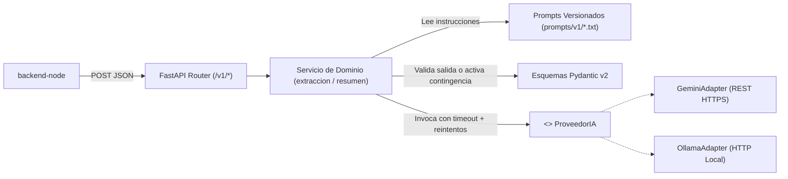

# ADR 0002: Patrón Adapter para Proveedor de IA (Gemini API y Ollama) con Degradación Elegante

* **Estado:** Aceptado
* **Fecha:** 2026-10-29
* **Contexto:** TP 3 — IA, políglota y tiempo real (Tarea T3.1)
* **Decisores:** Equipo de desarrollo `cafe-gestion` (validado con docentes de la cátedra)
* **Consulta previa:** `docs/PLAN_IMPLEMENTACION.md` (§0 2c/2d, §2, §6), `docs/PROPUESTA.md` (§2 HU7/HU13, §6), `docs/arquitectura.md` (§1, §3, §5, §6), `.agents/rules/convenciones-python.md` (§4)

---

## 1. Contexto y Problema

El sistema `cafe-gestion` incorpora un microservicio dedicado en Python con FastAPI (`ai-service`) para resolver dos problemas concretos del dominio:
1. **HU7 (Must):** Extraer insumos, presentaciones, unidades y precios desde el texto desestructurado de una lista de proveedor (pegada desde WhatsApp o PDF) y devolver un JSON tipado listo para revisión humana.
2. **HU13 (Could):** Generar un resumen semanal del rendimiento del menú con sugerencias de rotación basadas en ventas y márgenes.

### Restricciones operativas y de negocio
1. **Hardware del local comercial (~8 GB de RAM):** La PC del comercio ejecuta localmente Docker Compose con PostgreSQL, MongoDB, `backend-django`, `backend-node` y el navegador con la PWA de caja. Ejecutar un modelo de lenguaje local en Ollama (aun de 1B–3B parámetros) consume entre 2 GB y 4 GB adicionales de RAM y satura la CPU durante la inferencia, poniendo en riesgo la fluidez de la caja.
2. **Aprobación académica:** Los docentes de la cátedra confirmaron expresamente que se permite utilizar un proveedor externo de IA (como Gemini API) en lugar de correr Ollama localmente, siempre que quede documentado en un ADR y el servicio mantenga bajo acoplamiento.
3. **Resiliencia ante cortes de internet:** La extracción de precios o el resumen semanal nunca deben bloquear la operación del local si se corta internet, si el proveedor externo falla o si el modelo devuelve un formato inválido.
4. **Seguridad contra Prompt Injection y fuga de secretos:** El texto pegado por el usuario nunca debe concatenarse dentro de las instrucciones del sistema, y la clave del proveedor externo jamás debe exponerse en el repositorio ni en URLs de logs.

---

## 2. Alternativas Evaluadas

### Alternativa A: Acoplar `ai-service` exclusivamente a Ollama local
* **Descripción:** Invocar directamente la API de Ollama (`http://localhost:11434`) dentro de los servicios de FastAPI.
* **Desventajas:**
  * Inviable en la PC de 8 GB de RAM del comercio sin degradar el rendimiento del núcleo transaccional.
  * Alto acoplamiento: cambiar a un modelo en la nube requeriría reescribir la capa de servicios.

### Alternativa B: Acoplar `ai-service` exclusivamente a un SDK propietario en la nube
* **Descripción:** Importar y llamar directamente al SDK de un único proveedor externo dentro de los endpoints de FastAPI.
* **Desventajas:**
  * Dependencia rígida (*vendor lock-in*) con un proveedor específico.
  * Impide ejecutar pruebas locales con Ollama en máquinas de desarrollo que sí cuenten con RAM suficiente.

### Alternativa C: Patrón Adapter (`ProveedorIA`) con Gemini API principal y soporte Ollama (Propuesta Elegida)
* **Descripción:** Definir una interfaz abstracta `ProveedorIA` en `ai-service/app/services/proveedor_ia.py` con implementaciones intercambiables por configuración (`GeminiAdapter` y `OllamaAdapter`), validación estricta de salida con Pydantic v2 y respuesta de contingencia automática.

---

## 3. Decisión Técnica

Se adopta el **Patrón Adapter** seleccionable mediante la variable de entorno `AI_PROVIDER` (`gemini` por defecto para proteger los 8 GB de RAM del local, u `ollama` como opción local), acompañado de **validación obligatoria con Pydantic v2** y **respuesta de contingencia**.

### 3.1 Reglas de implementación del Adapter y Servicios
1. **Separación estricta entre instrucciones y datos:** Las instrucciones del prompt (`prompts/v1/`) se envían en el canal de sistema (`system_instruction` en Gemini / `role: "system"` en Ollama), mientras que los datos del usuario viajan exclusivamente en el mensaje de usuario (`role: "user"`). Jamás se concatenan textos del usuario dentro del prompt.
2. **Protección de credenciales en tránsito y logs:** `GeminiAdapter` envía la clave `GEMINI_API_KEY` mediante la cabecera HTTP `x-goog-api-key` y nunca como parámetro en la URL, evitando que posibles trazas de red o errores HTTP filtren el secreto.
3. **Timeouts y reintentos acotados:** Cada llamada se ejecuta bajo `asyncio.wait_for` y cliente `httpx.AsyncClient` con `AI_TIMEOUT_SECONDS` (10s por defecto) y `AI_MAX_RETRIES` (2 reintentos por defecto).
4. **Validación Pydantic v2 y Contingencia:** Toda respuesta cruda de la IA se valida contra `SalidaIAExtraccionPrecios` o `SalidaIAResumenSemanal` (usando `Decimal` para montos y cantidades). Si el proveedor falla, agota el timeout o devuelve datos que no superan el esquema, el servicio retorna HTTP 200 con `contingencia: true` y un mensaje claro para habilitar la carga manual/CSV sin interrumpir el sistema.

---

## 4. Consecuencias

* **Positivas:**
  * Consumo de RAM prácticamente nulo en la PC de 8 GB del comercio al delegar la inferencia en Gemini API.
  * Cambiar de proveedor de IA en el futuro (o alternar a Ollama) requiere únicamente cambiar `AI_PROVIDER` en `.env` o agregar una nueva subclase de `ProveedorIA`, sin modificar `backend-node`, `backend-django` ni el frontend.
  * Suite de tests 100% determinística y rápida mediante inyección de adaptadores mock sin consumir cuota real de API.
* **Negativas / Trade-offs:**
  * Cuando se utiliza `AI_PROVIDER=gemini`, las funciones de IA requieren conexión a internet; ante un corte de conectividad en el local, opera la degradación elegante documentada (carga manual o CSV).
