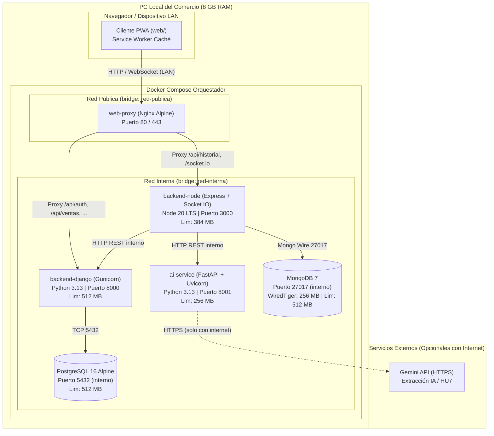

# ADR 0003: Modalidad de Despliegue en Producción (PC Local con Docker Compose y PWA en Red LAN)

* **Estado:** Aceptado
* **Fecha:** 2026-10-31
* **Contexto:** TP 4 — Docker, CI/CD, implementación y observabilidad (Tareas T4.1, T4.2, T4.4)
* **Decisores:** Equipo de desarrollo `cafe-gestion`
* **Consulta previa:** `docs/PLAN_IMPLEMENTACION.md` (§0 2d, §2, §6 T4.4), `docs/PROPUESTA.md` (§0, §2, §6), `docs/arquitectura.md` (§1, §2), Guía de Trabajos Prácticos (Sección 3.5: Modalidades de Implementación)

---

## 1. Contexto y Problema

El sistema `cafe-gestion` está destinado a una cafetería de especialidad con atención al público en salón y despacho en mostrador.
El entorno físico de operación presenta dos restricciones determinantes:
1. **Conectividad a internet inestable:** En la zona geográfica del local comercial suelen ocurrir microcortes o caídas prolongadas de la conexión a internet.
2. **Hardware del local comercial acotado (~8 GB de memoria RAM):** El local cuenta con una PC de escritorio para caja y administración donde deben convivir el sistema operativo anfitrión (Linux/Windows), el motor de contenedores y los servicios de software.

### Requisitos operacionales críticos
- **Disponibilidad ininterrumpida de caja y ventas:** La emisión de tickets, cobro en efectivo/transferencia/tarjeta, registro de turnos de caja, lectura de productos por lector de código de barras HID y control de stock y recetas no pueden suspenderse jamás ante la falta de conexión a internet.
- **Reproducibilidad y portabilidad:** La puesta en marcha debe realizarse mediante **un único comando** reproducible en cualquier equipo sin conflictos de versiones de bibliotecas ni instalaciones manuales complejas.
- **Seguridad perimetral y aislamiento:** Principio de menor privilegio, ejecución sin privilegios de superusuario (no-root), redes privadas aisladas y persistencia segura de datos transaccionales y documentales.
- **Optimización de recursos (presupuesto de RAM):** El consumo global de los servicios contenerizados no debe superar los 4.5 GB de RAM para dejar al menos 3.5 GB disponibles para el sistema operativo y el navegador web.

---

## 2. Alternativas Evaluadas

### Alternativa A: Despliegue 100 % en la Nube (AWS / GCP / Render / DigitalOcean)
* **Descripción:** Alojamiento de todos los servicios y bases de datos en infraestructura cloud pública.
* **Desventajas:**
  * **Falla crítica ante cortes de internet:** Una caída del proveedor de internet del local deja la caja inoperable, impidiendo cobrar a los clientes y registrando pérdidas económicas inmediatas.
  * Costos recurrentes en moneda extranjera (USD) para una pyme local.
  * Latencia de red añadida en cada lectura del escáner de códigos de barras o impresión de comandas.

### Alternativa B: Despliegue Híbrido con Aplicación de Escritorio Nativa (Electron)
* **Descripción:** Desarrollar un cliente local en Electron que sincronice bidireccionalmente con la nube.
* **Desventajas:**
  * Electron empaqueta una instancia completa de Chromium y Node.js dedicada, consumiendo entre 400 MB y 800 MB adicionales de memoria RAM en la máquina local.
  * La sincronización bidireccional distribuida ("offline-first" con resolución de conflictos de stock y numeración de tickets) añade una complejidad desmedida que excede el alcance del proyecto.

### Alternativa C: Instalación Nativa en el Host ("Bare-metal" sin contenedores)
* **Descripción:** Instalar PostgreSQL, MongoDB, Node.js y Python directamente sobre el sistema operativo del comercio.
* **Desventajas:**
  * Fragilidad operativa: problemas clásicos de dependencias ("en mi máquina funciona"), incompatibilidad de versiones y riesgo de desconfiguración accidental por parte del usuario.
  * Complejidad extrema para replicar entornos de desarrollo, testing y producción.
  * Falta de límites formales de recursos de CPU y memoria entre procesos.

### Alternativa D: PC Local con Docker Compose, Mitigación de RAM y PWA en LAN (Propuesta Elegida)
* **Descripción:** Despliegue contenerizado orquestado mediante Docker Compose directamente en la PC local del comercio (modalidad explícitamente respaldada por la sección 3.5 de la Guía de cátedra), complementado con una Progressive Web App (PWA) instalable que opera sobre la red de área local (LAN).

---

## 3. Decisión Técnica

Se adopta la **Alternativa D: Despliegue en PC Local con Docker Compose y PWA en Red LAN**.

### 3.1 Medidas de Mitigación para el Presupuesto de 8 GB de RAM

Para garantizar la estabilidad del sistema en el equipo de 8 GB del comercio, se implementan las mitigaciones acordadas en `docs/PLAN_IMPLEMENTACION.md` (§0 2d y §6 T4.4):

1. **Exclusión de LLM local pesado (Ollama):** No se ejecuta ningún modelo de lenguaje local (como Llama o Mistral) en el host del comercio. La extracción inteligente de precios de listas (HU7) utiliza el `GeminiAdapter` hacia la API en la nube (consumo de RAM local despreciable). Ante caídas de internet, el sistema activa automáticamente la contingencia hacia carga manual o importación CSV sin frenar la operatoria.
2. **Ajuste del motor WiredTiger de MongoDB:** Por defecto, MongoDB reserva hasta el 50 % de la memoria física para su motor de almacenamiento. En el archivo `docker-compose.yml` se fija la opción `--wiredTigerCacheSizeGB 0.25` (256 MB) y se establece un límite estricto de contenedor (`mem_limit: 512m`).
3. **Límites de memoria por contenedor (cgroups):**
   - `postgres`: 512 MB de límite de memoria.
   - `mongodb`: 512 MB de límite de memoria.
   - `backend-django`: 512 MB de límite de memoria.
   - `backend-node`: 384 MB de límite de memoria.
   - `ai-service`: 256 MB de límite de memoria.
   - `web-proxy` (Nginx): 128 MB de límite de memoria.
   - **Consumo total estimado en contenedores:** ~2.3 GB (máximo teórico ~2.8 GB), dejando holgadamente más de 5 GB libres para el kernel del sistema operativo, memoria de intercambio y el navegador web con la PWA.

### 3.2 Seguridad y Estándares de Contenedorización (T4.1)

1. **Compilación Multietapa (Multi-Stage Builds):**
   - En cada servicio (`backend-django`, `backend-node`, `ai-service`, `web`) se separa la etapa de compilación/instalación de dependencias (builder stage) de la imagen final de ejecución (runner stage).
   - Esto minimiza el tamaño de las imágenes (reduciendo la superficie de ataque y tiempo de descarga) y excluye compiladores C/C++, cabeceras de desarrollo y caches de paquetes.
2. **Ejecución con Usuario No-Root:**
   - Ningún contenedor corre como `root`. Se crean y configuran usuarios específicos con UID/GID no privilegiados (`appuser` con UID 10001 en Python/Alpine, `node` con UID 1000 en Node.js, `nginx` en Nginx).
3. **Healthchecks Nativos y Dependencias Condicionales (T4.2):**
   - Cada servicio cuenta con directivas `HEALTHCHECK` que verifican la salud real del proceso (ej. `pg_isready` en PostgreSQL, ping de admin en MongoDB, endpoints `/health` y `/api/health/` en las aplicaciones).
   - En `docker-compose.yml`, los servicios dependientes esperan activamente que las bases de datos estén saludables antes de iniciar (`depends_on: { service: { condition: service_healthy } }`), evitando fallos en cascada en arranques en frío.
4. **Segmentación de Redes:**
   - `red-interna`: red privada tipo bridge donde residen las bases de datos y la comunicación inter-servicios. Los puertos de PostgreSQL (5432) y MongoDB (27017) no se exponen al host en el compose de producción.
   - `red-publica`: red donde solo el proxy inverso Nginx y los servicios de frontend reciben conexiones entrantes del host o de la red local LAN.
5. **Persistencia mediante Volúmenes Nombrados:**
   - Volúmenes gestionados por Docker (`pgdata` y `mongodata`) para garantizar que la información financiera y documental sobreviva a reinicios y actualizaciones de contenedores.

---

## 4. Consecuencias y Evaluación de Impacto

### Consecuencias Positivas
- **Independencia operativa total:** Si se corta internet, la cafetería sigue vendiendo, cobrando, controlando recetas y emitiendo tickets normalmente a través de la red local.
- **Puesta en marcha con un solo comando:** Cualquier miembro del equipo docente o técnico puede clonar el repositorio y ejecutar `docker compose up -d` para tener la solución completa funcionando.
- **Uso predecible y seguro de la memoria RAM:** El local de 8 GB no sufre degradación por saturación de memoria (*swapping* o *OOM killer*).
- **Aislamiento y menor privilegio:** La postura de seguridad cumple con las mejores prácticas de la industria y la normativa académica.

### Consecuencias Negativas y Mitigaciones
- **Responsabilidad del respaldo local:** Al residir los datos en la PC local del comercio, es imperativo contar con un mecanismo automatizado de backup periódico fuera de la máquina (ej. script de volcado de PostgreSQL y MongoDB a disco externo o almacenamiento seguro).
- **Actualizaciones de software:** Requieren tirar y levantar los contenedores con las nuevas imágenes versionadas, lo cual se mitiga mediante un script de despliegue atómico documentado en `docs/despliegue.md`.
