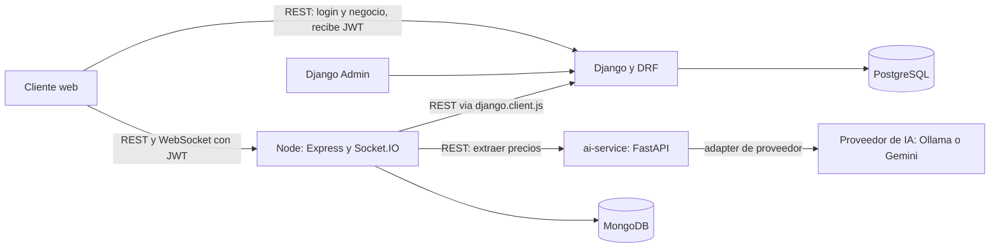

# Arquitectura — Sistema de gestión para cafetería

> TP 0 · Tarea T0.3. Basado solo en `docs/PLAN_IMPLEMENTACION.md` (§2, §3, §6), `docs/PROPUESTA.md` y `.agents/rules/`.
> Criterio de la guía para cada pieza: *"¿qué se rompe si la saco?"*

---

## 1. Mapa tecnológico

| Pieza | Responsabilidad en este sistema | Qué se rompe si se saca | Justificación |
|---|---|---|---|
| **Django 5 + DRF + PostgreSQL 16** | Núcleo transaccional: usuarios y roles, proveedores, insumos, compras, productos, recetas, ventas, turnos de caja. Calcula costos y márgenes y es el único emisor de JWT. | Todo: es la fuente de verdad contable. | El dinero y las relaciones entre entidades necesitan transacciones ACID y restricciones; una base relacional es lo natural. |
| **Express + Mongoose + MongoDB 7** | Subdominio documental: `historial_precios`, `snapshots_costeo`, `importaciones_ia`. Orquesta la importación con IA y sirve el tiempo real. | El historial, los snapshots y la trazabilidad de la IA; la importación deja de orquestarse. | Son datos de alto volumen, solo se agregan y tienen forma variable; en SQL serían tablas ruidosas sin necesidad de joins. |
| **FastAPI + Pydantic v2 + proveedor de IA** (adapter: Ollama y opcionalmente Gemini) | Extrae precios desde el texto de una lista de proveedor a JSON tipado y, como historia Could, genera el resumen semanal. | Cada lista de precios vuelve a cargarse a mano, que es el dolor principal del dueño. | La IA tiene un propósito concreto y acotado; el adapter permite cambiar de proveedor sin tocar el resto, y Pydantic valida toda salida antes de usarla. |
| **Socket.IO** (dentro de Node) | Tablero en vivo: ventas, ganancia, alertas de stock y de margen bajo, aviso de importación lista. Salas por local y por turno, autenticado con el JWT. | El tablero en vivo y los avisos de caja. | Los avisos tienen que llegar sin recargar la página; reutiliza el proceso de Node y no agrega otro servicio. |

El cliente web es un cliente mínimo (HTML + JS) y Django Admin hace de back-office; el frontend es de libre elección según lo confirmado con los docentes.

---

## 2. Diagrama de componentes

Quién llama a quién:

- El cliente web inicia sesión en **Django**, que emite el JWT. Con ese token consume la API de Django y se conecta a **Node** (REST y Socket.IO).
- **Node** nunca emite tokens: solo los valida con la clave pública. Consume a Django mediante `src/clients/django.client.js` y a `ai-service` para la extracción de precios.
- **ai-service** solo habla con el proveedor de IA. No accede a Django ni a MongoDB.
- Cada servicio de datos es dueño de su base: Django de PostgreSQL y Node de MongoDB. Nadie más accede directo.
- Django avisa a Node cuando un costo se recalcula o se registra una venta; el medio de ese aviso está **pendiente** (ver §6).
