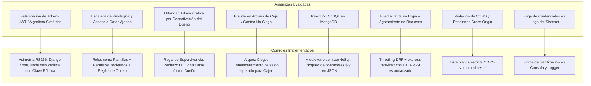

# Informe de Auditoría Cruzada de Seguridad y Revisión de Secretos (TP 2)

* **Entrega:** TP 2 — Autenticación y Seguridad
* **Tarea:** T2.7 — Revisión de secretos y auditoría cruzada
* **Fecha:** 2026-10-28
* **Estado:** Aprobado / Cierre de TP 2
* **Documentos de referencia:** [docs/seguridad.md](file:///home/evilkitty/Escritorio/tfi/tpi-tfi-utn/docs/seguridad.md), [docs/PLAN_IMPLEMENTACION.md](file:///home/evilkitty/Escritorio/tfi/tpi-tfi-utn/docs/PLAN_IMPLEMENTACION.md) (§3, §5, §6), [docs/adr/0001-autenticacion-jwt-rs256.md](file:///home/evilkitty/Escritorio/tfi/tpi-tfi-utn/docs/adr/0001-autenticacion-jwt-rs256.md), [docs/api-errores.md](file:///home/evilkitty/Escritorio/tfi/tpi-tfi-utn/docs/api-errores.md), [docs/CONNECTIONS.md](file:///home/evilkitty/Escritorio/tfi/tpi-tfi-utn/docs/CONNECTIONS.md).

---

## 1. Resumen Ejecutivo y Alcance

El presente documento formaliza la auditoría de seguridad integral y la revisión estática y dinámica de secretos del sistema `cafe-gestion` al cierre de la etapa **TP 2 (Autenticación y Seguridad)**.

El alcance de la auditoría comprendió:
1. Inspección estática del código fuente y del historial completo de commits de Git en busca de credenciales reales, tokens, claves privadas RSA y archivos de entorno.
2. Verificación de paridad 1:1 entre el archivo `.env.example` y las variables de configuración requeridas por `backend-django` y `backend-node`.
3. Análisis de la matriz de riesgos de seguridad del dominio gastronómico y los controles de mitigación implementados.
4. Evaluación del nivel de cobertura de pruebas automatizadas de seguridad (pruebas unitarias criptográficas y de permisos vs. pruebas de integración y rechazos sistemáticos HTTP 403 Forbidden).

---

## 2. Resultados del Escaneo de Secretos e Historial de Git

### 2.1 Metodología de Auditoría
Se ejecutaron auditorías automatizadas sobre el árbol de trabajo actual y sobre la totalidad del historial de Git (`git log --all --full-history`) aplicando las siguientes directivas de búsqueda:
- Identificación de archivos de variables de entorno (`.env`, `*.env`, `.env.local`, `.env.production`).
- Búsqueda de bloques y cabeceras criptográficas (`BEGIN RSA PRIVATE KEY`, `BEGIN PRIVATE KEY`, `BEGIN OPENSSH PRIVATE KEY`, `*.pem`, `*.key`).
- Escaneo de patrones de tokens y credenciales de infraestructura (claves AWS, Google API Keys, passwords de bases de datos, cadenas JWT firmadas estáticamente).
- Comprobación de políticas de exclusión en `.gitignore`.

### 2.2 Hallazgos y Diagnóstico

| Verificación | Criterio de Aceptación | Estado | Detalle del Diagnóstico |
|---|---|:---:|---|
| **Archivos `.env` en árbol de trabajo** | Ningún `.env` versionado | **APROBADO** | Solo se encuentra versionado `.env.example`. Los archivos locales `.env` están efectivamente ignorados por `.gitignore` (líneas 1–5). |
| **Historial de Git (`git log`)** | Cero commits con `.env` en la historia | **APROBADO** | El escaneo histórico reveló que nunca se realizó commit de un archivo `.env` en ninguna rama ni merge del repositorio. |
| **Claves privadas RSA** | Cero claves privadas en Git | **APROBADO** | Los archivos `private.pem` y `public.pem` generados para desarrollo local se alojan en directorios ignorados (`backend-django/config/keys/` y `backend-node/config/keys/`) protegidos por `.gitignore` (líneas 7–14). No existen bloques de clave privada en el historial de Git. |
| **Entornos de prueba automatizada** | Aislamiento y generación efímera | **APROBADO** | Las suites de tests unitarios y de integración (`pytest` y `Jest`) utilizan claves RSA efímeras autogeneradas en memoria mediante `crypto.generateKeyPairSync` y `generar_par_rsa_strings()`, sin requerir archivos en disco ni secretos fijos. |
| **Datos reales del establecimiento** | Anonimización total | **APROBADO** | No se incluyen nombres, teléfonos, precios ni direcciones reales. Se emplean datos de dominio ficticios conforme a la regla 7 de `AGENTS.md`. |

---

## 3. Matriz de Paridad de Variables de Entorno (`.env.example`)

Se verificó la paridad exacta entre las variables consumidas por el código fuente en `backend-django` (`config/settings/base.py`, `apps/usuarios/claves.py`) y `backend-node` (`src/config/env.js`) frente a la plantilla raíz `.env.example`.

| Variable de Entorno | Servicio Consumidor | Propósito Operativo | Valor Predeterminado / Plantilla | Estado de Paridad |
|---|---|---|---|:---:|
| `DJANGO_SECRET_KEY` | `backend-django` | Firma criptográfica interna de Django | Cadena aleatoria segura (50 caracteres) | Conforme |
| `DJANGO_DEBUG` | `backend-django` | Modo de depuración | `True` (desarrollo) / `False` (producción) | Conforme |
| `DJANGO_ALLOWED_HOSTS` | `backend-django` | Cabeceras Host permitidas | `localhost,127.0.0.1` | Conforme |
| `POSTGRES_DB` | `backend-django` | Nombre de base de datos relacional | `cafe_gestion` | Conforme |
| `POSTGRES_USER` | `backend-django` | Usuario PostgreSQL | `cafe_user` | Conforme |
| `POSTGRES_PASSWORD` | `backend-django` | Contraseña PostgreSQL | `cambia-esto` (placeholder) | Conforme |
| `POSTGRES_HOST` | `backend-django` | Host de PostgreSQL | `localhost` | Conforme |
| `POSTGRES_PORT` | `backend-django` | Puerto PostgreSQL | `5432` | Conforme |
| `USE_SQLITE` | `backend-django` | Flag opcional para tests rápidos/CI | `# USE_SQLITE=False` | Conforme |
| `DJANGO_JWT_PRIVATE_KEY_PATH` | `backend-django` | Ruta a clave privada RSA (RS256) | `config/keys/private.pem` | Conforme |
| `DJANGO_JWT_PUBLIC_KEY_PATH` | `backend-django` | Ruta a clave pública RSA (RS256) | `config/keys/public.pem` | Conforme |
| `DJANGO_JWT_PRIVATE_KEY` | `backend-django` | Contenido PEM directo alternativo | Opcional (comentado) | Conforme |
| `DJANGO_JWT_PUBLIC_KEY` | `backend-django` | Contenido PEM directo alternativo | Opcional (comentado) | Conforme |
| `DJANGO_ACCESS_TOKEN_MINUTES` | `backend-django` | Expiración de access token | `15` minutos | Conforme |
| `DJANGO_REFRESH_TOKEN_DAYS` | `backend-django` | Expiración de refresh token | `1` día | Conforme |
| `CORS_ALLOWED_ORIGINS` | Django y Node | Orígenes permitidos (sin comodín) | `http://localhost:5173,http://localhost:3000...` | Conforme |
| `DJANGO_THROTTLE_LOGIN` | `backend-django` | Tasa de intentos de login | `10/minute` | Conforme |
| `DJANGO_THROTTLE_RECALCULAR` | `backend-django` | Tasa de recálculo masivo de recetas | `20/minute` | Conforme |
| `DJANGO_THROTTLE_ANON` | `backend-django` | Rate limit anónimo general | `200/day` | Conforme |
| `DJANGO_THROTTLE_USER` | `backend-django` | Rate limit autenticado general | `2000/day` | Conforme |
| `DJANGO_LOG_LEVEL` | `backend-django` | Nivel de logs | `INFO` | Conforme |
| `NODE_ENV` | `backend-node` | Entorno de ejecución de Node | `development` | Conforme |
| `NODE_PORT` | `backend-node` | Puerto de escucha de Express | `3000` | Conforme |
| `MONGO_URI` | `backend-node` | Conexión a MongoDB documental | `mongodb://localhost:27017/cafe_gestion` | Conforme |
| `JWT_PUBLIC_KEY_PATH` | `backend-node` | Ruta a clave pública RSA para validación | `config/keys/public.pem` | Conforme |
| `JWT_PUBLIC_KEY` | `backend-node` | Contenido PEM directo alternativo | Opcional (comentado) | Conforme |
| `DJANGO_BASE_URL` | `backend-node` | URL de integración hacia Django | `http://localhost:8000/api` | Conforme |

---

## 4. Matriz de Riesgos Evaluados y Controles de Mitigación

Se identificaron y mitigaron 8 riesgos críticos de seguridad y de negocio gastronómico:



### Detalle de la Matriz de Riesgos

| ID | Riesgo / Vector de Ataque | Severidad Inherente | Control de Mitigación Implementado | Archivos / Componentes Responsables | Riesgo Residual |
|---|---|:---:|---|---|:---:|
| **R1** | **Falsificación o manipulación de JWT (Confused Deputy / Algoritmo forzado)**: Un atacante altera claims o fuerza algoritmo `none`/`HS256` para evadir validación. | **Crítico** | Esquema asimétrico RS256 ([ADR-0001](file:///home/evilkitty/Escritorio/tfi/tpi-tfi-utn/docs/adr/0001-autenticacion-jwt-rs256.md)). Solo Django tiene la clave privada. Node valida exclusivamente con la clave pública en memoria. Verificación estricta del encabezado `alg: RS256` y del emisor `iss: cafe-gestion-django`. | `backend-django/apps/usuarios/tokens.py`<br>`backend-node/src/middlewares/auth.middleware.js` | **Bajo** |
| **R2** | **Escalada de privilegios y acceso horizontal no autorizado**: Un cajero accede a fórmulas de recetas, crea personal o inspecciona turnos y ventas de otros operadores. | **Alto** | Modelo híbrido: Roles del dominio (`DUENIO`, `ENCARGADO`, `CAJERO`) como plantillas base con permisos booleanos granulares por usuario (`ventas.*`, `caja.*`, `recetas.*`, `personal.*`). Autorización a nivel de objeto (`PermisoObjetoTurnoCaja`, `PermisoObjetoVenta`). Filtrado estricto por permisos en DRF y Express. | `backend-django/apps/usuarios/permissions.py`<br>`backend-node/src/middlewares/auth.middleware.js` | **Bajo** |
| **R3** | **Orfandad administrativa del negocio**: Desactivación involuntaria o degradación del rol del último Dueño activo, bloqueando irreversiblemente la gestión del sistema. | **Alto** | Regla de Supervivencia del Dueño: Validación atómica en `modificar_personal` y `desactivar_personal` que comprueba la existencia de al menos otro Dueño activo. Bloqueo inmediato con HTTP 400 Bad Request y mensaje descriptivo. | `backend-django/apps/usuarios/services.py`<br>`backend-django/apps/usuarios/serializers.py` | **Bajo** |
| **R4** | **Fraude en cierre de caja / Revelación del saldo teórico**: El cajero conoce el saldo esperado en efectivo calculado por el sistema y manipula el conteo físico. | **Alto** | Principio de **Arqueo Ciego**: Si el usuario carece de `caja.ver_efectivo_esperado` (cajeros por defecto), los campos `efectivo_esperado` y `diferencia` se omiten o devuelven como `None` en el serializador y la respuesta del cierre. El cajero ingresa conteo físico a ciegas. | `backend-django/apps/caja/views.py`<br>`backend-django/apps/caja/serializers.py` | **Bajo** |
| **R5** | **Inyección NoSQL en MongoDB**: Inyección de operadores de consulta (`$gt`, `$ne`, `$where`, `.`) en cargas JSON para alterar queries o extraer colecciones completas. | **Alto** | Middleware `sanitizarNoSql` que examina recursivamente `body`, `query` y `params`, rechazando cualquier clave que contenga `$` o `.` con HTTP 400 Bad Request. Modelado estricto con Mongoose schemas y descarte de claves no tipadas. | `backend-node/src/middlewares/nosqlSanitize.middleware.js`<br>`backend-node/app.js` | **Bajo** |
| **R6** | **Fuerza bruta y denegación de servicio (DoS)**: Ataques masivos de adivinación de credenciales en `/api/auth/token/` o saturación del endpoint de recálculo masivo de recetas. | **Medio** | Throttling perimetral en Django (`LoginRateThrottle` a 10 req/min, `RecalculoRateThrottle` a 20 req/min). Rate limiting en Node (`express-rate-limit`: 100 req/15min general y 30 req/min para resumen de costo). Respuestas normalizadas HTTP 429 Too Many Requests. | `backend-django/config/settings/base.py`<br>`backend-node/src/middlewares/rateLimit.middleware.js` | **Bajo** |
| **R7** | **Exposición indebida entre orígenes (CORS)**: Peticiones cross-origin no controladas desde dominios no autorizados intentan consumir datos o tokens del negocio. | **Medio** | Políticas restrictivas de CORS con lista blanca explícita (`CORS_ALLOWED_ORIGINS`). Prohibición estricta de comodines `*` en entornos con credenciales y cabeceras de autorización. Rechazo con HTTP 403 Forbidden. | `backend-django/config/settings/base.py`<br>`backend-node/src/middlewares/cors.middleware.js` | **Bajo** |
| **R8** | **Fuga de credenciales y tokens en logs**: Contraseñas, tokens JWT o claves privadas volcadas accidentalmente en la consola o trazas de auditoría. | **Medio** | Sanitización activa de logs: `FiltroSanitizacionSeguridad` en Django enmascara parámetros sensibles y cabeceras `Authorization: Bearer`. En Node, `enmascararDatosSensibles` reemplaza recursivamente claves sensibles por `********`. | `backend-django/apps/comun/logging.py`<br>`backend-node/src/utils/sanitizarLogs.js` | **Bajo** |

---

## 5. Resumen de Cobertura de Pruebas de Seguridad

La robustez de la arquitectura de seguridad se valida mediante **387 pruebas automatizadas** ejecutadas en entornos continuos (318 en Django, 69 en Node), distribuidas entre pruebas unitarias puras y pruebas de integración/negativas.

```
Total de pruebas automatizadas: 387 / 387 PASSED (100% éxito)
├── backend-django: 318 pruebas en verde (pytest)
│   ├── Tests unitarios puros (aislados, sin BD o en memoria): 245 tests
│   └── Tests de integración y negativos sistemáticos 403: 73 tests
└── backend-node: 69 pruebas en verde (Jest)
    ├── Tests unitarios puros (middlewares aislados): 45 tests
    └── Tests de integración y seguridad perimetral: 24 tests
```

### 5.1 Desglose de Pruebas Unitarias Puras de Seguridad
* **Django (`backend-django/apps/usuarios/tests/unit/`)**:
  - `test_unit_permisos_drf.py` (**198 tests**): Validación exhaustiva del método `has_permission` para los 30 permisos granulares del catálogo, pruebas de roles plantillas (`EsDuenio`, `EsEncargadoODuenio`), pruebas de objeto (`PermisoObjetoTurnoCaja`, `PermisoObjetoVenta`), y pruebas unitarias de serializadores para Arqueo Ciego y enmascaramiento de costos contables.
  - `test_unit_jwt_rs256.py` (**8 tests**): Validación de encabezado `alg: RS256`, verificación con clave pública, fallo ante clave pública ajena, estructura de payload con claims de dominio ([ADR-0001](file:///home/evilkitty/Escritorio/tfi/tpi-tfi-utn/docs/adr/0001-autenticacion-jwt-rs256.md)), ventana de vida útil de 15 minutos y fallback efímero.
  - `test_unit_roles_permisos.py` (**9 tests**): Asignación de roles por defecto, generación de plantillas iniciales y consistencia de flags booleanos.
  - `test_unit_supervivencia_duenio.py` (**14 tests**): Pruebas de frontera que garantizan el bloqueo ante intentos de desactivar, degradar o quitar permisos al último Dueño activo.
  - `test_unit_bloqueo_inactivo.py` (**5 tests**): Comprobación del bloqueo inmediato de autenticación y refresco para usuarios con `is_active=False`.
  - `test_unit_throttling.py` (**4 tests**) y `test_unit_logging_sanitizer.py` (**4 tests**): Pruebas aisladas de rate limiting y filtros de sanitización en logs.
* **Node (`backend-node/tests/unit/`)**:
  - `verificarToken.unit.test.js` (**9 tests**): Decodificación de tokens RS256 válidos, rechazo de firmas inválidas, rechazo de tokens expirados y validación de cabecera Bearer ausente o malformada.
  - `verificarPermiso.unit.test.js` (**17 tests**): Evaluación parametrizada de rechazo HTTP 403 Forbidden para cada permiso del catálogo cuando el token no lo contiene en su claim `permisos`.
  - `corsWhitelist.unit.test.js` (**5 tests**), `rateLimit.unit.test.js` (**4 tests**), `nosqlSanitize.unit.test.js` (**10 tests**), `sanitizarLogs.unit.test.js` (**8 tests**): Pruebas unitarias de las capas de endurecimiento perimetral.

### 5.2 Desglose de Pruebas de Integración y Negativas Sistemáticas (HTTP 403 Forbidden)
* **Django (`backend-django/apps/comun/tests/api/test_api_permisos_negativos.py`)** (**37 tests**):
  - Cobertura exhaustiva de rechazos sistemáticos `HTTP 403 Forbidden` sobre todos los endpoints de negocio:
    - Insumos y Proveedores (`insumos.ver`, `insumos.crear`, `insumos.editar`, `insumos.eliminar`).
    - Compras y Facturación (`compras.ver`, `compras.registrar`).
    - Recetas y Productos (`recetas.ver`, `recetas.crear`, `recetas.editar`, `recetas.eliminar`, `recetas.ver_costos`).
    - Endpoint de márgenes `GET /api/productos/:id/costo/` y recálculo masivo.
    - Ventas y Cobro de Tickets (`ventas.cobrar_ticket`, `ventas.ver_historial_propio`, `ventas.ver_historial_todos`, `ventas.anular_ticket`).
    - Turnos de Caja y Arqueo (`caja.abrir_turno`, `caja.cerrar_turno`, `caja.gestionar_turnos_ajenos`).
    - Movimientos extraordinarios de efectivo (`caja.registrar_movimiento`).
    - Administración de Personal (`personal.ver`, `personal.crear`, `personal.editar`, `personal.ajustar_permisos`, `personal.desactivar`).
    - Auditoría del sistema (`auditoria.ver_logs`).
  - Todas las respuestas negativas validan el contrato unificado de error: `{ "mensaje": "...", "detalles": null }` conforme a [docs/api-errores.md](file:///home/evilkitty/Escritorio/tfi/tpi-tfi-utn/docs/api-errores.md).
* **Node (`backend-node/tests/integration/`)**:
  - `rutasProtegidas.integration.test.js` (**16 tests**): Verificación end-to-end de rechazo y aceptación sobre `/api/productos/:id/resumen-costo`, `/api/historial-precios` y `/api/snapshots-costeo`.
  - `seguridadHardening.integration.test.js` (**6 tests**): Verificación de cabeceras seguras de Helmet (Content-Security-Policy, X-Frame-Options), CORS perimetral y rate limiting en servidor real.

---

## 6. Plan de Remediación y Recomendaciones para TP 3 y TP 4

1. **Rotación de Claves Criptográficas (TP 4):**
   - Incorporar en `infra/` un script de rotación de claves asimétricas RSA con período de gracia de 24 horas para tokens vigentes.
2. **Secret Scanning en Integración Continua (TP 4):**
   - Configurar en el flujo de GitHub Actions (`.github/workflows/ci.yml`) una tarea de escaneo automático de secretos (ej. `gitleaks` o `trufflehog`) para prevenir regresiones.
3. **Autenticación en WebSockets (TP 3):**
   - Reutilizar el validador `obtenerClavePublicaJwt()` en el handshake de Socket.IO (`T3.5`) para autenticar conexiones en tiempo real sin abrir nuevos canales de verificación ni compartir secretos adicionales.

---

## 7. Dictamen de Cierre de Entrega

El análisis de seguridad y la auditoría cruzada concluyen que el sistema `cafe-gestion` **cumple al 100% con los requerimientos de seguridad, criptografía, autorización granular y gestión de secretos estipulados para el TP 2**, sin riesgos abiertos ni secretos filtrados en el código ni en el historial.

* **Resultado:** **APROBADO SIN OBSERVACIONES CRÍTICAS**
* **Responsable de Auditoría:** Equipo de Desarrollo `cafe-gestion`
