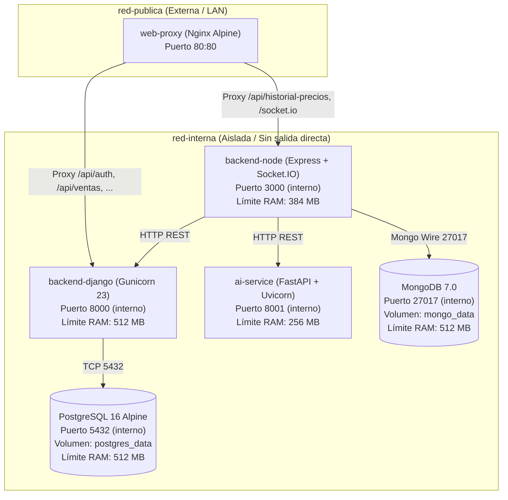

# Manual de Despliegue y Operación en Producción — Sistema de Gestión para Cafetería

> Trabajo Práctico 4 (Unidad 5 · Tareas T4.1, T4.2, T4.4, T4.7).  
> Modalidad: **PC Local con Docker Compose y PWA en Red de Área Local (LAN)** (respaldada por la sección 3.5 de la Guía de cátedra y ADR 0003).

---

## 1. Requisitos del Entorno y Hardware

### 1.1 Hardware Mínimo Recomendado (PC del Comercio)
* **Memoria RAM:** 8 GB DDR4 (con las mitigaciones activas el conjunto de contenedores consume ~2.3 GB, dejando más de 5 GB para el sistema operativo y el navegador).
* **Procesador:** CPU de 4 núcleos x86_64 (Intel Core i3 / AMD Ryzen 3 o superior).
* **Almacenamiento:** 20 GB de espacio disponible en disco SSD.
* **Red:** Interfaz Ethernet o Wi-Fi conectada al router del comercio para proveer acceso LAN a los dispositivos de los mozos y cajeros.

### 1.2 Software Base del Host
* Sistema Operativo: Linux (Ubuntu 22.04 LTS / 24.04 LTS o Debian 12 recomendado) o Windows 11 con WSL2.
* Docker Engine 24.0+ y Docker Compose v2.20+.
* Git 2.34+.
* **Sin requerimiento de herramientas instaladas en el host:** Toda la pila de ejecución (Python, Node.js, PostgreSQL y MongoDB) corre aislada en contenedores.

---

## 2. Arquitectura de Despliegue y Redes

El despliegue orquesta 6 contenedores organizados en dos redes bridge privadas:



### Puertos Expuestos al Host
* **Puerto 80:** Servidor web Nginx que entrega la PWA (`/app` o `/`) y actúa como Reverse Proxy seguro hacia Django (`/api/`) y Node (`/socket.io`, `/api/historial-precios`, etc.).
* Los puertos internos de bases de datos (5432 y 27017) y de microservicios (8000, 3000, 8001) **no se publican al exterior**, garantizando el aislamiento perimetral.

---

## 3. Puesta en Marcha con un Solo Comando (T4.2)

### Paso 1: Clonar el repositorio y configurar variables
```bash
git clone https://github.com/tu-usuario/tpi-tfi-utn.git
cd tpi-tfi-utn

# Crear el archivo de variables a partir de la plantilla segura
cp .env.example .env
```

> [!IMPORTANT]
> Editá `.env` para definir una clave segura en `DJANGO_SECRET_KEY` y, si disponés de conexión a internet para la extracción con IA, agregá tu `GEMINI_API_KEY`. Nunca hagas commit de este archivo (está bloqueado en `.gitignore`).

### Paso 2: Ejecutar el script automatizado de despliegue
```bash
./scripts/desplegar.sh
```
El script valida la configuración, compila las imágenes multietapa, aplica las migraciones pendientes en PostgreSQL y espera a que todos los healthchecks pasen a estado `healthy`.

*(Método alternativo directo con Docker Compose:)*
```bash
docker compose up -d --build
```

### Paso 3: Acceso a la Aplicación
* **Cliente Web / PWA:** Abrí en el navegador de la PC local o de cualquier tablet/móvil en la red Wi-Fi: `http://localhost` (o `http://<IP-DE-LA-PC-LOCAL>`).
* **Documentación / Endpoints:**
  * Healthcheck general: `http://localhost/healthz`
  * Healthcheck Django: `http://localhost/api/health/`
  * Healthcheck profundo Django: `http://localhost/api/health/profundo/`
  * Healthcheck Node: `http://localhost/health/`
  * Healthcheck profundo Node: `http://localhost/health/profundo/`

---

## 4. Mitigaciones de Memoria para 8 GB de RAM

De acuerdo con lo acordado con la cátedra en `docs/PLAN_IMPLEMENTACION.md` (§0 2d) y ADR 0003:
1. **Límite de memoria WiredTiger en MongoDB:** Se fuerza `--wiredTigerCacheSizeGB 0.25` en `docker-compose.yml`, evitando que MongoDB consuma el 50 % de la memoria física de la máquina.
2. **Límites cgroups por contenedor:** Cada servicio tiene un tope rígido de memoria configurado (`limits.memory`).
3. **Consumo externo de IA (Gemini API):** No se ejecuta Ollama local en la PC de caja. Las llamadas de extracción inteligente salen por HTTPS a la API de Google, consumiendo escasos megabytes de memoria local. Ante cortes de internet, el sistema activa la contingencia automática hacia carga manual o CSV.

---

## 5. Observabilidad, Trazabilidad y Logs

### 5.1 Correlación Distribuida (`X-Request-ID`)
Cada petición entrante recibe o genera un UUID v4 mediante middlewares específicos en los tres servicios:
* `backend-django`: `CorrelationIdMiddleware`
* `backend-node`: `correlationIdMiddleware`
* `ai-service`: `CorrelationIdMiddleware`

El identificador se inyecta en la cabecera HTTP de respuesta `X-Request-ID` y se propaga en todas las llamadas inter-servicios (`django.client.js` y `ai.client.js`), permitiendo rastrear el ciclo de vida completo de una transacción a través de los logs.

### 5.2 Logging Estructurado JSON
Los servicios soportan formateo de logs estructurados en JSON que incluyen:
* `timestamp` (ISO 8601 UTC)
* `nivel` (INFO, WARN, ERROR)
* `servicio` (nombre del contenedor)
* `mensaje` (con sanitización activa de contraseñas y tokens)
* `correlation_id` (ID de trazabilidad de la petición)

Para inspeccionar logs en vivo con correlación:
```bash
docker compose logs -f backend-django backend-node ai-service
```

### 5.3 Healthchecks Nativos y Profundos
| Endpoint | Tipo | Propósito | Criterio de Éxito |
|---|---|---|---|
| `/healthz` | Liveness | Nginx Reverse Proxy | HTTP 200 OK |
| `/api/health/` | Liveness | Django Process | HTTP 200 OK (sin tocar BD) |
| `/api/health/profundo/` | Readiness | Django + PostgreSQL | HTTP 200 OK + `SELECT 1` exitoso y latencia |
| `/health/` | Liveness | Node.js Process | HTTP 200 OK (sin tocar BD) |
| `/health/profundo/` | Readiness | Node + MongoDB + Django | HTTP 200/503 con diagnóstico de conexiones |
| `/health/profundo` (ai) | Readiness | FastAPI AI Service | HTTP 200 con configuración activa de adapter |

---

## 6. Procedimiento de Respaldo y Restauración

### 6.1 Generar Respaldo
El script `scripts/backup.sh` realiza un volcado consistente de PostgreSQL y MongoDB sin detener los contenedores:
```bash
./scripts/backup.sh
```
El archivo resultante se almacena con marca de tiempo en la carpeta `backups/backup_cafe_gestion_YYYYMMDD_HHMMSS.tar.gz`.

### 6.2 Restaurar Respaldo
Para recuperar la base de datos a un punto específico en el tiempo:
```bash
./scripts/restore.sh backups/backup_cafe_gestion_20261031_203000.tar.gz
```

---

## 7. Plan de Rollback y Despliegue de Nuevas Versiones (T4.7)

Si tras desplegar una actualización se detecta un incidente en producción:

1. **Identificar el tag o commit previo estable:**
   ```bash
   git log --oneline -n 5
   ```
2. **Volver al tag o commit estable anterior:**
   ```bash
   git checkout tags/v1.0.0 # o commit SHA específico
   ```
3. **Recompilar y reiniciar los contenedores:**
   ```bash
   docker compose down
   docker compose up -d --build
   ```
4. **En caso de requerir restauración de datos:**
   Ejecutar `./scripts/restore.sh backups/backup_previo.tar.gz`.
5. **Verificar estado de salud:**
   ```bash
   docker compose ps
   curl -I http://localhost/healthz
   curl -s http://localhost/api/health/profundo/ | jq
   ```
