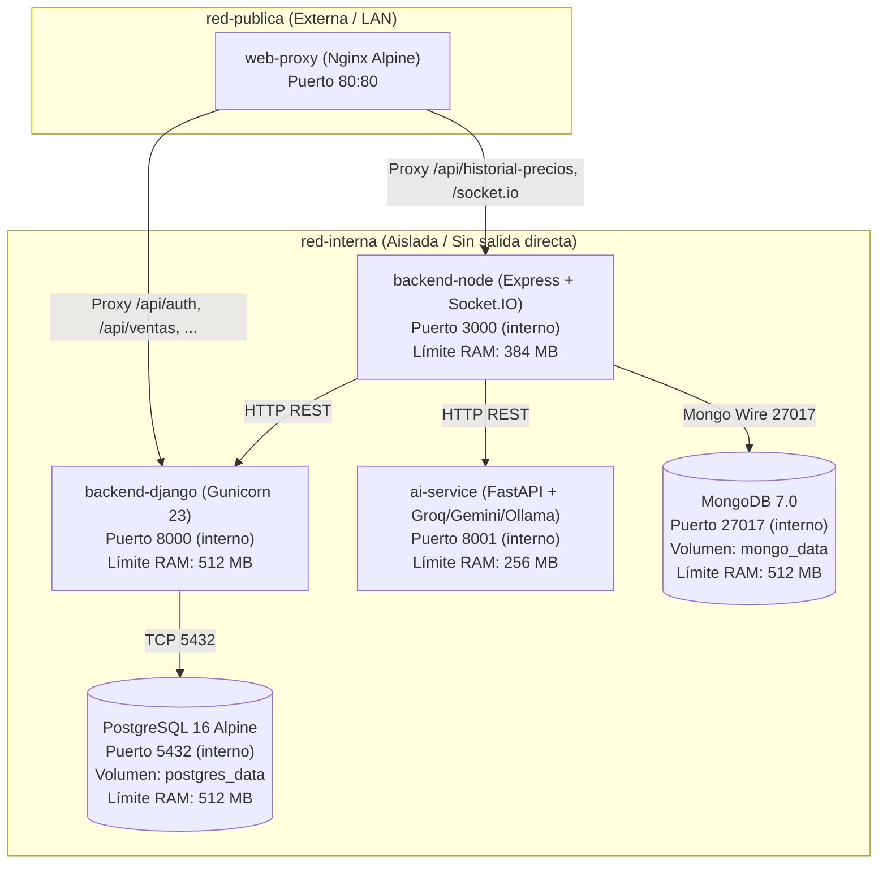

# Manual de Despliegue y Operación en Producción — Sistema de Gestión para Cafetería

> Trabajo Práctico 4 (Unidad 5 · Tareas T4.1, T4.2, T4.4, T4.7).  
> Modalidad: **PC Local con Docker Compose y PWA en Red de Área Local (LAN)** (respaldada por la sección 3.5 de la Guía de cátedra y ADR 0003).

---

## 1. Requisitos del Entorno y Hardware

### 1.1 Hardware Mínimo Recomendado (PC del Comercio)
* **Memoria RAM:** 8 GB DDR4 (con las mitigaciones activas el conjunto de contenedores consume ~2.3 GB, dejando más de 5 GB para el sistema operativo y el navegador).
* **Procesador:** CPU de 4 núcleos x86_64 (Intel Core i3 / AMD Ryzen 3 o superior).
* **Almacenamiento:** 20 GB de espacio disponible en disco SSD.
* **Red:** Interfaz Ethernet o Wi-Fi conectada al router del comercio para proveer acceso LAN a los dispositivos de los mozos y cajeros.

### 1.2 Software Base del Host
* Sistema Operativo: Linux (Ubuntu 22.04 LTS / 24.04 LTS o Debian 12 recomendado) o Windows 11 con WSL2.
* Docker Engine 24.0+ y Docker Compose v2.20+.
* Git 2.34+.
* **Sin requerimiento de herramientas instaladas en el host:** Toda la pila de ejecución (Python, Node.js, PostgreSQL y MongoDB) corre aislada en contenedores.

---

## 2. Arquitectura de Despliegue y Redes

El despliegue orquesta 6 contenedores organizados en dos redes bridge privadas:



### Puertos Expuestos al Host
* **Puerto 80:** Servidor web Nginx que entrega la PWA (`/app` o `/`) y actúa como Reverse Proxy seguro hacia Django (`/api/`) y Node (`/socket.io`, `/api/historial-precios`, etc.).
* Los puertos internos de bases de datos (5432 y 27017) y de microservicios (8000, 3000, 8001) **no se publican al exterior**, garantizando el aislamiento perimetral.

---

## 3. Puesta en Marcha con un Solo Comando (T4.2)

### Paso 1: Clonar el repositorio y configurar variables
```bash
git clone https://github.com/tu-usuario/tpi-tfi-utn.git
cd tpi-tfi-utn

# Crear el archivo de variables a partir de la plantilla segura
cp .env.example .env
```

> [!IMPORTANT]
> Editá `.env` para definir una clave segura en `DJANGO_SECRET_KEY` y, para la inferencia de IA en la nube (extracción de listas, consultoría de stock y auditoría de caja), configurá `GROQ_API_KEY` (proveedor predeterminado ultrarrápido sin consumo local) o `GEMINI_API_KEY`. Nunca hagas commit de este archivo (está bloqueado en `.gitignore`).

### Paso 2: Ejecutar el script automatizado de despliegue
```bash
./scripts/desplegar.sh
```
El script valida la configuración, compila las imágenes multietapa, aplica las migraciones pendientes en PostgreSQL y espera a que todos los healthchecks pasen a estado `healthy`.

*(Método alternativo directo con Docker Compose:)*
```bash
docker compose up -d --build
```

### Paso 3: Acceso a la Aplicación
* **Cliente Web / PWA:** Abrí en el navegador de la PC local o de cualquier tablet/móvil en la red Wi-Fi: `http://localhost` (o `http://<IP-DE-LA-PC-LOCAL>`).
* **Carta Digital Pública (`carta.html`):** `http://localhost/carta.html` o `http://localhost/app/carta.html` (incluida en la imagen `web-proxy` junto con `index.html`).
* **Documentación / Endpoints de Salud:**
  * Healthcheck general (Nginx): `http://localhost/healthz`
  * Healthcheck Django: `http://localhost/api/health/`
  * Healthcheck profundo Django: `http://localhost/api/health/profundo/`
  * Healthcheck Node (interno en Docker o modo local `:3000`): `web/nginx.conf` no proxea `/health` ni `/health/profundo` en `:80`; en Docker se verifica con `docker compose ps` o `docker compose exec backend-node node -e "fetch('http://localhost:3000/health').then(r=>r.text()).then(console.log)"`, y en desarrollo local sin Docker en `http://localhost:3000/health` y `http://localhost:3000/health/profundo`.

---

## 4. Mitigaciones de Memoria y Resiliencia Operativa

De acuerdo con lo acordado con la cátedra en `docs/PLAN_IMPLEMENTACION.md` (§0 2d) y ADR 0003:
1. **Límite de memoria WiredTiger en MongoDB:** Se fuerza `--wiredTigerCacheSizeGB 0.25` en `docker-compose.yml`, evitando que MongoDB consuma el 50 % de la memoria física de la máquina.
2. **Límites cgroups por contenedor:** Cada servicio tiene un tope rígido de memoria configurado (`limits.memory`).
3. **Consumo externo de IA (GroqAdapter / Gemini API):** No se ejecuta Ollama local en la PC de caja de forma obligatoria. Las llamadas de inferencia y extracción inteligente salen por HTTPS a la API de Groq (LPU Cloud, con latencias de respuesta submétricas) o Google Gemini, consumiendo escasos megabytes de memoria local. Ante cortes de internet o falta de API Key, el sistema activa la contingencia automática hacia importador determinista CSV y diagnósticos locales basados en reglas.
4. **Cola de ventas offline en IndexedDB:** Si se corta la red o se pierde contacto con los servidores centrales, el POS conmuta al modo sin conexión y almacena los tickets en IndexedDB localmente, sincronizándolos automáticamente en segundo plano en cuanto se restaura el enlace (`window.ononline`).

---

## 5. Observabilidad, Trazabilidad y Logs

### 5.1 Correlación Distribuida (`X-Request-ID`)
Cada petición entrante recibe o genera un UUID v4 mediante middlewares específicos en los tres servicios:
* `backend-django`: `CorrelationIdMiddleware`
* `backend-node`: `correlationIdMiddleware`
* `ai-service`: `CorrelationIdMiddleware`

El identificador se inyecta en la cabecera HTTP de respuesta `X-Request-ID` y se propaga en todas las llamadas inter-servicios (`django.client.js` y `ai.client.js`), permitiendo rastrear el ciclo de vida completo de una transacción a través de los logs.

### 5.2 Logging Estructurado JSON
Los servicios soportan formateo de logs estructurados en JSON que incluyen:
* `timestamp` (ISO 8601 UTC)
* `nivel` (INFO, WARN, ERROR)
* `servicio` (nombre del contenedor)
* `mensaje` (con sanitización activa de contraseñas y tokens)
* `correlation_id` (ID de trazabilidad de la petición)

Para inspeccionar logs en vivo con correlación:
```bash
docker compose logs -f backend-django backend-node ai-service
```

### 5.3 Healthchecks Nativos y Profundos
| Endpoint | Tipo | Propósito | Criterio de Éxito |
|---|---|---|---|
| `/healthz` | Liveness | Nginx Reverse Proxy | HTTP 200 OK |
| `/api/health/` | Liveness | Django Process | HTTP 200 OK (sin tocar BD) |
| `/api/health/profundo/` | Readiness | Django + PostgreSQL | HTTP 200 OK + `SELECT 1` exitoso y latencia |
| `/health` *(puerto 3000 local / interno Docker)* | Liveness | Node.js Process | HTTP 200 OK (sin tocar BD; no proxieado por Nginx en `:80`) |
| `/health/profundo` *(puerto 3000 local / interno Docker)* | Readiness | Node + MongoDB + Django | HTTP 200/503 con diagnóstico de conexiones (no proxieado por Nginx en `:80`) |
| `/health/profundo` (ai) | Readiness | FastAPI AI Service | HTTP 200 con configuración activa de adapter |

---

## 6. Procedimiento de Respaldo y Restauración

### 6.1 Generar Respaldo
El script `scripts/backup.sh` realiza un volcado consistente de PostgreSQL y MongoDB sin detener los contenedores:
```bash
./scripts/backup.sh
```
El archivo resultante se almacena con marca de tiempo en la carpeta `backups/backup_cafe_gestion_YYYYMMDD_HHMMSS.tar.gz`.

### 6.2 Restaurar Respaldo
Para recuperar la base de datos a un punto específico en el tiempo:
```bash
./scripts/restore.sh backups/backup_cafe_gestion_20261031_203000.tar.gz
```

---

## 7. Plan de Rollback y Despliegue de Nuevas Versiones (T4.7)

Si tras desplegar una actualización se detecta un incidente en producción:

1. **Identificar el tag o commit previo estable:**
   ```bash
   git log --oneline -n 5
   ```
2. **Volver al tag o commit estable anterior:**
   ```bash
   git checkout tags/v1.0.0 # o commit SHA específico
   ```
3. **Recompilar y reiniciar los contenedores:**
   ```bash
   docker compose down
   docker compose up -d --build
   ```
4. **En caso de requerir restauración de datos:**
   Ejecutar `./scripts/restore.sh backups/backup_previo.tar.gz`.
5. **Verificar estado de salud:**
   ```bash
   docker compose ps
   curl -I http://localhost/healthz
   curl -s http://localhost/api/health/profundo/ | jq
   ```

---

## 8. Despliegue en la nube: Render + Vercel (entrega final)

Modalidad pública para la demo: la web estática en **Vercel**, los tres servicios en **Render**
(`render.yaml`, plan gratuito), PostgreSQL en **Aiven** y MongoDB en **Atlas**.

```text
Navegador ──> Vercel (web/, vercel.json)
   │ HTTPS/WSS
   ├──> sapori-backend-django.onrender.com ──> PostgreSQL (Aiven)
   │         └── avisos de ventas/stock ──> Node (NODE_BASE_URL + EVENTOS_INTERNOS_CLAVE)
   └──> sapori-backend-node.onrender.com ──> MongoDB (Atlas)
             ├──> Django (DJANGO_BASE_URL, termina en /api)
             └──> sapori-ai-service.onrender.com ──> Groq
```

### 8.1 Límites del plan gratuito de Render (docs oficiales: https://render.com/docs/free)
* Sin `plan` en `render.yaml`, Render crea instancias **pagas** (`0.5c-512mb`); por eso cada servicio tiene `plan: free`.
* Un servicio gratuito **se duerme a los 15 minutos sin tráfico** y tarda **alrededor de un minuto** en despertar. Antes de mostrar la app (o de grabar), abrí las tres URLs de salud y esperá el `200`.
* Hay **750 horas gratis por mes para todo el workspace** (se comparten entre los tres servicios; dormidos no consumen). Si se agotan, Render suspende los servicios hasta el mes siguiente.
* Sin consola ni tareas sueltas (no hay `shell` ni `preDeployCommand`): las migraciones corren al arrancar (`dockerCommand` de Django) y los datos de demo se cargan desde la PC (8.5).
* Sin red privada: los servicios se hablan por sus URLs públicas `https://…onrender.com`.
* El disco es efímero: nada se guarda en el contenedor; los datos viven en Aiven y Atlas.

### 8.2 Claves JWT (obligatorias)
Con `DJANGO_DEBUG=False`, Django **no arranca** sin `DJANGO_JWT_PRIVATE_KEY` y `DJANGO_JWT_PUBLIC_KEY`
(con un par efímero, cada worker de gunicorn firmaría con su propia clave y Node no podría validar los tokens).
Se genera un par nuevo para la nube (no reutilizar el de desarrollo):

```bash
openssl genrsa -out /tmp/jwt_privada.pem 2048 && openssl rsa -in /tmp/jwt_privada.pem -pubout -out /tmp/jwt_publica.pem
```

El contenido completo de cada archivo (con `-----BEGIN…` y `-----END…`) se pega en el panel de Render.
Se acepta multilínea o en una sola línea con `\n` literales. La **pública** va también en Node (`JWT_PUBLIC_KEY`).

### 8.3 Variables por servicio
| Servicio | Variable | Valor |
|---|---|---|
| Django | `DJANGO_ALLOWED_HOSTS` | `sapori-backend-django.onrender.com` (el host propio de Render también se suma solo con `RENDER_EXTERNAL_HOSTNAME`) |
| Django | `DATABASE_URL` | URL de Aiven, con `?sslmode=require` |
| Django | `CORS_ALLOWED_ORIGINS` | `https://<proyecto>.vercel.app,https://sapori-backend-node.onrender.com` (sin barra final, sin `*`) |
| Django | `DJANGO_JWT_PRIVATE_KEY` / `DJANGO_JWT_PUBLIC_KEY` | par de 8.2 |
| Django | `NODE_BASE_URL` | `https://sapori-backend-node.onrender.com` |
| Django | `EVENTOS_INTERNOS_CLAVE` | misma clave larga al azar que en Node (`openssl rand -hex 32`) |
| Django | `POSTGRES_*` | se pueden dejar vacías si `DATABASE_URL` está completa |
| Node | `MONGO_URI` | cadena `mongodb+srv://…` de Atlas (en Atlas, permitir acceso desde `0.0.0.0/0`: Render gratis no tiene IP fija) |
| Node | `DJANGO_BASE_URL` | `https://sapori-backend-django.onrender.com/api` (**con** `/api`) |
| Node | `AI_SERVICE_URL` | `https://sapori-ai-service.onrender.com` |
| Node | `CORS_ALLOWED_ORIGINS` | `https://<proyecto>.vercel.app` (también habilita Socket.IO) |
| Node | `JWT_PUBLIC_KEY` | pública de 8.2 |
| Node | `EVENTOS_INTERNOS_CLAVE` | la misma que en Django |
| IA | `GROQ_API_KEY` | clave de Groq (regenerada; la anterior se expuso en un chat) |

`DEMO_ACCESO_RAPIDO` no está en `render.yaml`: en la nube el acceso en un clic queda **apagado** y se entra
con usuario y contraseña. Activarlo expone tres cuentas sin contraseña en un sitio público: decisión del equipo.

### 8.4 Vercel
* Importar el repo con la raíz en la carpeta del repositorio (usa `vercel.json`; no hace falta build).
* Las URLs de los backends están en `web/js/config.js` (`urlsNube`). Si Render asigna otros nombres
  (por ejemplo, porque `sapori-backend-django` ya estaba tomado), hay que cambiarlas ahí **y** en la CSP
  (`connect-src`, con `https://` y `wss://` para Node) de `vercel.json`, `web/nginx.conf` y `backend-node/app.js`.
* El cliente de Socket.IO se sirve desde `web/vendor/socket.io/` (Vercel no tiene Node detrás).

### 8.5 Datos de demo en la base de la nube
Render gratis no tiene consola: el seed se corre desde la PC apuntando a Aiven (las variables puestas en la
línea pisan las del `.env` local):

```bash
cd backend-django && USE_SQLITE=False DATABASE_URL='<url de Aiven>' SEED_DEMO_PASSWORD='<contraseña de demo>' .venv/bin/python manage.py seed_demo --video --force-production
```

### 8.6 QR de la carta
El QR se arma con el dominio desde donde se abre la app. Para imprimirlo, abrí la app **desde la URL de
Vercel** (no desde `localhost`): el QR apuntará a `https://<proyecto>.vercel.app/app/carta.html`
(o `/carta.html` si se entró por la raíz; ambas rutas tienen rewrite). Si después cambia el dominio, hay que
reimprimirlo. La carta consulta a Django, así que también depende de que Render esté despierto.

### 8.7 Verificación después de desplegar
```bash
curl -s https://sapori-backend-django.onrender.com/api/health/profundo/ && echo && curl -s https://sapori-backend-node.onrender.com/health/profundo && echo && curl -s https://sapori-ai-service.onrender.com/health
```
Tienen que responder `"estado":"ok"` (la primera vez puede tardar un minuto por el arranque en frío).
En la web, el indicador de la cabecera tiene que decir **Conectado** (Socket.IO).
