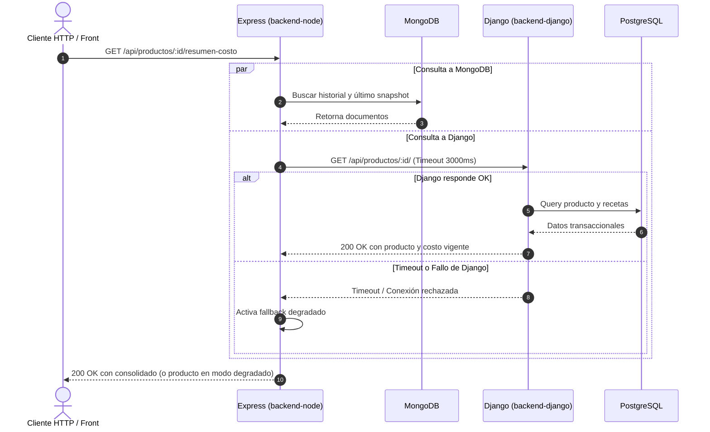

# Integración entre Servicios — `cafe-gestion`

> Documento de integración correspondiente al TP 1 (Tarea T1.11) y base para la integración políglota del TP 3.

---

## 1. Mapa de Integración (TP 1)



---

## 2. Contrato de Integración y Tolerancia a Fallos

### Cliente HTTP en Node (`src/clients/django.client.js`)
- **URL Base:** `DJANGO_BASE_URL` (por defecto `http://localhost:8000/api`).
- **Timeout acotado:** 3000 ms mediante `AbortSignal.timeout(3000)`.
- **Mapeo de nombres:** Django expone sus campos en `snake_case` (estándar de DRF); el cliente de Node o el endpoint de consumo normaliza a `camelCase` en este único punto de integración, evitando acoplar el esquema interno de Django.

### Política de Degradación Elegante
Si el servicio Django no está disponible o se agota el tiempo de espera:
1. Node **no bloquea ni devuelve un error 500 no controlado**.
2. Devuelve el objeto con bandera `degradado: true`:
   ```json
   {
     "producto": {
       "degradado": true,
       "id": 1,
       "mensaje": "No se pudo comunicar con el núcleo transaccional Django",
       "error": "The operation was aborted due to timeout"
     },
     "historialReciente": [ ... ],
     "ultimoSnapshot": { ... }
   }
   ```
3. Permite al usuario consultar el historial de precios y snapshots almacenados en MongoDB aunque el motor transaccional se encuentre temporalmente fuera de línea.
