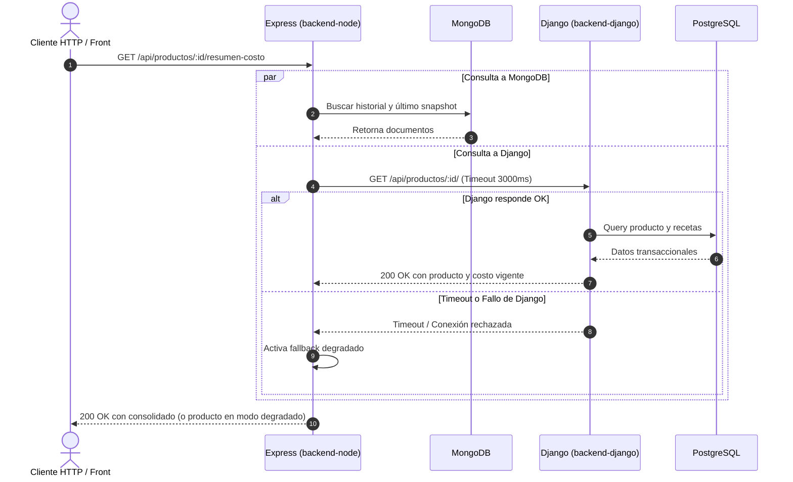

# Integración entre Servicios — `cafe-gestion`

> Documento de integración correspondiente al TP 1 (Tarea T1.11) y a la integración políglota del TP 3 (Tareas T3.1, T3.2 y T3.3).

---

## 1. Mapa de Integración de Consulta Consolidada (TP 1)



---

## 2. Flujo de Punta a Punta: Importación con IA y Aprobación Humana (TP 3)

Cumple el flujo definido en `docs/PLAN_IMPLEMENTACION.md` (§2) y `docs/arquitectura.md` (§3):

1. **Recepción no bloqueante (`T3.2`):** El dueño pega la lista de precios del proveedor y envía `POST /api/importaciones` a `backend-node`. Node persiste el documento en estado `PENDIENTE` en `importaciones_ia` y responde de inmediato `HTTP 202 Accepted`.
2. **Extracción y validación tipada (`T3.1` y `T3.2`):** En segundo plano, `src/clients/ai.client.js` invoca `POST /v1/extraer-precios` en `ai-service` (FastAPI + Pydantic v2 + Adapter `ProveedorIA`), valida la salida y actualiza el documento en MongoDB a `LISTA` (o `CONTINGENCIA` ante timeout/error).
3. **Revisión humana en el circuito (`T3.3`, CA7.3):**
   - Si el dueño **rechaza** (`POST /api/importaciones/:id/rechazar`), Node marca el documento como `RECHAZADA` en MongoDB sin invocar a Django ni alterar compras ni costos.
   - Si el dueño **aprueba** (`POST /api/importaciones/:id/aprobar`), Node invoca `POST /api/compras/confirmar-importacion/` en Django reenviando el token JWT RS256 del usuario.
4. **Persistencia transaccional y propagación de costos (`T3.3`, CA3.1 y CA3.2):**
   - Django ejecuta `registrar_lote_compras_importacion` dentro de `@transaction.atomic`: resuelve proveedor e insumos, prorratea el envío proporcionalmente al precio de cada línea, crea las compras, actualiza `Insumo.costo_unitario` y recalcula todas las recetas afectadas devolviendo el desglose completo.
   - Con la respuesta de Django, Node registra cada cambio en `historial_precios`, guarda el desglose actualizado en `snapshots_costeo` y pasa la importación a `APROBADA`.

---

## 3. Contrato de Integración y Tolerancia a Fallos

### Cliente HTTP en Node (`src/clients/django.client.js`)
- **URL Base:** `DJANGO_BASE_URL` (por defecto `http://localhost:8000/api`).
- **Timeouts acotados:** 3000 ms para lecturas (`obtenerProductoDjango`) y 5000 ms para confirmación transaccional de lotes (`confirmarImportacionComprasDjango`) mediante `AbortSignal.timeout`.
- **Mapeo de nombres en un único punto:** Django expone y recibe sus campos en `snake_case` (estándar de DRF); `src/clients/django.client.js` traduce hacia y desde `camelCase` en este único punto de integración (`normalizarRespuestaConfirmacionDjango`), evitando acoplar el esquema interno de Django al resto de Node.
- **Reenvío de identidad JWT RS256:** En las operaciones de confirmación humana (`confirmarImportacionComprasDjango`), Node reenvía la cabecera `Authorization: Bearer <token>` emitida originalmente por Django para que el núcleo transaccional verifique el permiso granular `compras.registrar`.

### Política de Degradación Elegante
1. **En lecturas (`GET /api/productos/:id/resumen-costo`):**
   Si Django no está disponible o se agota el tiempo de espera, Node **no bloquea ni devuelve un error 500**, sino que retorna el historial y snapshot de MongoDB junto con la bandera `degradado: true`:
   ```json
   {
     "producto": {
       "degradado": true,
       "id": 1,
       "mensaje": "No se pudo comunicar con el núcleo transaccional Django",
       "error": "The operation was aborted due to timeout"
     },
     "historialReciente": [ ... ],
     "ultimoSnapshot": { ... }
   }
   ```
2. **En escrituras de aprobación (`POST /api/importaciones/:id/aprobar`):**
   Si Django no responde al momento de aprobar, Node responde con `HTTP 502 Bad Gateway` en formato unificado `{ mensaje, detalles }` y **conserva la importación en estado `LISTA`**, permitiendo que el dueño reintente la aprobación apenas el núcleo transaccional esté disponible sin perder la propuesta extraída por la IA.
