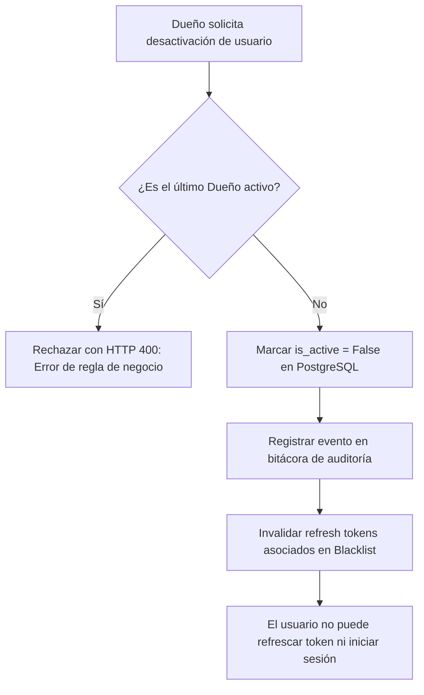

# Política de Seguridad, Roles y Permisos — cafe-gestion

Este documento define la arquitectura de seguridad, la matriz de roles y el sistema de permisos granulares del sistema `cafe-gestion`, en cumplimiento de los requisitos del **TP 2 (Autenticación y seguridad)** y las reglas de negocio establecidas en `docs/PLAN_IMPLEMENTACION.md` (§3 y §6).

---

## 1. Modelo de Autorización: Roles como Plantillas de Permisos

El sistema implementa un modelo híbrido basado en **Roles como Plantillas (Role-based Templates)** combinado con **Permisos Granulares Booleanos por Usuario**.

### 1.1 Filosofía de Diseño
Inspirado en los sistemas de Punto de Venta (POS) gastronómicos modernos:
1. **Roles base como plantillas iniciales:** Al dar de alta a un empleado, el Dueño selecciona un rol inicial (`DUENIO`, `ENCARGADO` o `CAJERO`), el cual precarga un conjunto predeterminado de permisos booleanos.
2. **Ajuste granular individual:** El Dueño puede encender o apagar permisos específicos de manera individual para cada usuario (por ejemplo, habilitar a un cajero de confianza para registrar ingresos/egresos de efectivo menores, o restringir a un encargado la visualización de reportes de rentabilidad general).
3. **Desacoplamiento funcional:** La lógica de autorización en los controladores y servicios valida **permisos granulares** (ej. `caja.abrir_turno`, `recetas.ver_costos`), no únicamente el nombre del rol, permitiendo flexibilidad operativa sin requerir cambios de código.

### 1.2 Definición de Roles del Dominio

| Rol | Identificador | Propósito Operativo | Alcance de Responsabilidad |
|---|---|---|---|
| **Dueño** | `DUENIO` | Control total del negocio y administración global | Acceso irrestricto: administración de personal, ajuste de permisos, visualización de márgenes y punto de equilibrio, importación de listas con IA, auditoría y configuración general. |
| **Encargado** | `ENCARGADO` | Gestión operativa de cocina, inventario y supervisión de salón | Control de recetas e insumos, registro de compras, supervisión de turnos de caja, autorización de anulación de tickets y arqueos generales (sin gestión de personal ni configuración global). |
| **Cajero** | `CAJERO` | Operación transaccional de caja y atención al público | Emisión y cobro de tickets, apertura y cierre exclusivo de su propio turno de caja (con arqueo ciego, sin ver el monto esperado antes del recuento) y consulta de su historial de ventas del turno. |

---

## 2. Catálogo de Permisos Granulares

Los permisos se organizan bajo la convención de espacio de nombres `<modulo>.<accion>` y se gestionan como valores booleanos (`true` / `false`) asociados al usuario.

| Módulo | Clave del Permiso | Descripción Operativa | Dueño (Default) | Encargado (Default) | Cajero (Default) |
|---|---|---|:---:|:---:|:---:|
| **Ventas** | `ventas.cobrar_ticket` | Crear ventas, procesar pagos y emitir comprobantes | ✔ | ✔ | ✔ |
| | `ventas.anular_ticket` | Anular ventas emitidas y revertir transacciones | ✔ | ✔ | ✖ |
| | `ventas.aplicar_descuento` | Aplicar descuentos o promociones manuales sobre tickets | ✔ | ✔ | ✖ |
| | `ventas.ver_historial_propio`| Consultar ventas y tickets generados por el propio usuario | ✔ | ✔ | ✔ |
| | `ventas.ver_historial_todos` | Consultar tickets y ventas de cualquier vendedor o turno | ✔ | ✔ | ✖ |
| **Caja** | `caja.abrir_turno` | Abrir un nuevo turno de caja e indicar fondo inicial | ✔ | ✔ | ✔ |
| | `caja.cerrar_turno` | Realizar el arqueo y cierre del propio turno activo | ✔ | ✔ | ✔ |
| | `caja.ver_efectivo_esperado`| Visualizar el saldo teórico calculado antes del arqueo | ✔ | ✔ | ✖ *(Arqueo ciego)* |
| | `caja.registrar_movimiento` | Registrar entradas y salidas de efectivo extraordinarias | ✔ | ✔ | ✖ |
| | `caja.gestionar_turnos_ajenos`| Supervisar, forzar cierre o auditar turnos de otros cajeros | ✔ | ✔ | ✖ |
| **Insumos** | `insumos.ver` | Consultar catálogo de insumos y unidades base | ✔ | ✔ | ✖ |
| | `insumos.crear` | Dar de alta nuevos insumos con su unidad base de medida | ✔ | ✔ | ✖ |
| | `insumos.editar` | Modificar datos de insumos existentes | ✔ | ✔ | ✖ |
| | `insumos.eliminar` | Desactivar insumos del catálogo (borrado lógico) | ✔ | ✖ | ✖ |
| **Compras** | `compras.ver` | Visualizar historial de facturas y lotes de compras | ✔ | ✔ | ✖ |
| | `compras.registrar` | Cargar compras de insumos con prorrateo de flete e IVA | ✔ | ✔ | ✖ |
| **Recetas** | `recetas.ver` | Consultar catálogo de productos y recetas | ✔ | ✔ | ✖ |
| | `recetas.crear` | Crear nuevos productos y definir su composición de receta | ✔ | ✔ | ✖ |
| | `recetas.editar` | Modificar recetas, descartables o minutos de mano de obra | ✔ | ✔ | ✖ |
| | `recetas.eliminar` | Desactivar productos y recetas (borrado lógico) | ✔ | ✖ | ✖ |
| | `recetas.ver_costos` | Visualizar costos de elaboración, ganancia y margen bruto | ✔ | ✔ | ✖ |
| **Reportes** | `reportes.ver_financieros` | Consultar ganancia diaria acumulada, PE y cumplimiento de metas | ✔ | ✖ | ✖ |
| | `reportes.ver_operativos` | Consultar métricas de rotación de productos y volumen de ventas | ✔ | ✔ | ✖ |
| **IA** | `ia.importar_listas` | Procesar listas de precios con IA y aplicar actualizaciones | ✔ | ✖ | ✖ |
| **Personal** | `personal.ver` | Listar empleados, estados de cuenta y roles | ✔ | ✖ | ✖ |
| | `personal.crear` | Registrar nuevos usuarios y asignar clave inicial | ✔ | ✖ | ✖ |
| | `personal.editar` | Modificar datos de perfil de empleados | ✔ | ✖ | ✖ |
| | `personal.ajustar_permisos`| Modificar flags booleanos de permisos a un usuario | ✔ | ✖ | ✖ |
| | `personal.desactivar` | Realizar desactivación lógica de usuarios | ✔ | ✖ | ✖ |
| **Auditoría** | `auditoria.ver_logs` | Consultar trazas de cambios de precios, permisos y seguridad | ✔ | ✖ | ✖ |

---

## 3. Reglas de Negocio de Seguridad

1. **Jerarquía estricta de administración:**
   - Únicamente los usuarios con el permiso `personal.crear` y `personal.ajustar_permisos` (por defecto, rol `DUENIO`) pueden dar de alta empleados, cambiar roles o sobreescribir permisos.
   - Ningún usuario puede otorgar permisos que no posea él mismo en su conjunto activo de permisos.
2. **Regla de supervivencia del Dueño (Protección contra bloqueo total):**
   - El sistema rechaza cualquier solicitud que intente desactivar (`is_active = False`), cambiar el rol o revocar permisos administrativos al **último usuario activo con rol `DUENIO`**.
   - Esto evita estados de orfandad administrativa irrecuperables.
3. **Arqueo Ciego para Cajeros:**
   - El cajero opera bajo el principio de "arqueo ciego": al cerrar turno, debe contar e ingresar el monto real en efectivo físico sin conocer previamente el `efectivo_esperado` calculado por el sistema.
   - Solo los usuarios con `caja.ver_efectivo_esperado` (`DUENIO` y `ENCARGADO`) pueden visualizar la diferencia entre el esperado y el ingresado antes o durante el cierre.
4. **Propagación y vigencia de permisos:**
   - Los permisos efectivos del usuario viajan empaquetados en el JWT (claim `permisos`).
   - Dado que los tokens de acceso tienen una vida útil corta (5 a 15 minutos), cualquier ajuste de permisos entra en vigencia a partir del siguiente refresco del token de acceso (`POST /api/auth/token/refresh/`), sin requerir consultas constantes a la base de datos de PostgreSQL en cada petición HTTP.

---

## 4. Esquema de Desactivación Lógica (`is_active`) sin Borrado Físico

### 4.1 Justificación Contable y de Trazabilidad
En un sistema gastronómico con trazabilidad contable y fiscal:
- Las ventas (`Venta`), los ítems con costos congelados (`VentaItem`), los turnos de caja (`TurnoCaja`), los movimientos de efectivo (`MovimientoCaja`) y las recepciones de mercadería (`Compra`) poseen claves foráneas que referencian a `User`.
- El borrado físico (`DELETE FROM auth_user`) causaría la destrucción de la integridad referencial en cascada o dejaría registros huérfanos con pérdida de autoría (vulnerando normas de auditoría comercial: quién abrió la caja, quién cobró un ticket o quién autorizó una anulación).
- **Decisión:** Los usuarios **nunca se eliminan físicamente**. Se utiliza una columna booleana `is_active` (`estado_activo`).

### 4.2 Mecanismo Técnico de Desactivación

1. **Bloqueo de autenticación inmediata:**
   - Django SimpleJWT y el backend de autenticación verifican que `user.is_active` sea `True`.
   - Si `is_active` es `False`, el endpoint `POST /api/auth/token/` rechaza el inicio de sesión con `HTTP 401 Unauthorized`.
   - El endpoint `POST /api/auth/token/refresh/` verifica el estado del usuario asociado al refresh token y rechaza el refresco.
2. **Invalidación de tokens vigentes:**
   - Al desactivar un usuario, el servicio de seguridad de Django envía todos los refresh tokens activos del usuario a la lista negra (`OutstandingToken` / `BlacklistedToken`).
   - Los access tokens ya emitidos caducan naturalmente al expirar su breve ventana de vida (máximo 15 minutos).
3. **Auditoría de cambios de estado:**
   - Todo cambio de `is_active` genera un registro con: `timestamp`, `usuario_modificado_id`, `modificado_por_id`, `motivo` y `estado_resultante`.

---

## 5. Matriz de Autorización por Endpoint (Django y Node)

### 5.1 Backend Django (Núcleo Transaccional)

| Endpoint | Método | Permiso Requerido | Restricción por Objeto |
|---|---|---|---|
| `/api/ventas/` | `POST` | `ventas.cobrar_ticket` | Debe pertenecer al turno abierto del cajero |
| `/api/ventas/` | `GET` | `ventas.ver_historial_propio` | Cajero: filtra solo sus ventas. Con `ventas.ver_historial_todos`: lista global |
| `/api/ventas/:id/anular/` | `POST` | `ventas.anular_ticket` | Requiere autorización de Encargado o Dueño |
| `/api/ventas/reporte-por-producto/` | `GET` | `reportes.ver_operativos` | Reporte agregado por rango de fechas (Dueño y Encargado) |
| `/api/caja/turnos/` | `POST` | `caja.abrir_turno` | Solo si no tiene un turno previo sin cerrar |
| `/api/caja/turnos/:id/cerrar/`| `POST` | `caja.cerrar_turno` | Cajero solo puede cerrar su propio turno |
| `/api/caja/movimientos/` | `POST` | `caja.registrar_movimiento` | Registrar extracciones o ingresos |
| `/api/insumos/` | `POST`/`PUT` | `insumos.crear` / `insumos.editar` | CRUD operativo |
| `/api/compras/` | `POST` | `compras.registrar` | Alta de facturas y prorrateo |
| `/api/compras/confirmar-importacion/` | `POST` | `compras.registrar` | Registro atómico de compras aprobadas por revisión humana |
| `/api/recetas/` | `POST`/`PUT` | `recetas.crear` / `recetas.editar` | Modificación de fórmulas |
| `/api/productos/:id/costo/`| `GET` | `recetas.ver_costos` | Protege desglose de costos y márgenes |
| `/api/usuarios/` | `CRUD` | `personal.*` | Exclusivo Dueño |

### 5.2 Backend Node (Consultas y Tiempo Real)

| Endpoint / Evento Socket.IO | Método / Evento | Verificación Requerida |
|---|---|---|
| `/api/productos/:id/resumen-costo` | `GET` | Requiere token válido y permiso `recetas.ver_costos` |
| `/api/historial-precios` | `GET` | Requiere token válido y permiso `insumos.ver` |
| `/api/importaciones` (`/importaciones`) | `POST`/`GET` | Requiere token válido y permiso `ia.importar_listas` |
| `/api/importaciones/:id/aprobar` | `POST` | Requiere token válido y permiso `ia.importar_listas` (y reenvía JWT a Django) |
| `/api/importaciones/:id/rechazar` | `POST` | Requiere token válido y permiso `ia.importar_listas` |
| Handshake Socket.IO | `CONNECT` | Valida firma del JWT con `JWT_PUBLIC_KEY` y estado activo |
| Sala `local` | `JOIN` | Requiere token de cualquier empleado activo |
| Sala `turno:{id}` | `JOIN` | Valida que el `user_id` sea titular del turno o posea `caja.gestionar_turnos_ajenos` |
| Evento `costo.actualizado` | `RECEIVE` | Solo emitido a clientes con `recetas.ver_costos` |
| Evento `stock.bajo` | `RECEIVE` | Emitido a `DUENIO` y `ENCARGADO` |

---

## 6. Verificación y Pruebas de Seguridad

Para garantizar la robustez del modelo (según `T2.6`):
- **Pruebas positivas:** Verifican que los roles predeterminados puedan realizar sus tareas correspondientes sin bloqueos.
- **Pruebas negativas sistemáticas:** Cada endpoint y permiso debe contar con un test automatizado que intente la operación sin el permiso o rol correspondiente, comprobando que la API responda exactamente con `HTTP 403 Forbidden` y el formato de error unificado (`docs/api-errores.md`).
- **Pruebas de frontera:** Intentar la desactivación o degradación del último usuario Dueño, esperando un error `HTTP 400 Bad Request`.

---

## 7. Auditoría Cruzada y Revisión de Secretos (T2.7)

El informe completo de auditoría cruzada de seguridad, escaneo de secretos en el historial de Git, matriz de riesgos mitigados y resumen de cobertura se encuentra detallado en:
- [docs/auditoria-seguridad-tp2.md](file:///home/evilkitty/Escritorio/tfi/tpi-tfi-utn/docs/auditoria-seguridad-tp2.md)
